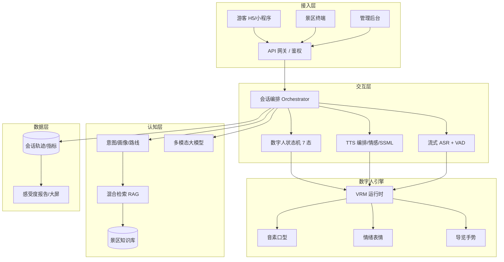

# A5 景区导览服务 AI 数字人 · 国赛级完备方案

> 适用对象：智维 Agent / SmartOpsAgent 现有数字人「小鱼」的升级改造
> 对标赛题：第十五届「中国软件杯」A5-景区导览服务 AI 数字人（锐捷网络）
> 方案定位：可演示、可评测、可部署、可答辩的国赛一等奖 / 企业级交付形态
> 约束继承：沿用现有 7 状态枚举、同屏单 WebGL 主体、CC0/MIT 资产、性能预算与降级看门狗规则

---

## 0. 先给结论

**小鱼现在"拉垮"的根因不是模型不够强，而是没有一条产品化的数字人管线。**
现有实现把「3D 加载 + 口型 + 手势 + 语音」拼在了页面里，缺的是四件事：

1. **形象不过关**——15MB 占位模型、17 材质、二次元示例皮，移动端直接掉静态替身；
2. **说话不像人**——中文口型按字近似、表情只有四个标量、手势是客服卖萌语义，没有导览语义；
3. **业务不闭环**——运维人设、没有景区知识、路线、POI、定位、游客洞察；
4. **无法证明**——准确率 90%、延迟 <5s、稳定性都没有测试集与埋点，答辩时只能"看感觉"。

**三句话战略：**

- **表现力做"第一眼"**：一条可复现的 VRM 资产流水线 + 音素级口型 + 情绪表情层 + 导览手势库，把"数字人效果良好"从评语变成硬指标。
- **业务做"闭环"**：景区知识库 → 个性化路线 → 定位触发讲解 → 游客感受度报告 → 数据大屏，对齐 40 分功能完整度。
- **工程做"证据"**：300 题黄金测试集、端到端时延埋点、压测报告、降级矩阵、许可台账，对齐 30 分技术分与 10 分文档分。

**目标得分结构（保守/冲刺）：**

| 评分项 | 权重 | 现状估计 | 目标 | 拿分抓手 |
|---|---:|---:|---:|---|
| 功能完整度 | 40 | 22 | 36+ | 游客端三模态 + 管理端四模块 + 大屏 |
| 技术与创新 | 30 | 15 | 27+ | 数字人管线、音素口型、情绪驱动、无信号导览 |
| 行业实用与体验 | 20 | 11 | 18+ | 真实痛点闭环、自然度、弱网/离线可用 |
| 文档质量 | 10 | 5 | 9+ | 架构图、指标证据、7 分钟分镜 |

---

## 1. 依据与拆解

### 1.1 已确认的输入（不臆造）

- 赛题官网明确的功能/非功能要求、评分表与提交物清单（源码、部署手册、总体设计文档、PPT、≤7 分钟演示视频）。
- 参考作品视频时长 **419 秒（6:59）**，正好卡在 7 分钟上限；其公开评语给出的有效信号是：
  - 优点：**数字人效果良好、功能有亮点**；
  - 失分：**文档对数字人实现方案与创新说明不足**。
- 因此本方案把「数字人实现方案」写成可评审的工程章节，而不是效果截图堆砌。

> 说明：视频画面内容无法逐帧解析，本方案以官网评分细则 + 公开评语 + 现有代码事实为依据；不引用无法验证的画面细节。

### 1.2 评分表 → 打法

| 评分项 | 子项 | 评委实际在看什么 | 我们的动作 |
|---|---|---|---|
| 功能完整度 40 | 多模态交互 | 语音进、语音出、表情、口型是否同一个人 | 一条全双工链路 + 统一状态机 |
| | 智能问答 | 事实题是否答对、是否敢拒答 | 混合检索 + 引用 + 置信度拒答 |
| | 管理后台 | 能不能真的改知识、改形象、看报告 | 四模块全部可用，不做假按钮 |
| | 稳定度 | 会不会崩、会不会卡死 | 降级矩阵 + 熔断 + 压测证据 |
| 技术 30 | 数字人集成与表现力 15 | 加载速度、动作自然度、口型贴合 | 资产流水线 + 音素口型 + 混合动画 |
| | 大模型与知识库 15 | 准确率、引用、幻觉控制 | 黄金集 90% + 评测报告 |
| 体验 20 | 痛点解决 | 是否真的替代导游 | 路线/定位/讲解/离园全旅程 |
| | 自然度 | 像不像真人导游 | 情感 TTS + 微表情 + 打断 |
| 文档 10 | 设计文档/视频 | 讲不讲得清 | 本方案即文档骨架 + 分镜脚本 |

### 1.3 硬性验收线（写进测试，不写进口号）

| 指标 | 要求 | 我们的内控值 | 测量方式 |
|---|---|---|---|
| 事实问答准确率 | ≥90% | ≥93% | 300 题黄金集，双人标注 |
| 语音问答端到端 | <5s | P95 ≤3.5s，首字 ≤1.2s | trace 埋点 |
| 数字人首帧 | 无硬性 | ≤1.2s | PerformanceObserver |
| 稳态帧时 | 无硬性 | P90 ≤8ms（桌面）/≤14ms（移动） | 现有看门狗 |
| 崩溃/卡死 | 不允许 | 0 次 / 8 小时压测 | 长稳脚本 |
| 模型体积 | 无硬性 | ≤6MB（KTX2） | 构建产物校验 |

---

## 2. 现状诊断：小鱼 v1 到底差在哪

| 能力 | 现状（代码事实） | 国赛/大厂要求 | 差距 | 严重度 |
|---|---|---|---|---|
| 形象资产 | `public/avatar/sendagaya-shino/model.vrm` 14.38MB、17 材质、官方示例皮 | 景区文化定制、≤6MB、移动端可跑 | 无资产管线、无文化皮肤 | P0 |
| 渲染兜底 | 移动端/减少动效直接静态替身 | 至少 2D 动态兜底 | 降级太粗暴 | P0 |
| 口型 | 三源：频谱/时间戳/文字近似；中文按码位散列选口型 | 音素级中文 viseme | 文字模式"假动嘴" | P0 |
| 表情 | 4 个标量（relaxed/happy/sad/angry） | 情绪驱动 + 微表情 | 无情绪层 | P1 |
| 动作 | 34 手势，社交/卖萌语义为主 | 导览语义：指路、介绍、邀请、告别 | 缺场景手势 | P1 |
| 语音输入 | 浏览器 `SpeechRecognition`（依赖 Google 服务） | 国内可用、弱网可用 | 国内基本不可用 | P0 |
| 语音输出 | VoxCPM2/F5/Edge/Baidu/PiperPlus 多后端（已很强） | 情感风格 + 讲解节奏 | 缺情感与 SSML 编排 | P1 |
| 知识 | 运维知识库 + 候选审核链路 | 景区资料包、景点元数据 | 无景区域 | P0 |
| 业务 | 人格化身页 + 桌宠 | 路线、POI、定位、报告 | 全缺 | P0 |
| 数据 | 有 dashboard 组件与评测文档 | 服务人次/热门问答/满意度 | 未接数字人域 | P1 |
| 证据 | 无黄金集、无端到端 trace | 可复现评测 | 无法自证 | P0 |

**七个"拉垮点"按修复收益排序：**

1. 移动端没有可用的数字人（静态替身）→ 演示一换设备就露馅；
2. 中文口型不准 → 评委第一眼就判定"假"；
3. 语音输入在国内浏览器不可用 → 三模态只剩两模态；
4. 没有景区知识与路线 → 功能完整度直接丢 15 分以上；
5. 表情/动作无情绪与导览语义 → 表现力 15 分拿不满；
6. 管理后台未接数字人域 → 40 分里的后台项空转；
7. 没有评测证据 → 技术 30 分只能靠主观印象。

---

## 3. 产品定义

### 3.1 双端三角色

| 端 | 角色 | 核心任务 | 载体 |
|---|---|---|---|
| 游客端 | 到园前 / 游中 / 离园 | 问路、问史、要路线、要讲解、反馈 | H5 / 小程序 / 景区大屏终端 |
| 管理端 | 景区运营 | 知识维护、形象配置、看报告 | Web 后台 |
| 数字人 | 小鱼 · 景区讲解员 | 语音/文本/表情三模态表达 | 3D 实时 + 2D 兜底 |

### 3.2 场景策略：一套内核，两条皮肤

- **比赛线（景区导览）**：`/scenic/*` 路由组，独立导航组，不污染现有控制台。
- **既有线（运维 Agent）**：`/agent/persona` 保持不变，共享同一套数字人引擎与语音管线。
- 人设、知识域、路线、话术由**配置驱动**，不复制两套组件。

### 3.3 游客旅程（功能完整度的叙事骨架）

```
到园前：小程序问"带 6 岁孩子半天怎么玩" → 兴趣画像 → 推荐亲子路线
入园：  扫码/信标唤醒数字人 → 欢迎语 + 今日人流提示 + 路线确认
游中：  走到景点自动讲解 / 随时打断提问 / 拍照点推荐 / 洗手间餐饮导航
离园：  满意度一句话反馈 → 情感分析入库 → 生成游客感受度报告
管理：  看当日服务人次、热门问题、负面情绪聚类 → 调整讲解词 → 灰度生效
```

---

## 4. 总体架构



### 4.1 三条链路

| 链路 | 时序 | 关键预算 |
|---|---|---|
| 文字问答 | 输入 → 意图 → 检索 → LLM 流式 → 分段 TTS → 口型 | 首字 ≤800ms |
| 语音问答 | VAD 断句 → ASR → 同上 → TTS 首句先回 | 端到端 P95 ≤3.5s |
| 管理数据 | 交互事件 → 异步队列 → 聚合 → 报告 | 分钟级延迟 |

### 4.2 与现有服务的映射（复用而非重写）

| 层 | 现有资产 | 改造 |
|---|---|---|
| 前端壳 | Vue 3 + 设计 token + `MainLayout` | 新增 `/scenic` 导航组与路由 |
| 数字人 | `components/persona/*`、`AgentPersona.vue`、`useVrmModel.js` | 抽成独立运行时 + 场景配置 |
| 口型 | `useLipSync.js`（三源） | 增加音素级时间线主时钟 |
| 手势 | `personaGestures.js`（34 个） | 追加导览语义手势包 |
| 语音 | `ai-service/app/services/tts.py`（5 后端） | 增加情感/SSML/流式分句 |
| 听写 | `agent/tools/speech.py`（vosk/faster-whisper） | 暴露为流式 ASR 服务 |
| 知识 | Java `PersonalKnowledge*`、候选审核 | 新增景区域 + 版本化 |
| 对话 | `ai-service chat` + `streamChat` 引用 | 增加景区人设与拒答策略 |
| 数据 | dashboard/sentinel 组件 | 新增数字人运营指标 |

---

## 5. 数字人表现力方案（核心章节）

> 这一章直接对应「数字人技术集成度与表现力 15 分」和评委的第一印象。

### 5.1 形象双轨

| 轨道 | 用途 | 技术 | 成本 | 风险 |
|---|---|---|---|---|
| **A. VRM 实时 3D（主）** | 全场景交互、口型、手势、表情 | three.js + `@pixiv/three-vrm` | 低，纯前端 | 写实度上限 |
| **B. 2D 真人级（增强）** | 演示视频中的"重点讲解"镜头 | 预渲染讲解片段 + 实时口型/切换 | 中，需 GPU/云 | 无法全双工 |

**取舍原则（必须写进文档，评委会问）：**

- 主交互坚持 3D 实时，理由是**可打断、可全双工、可离线**；
- 2D 真人级只用于"非交互镜头"，且必须显式标注"预渲染"，不做"实时照片级"的虚假承诺；
- 两轨共用同一个人设、同一套话术、同一个语音音色，避免"换人"感。

**形象设定（景区文化贴合）：**

- 定位：22 岁左右的山野讲解员「小鱼」，青绿/竹青色系服装，发饰取景区图腾元素；
- 三套皮肤：日常讲解 / 节庆（汉服）/ 夜间灯光秀，管理端可切换；
- 表情基座：温和、可信、不过度卖萌（评委对"二次元卖萌"容忍度低）。

### 5.2 资产流水线与预算

```
VRoid/Blender 建模
  → 面数/材质收敛（材质 ≤8，三角面 ≤45k）
  → 贴图烘焙 + KTX2(BasisU) 压缩
  → glTF-Transform 清理 + Draco
  → LOD0(桌面) / LOD1(移动) / Billboard(兜底)
  → 许可台账（模型、贴图、动作、音色逐项登记）
  → 构建期体积门禁（>6MB 直接失败）
```

| 指标 | 预算 | 门禁 |
|---|---|---|
| 模型传输 | ≤6MB | CI 校验 |
| 首帧 | ≤1.2s | 自动采集 |
| Draw call | ≤12 | 运行时统计 |
| 稳态帧时 | ≤8ms / ≤14ms | 看门狗 |
| 材质数 | ≤8 | 资产检查脚本 |
| 许可 | 全部 CC0/MIT 或自制 | 台账 + PR 检查 |

### 5.3 表情系统：从"四个标量"到"情绪层"

**三层结构：**

1. **情绪层**：`valence`（愉悦度 -1..1）+ `arousal`（唤醒度 0..1），由文本情感/语音韵律/对话上下文估计；
2. **表情层**：情绪二维 → VRM 表达式权重（happy/relaxed/sad/angry/surprised/blink）；
3. **微表情层**：眨眼节律、眉毛轻动、嘴角不对称、说话时下颌联动，按 2–6 秒随机事件触发。

```js
// 纯数据配置（示意）：情绪 → 表情权重增量
export const EMOTION_EXPRESSIONS = {
  warm:    { happy: 0.28, relaxed: 0.22 },
  excited: { happy: 0.55, surprised: 0.12 },
  sorry:   { sad: 0.35, relaxed: 0.1 },
  neutral: { relaxed: 0.2 }
}
```

**与口型的优先级**：口型权重 > 表情权重 > 微表情；情绪切换用 300–600ms 指数过渡，禁止瞬切。

### 5.4 口型同步：把"近似"升级为"音素级"

现状已有三源（`useLipSync.js`），问题在中文文字模式用码位散列。升级路径：

| 层级 | 输入 | 精度 | 用途 |
|---|---|---|---|
| L1 音频频谱 | `<audio>` + AnalyserNode | 中 | 兜底，任何音源都能动 |
| **L2 音素时间线（主）** | TTS 回传 `offset_ms/duration_ms/viseme` | 高 | 正式演示 |
| L3 文本近似 | 纯文字 | 低 | 无音频时的占位 |

**关键改造：**

1. **中文 viseme 映射表**：拼音韵母 → 6 类口型（aa/oh/ou/ee/ih/closed），前后鼻音单独一档；
2. **音频时钟为主时钟**：`audio.currentTime` 驱动，文字时间线只做预排；避免"字说完了嘴还在动"；
3. **流式分句**：LLM 输出按标点切句 → 首句立即 TTS → 边播边合成下一句，口型按句重置；
4. **精度标注**：UI/文档如实写"词级/音节级/音素级"，不把词级说成音素级（这条评委会追问）。

**实施状态（已落地）：**

- 前端新增 `chineseViseme.js`：带调/数字声调/`ü`/`u:`/y-w 零声母/j-q-x 省略 ü 全部归一，韵母表覆盖 35 个韵母，鼻音韵尾回传 `nasal`；
- `useLipSync.js` 时间线新增 `pinyin` 输入与三档 `precision`（phoneme > pinyin > char），新增 `timelineWeightsAt()` 按毫秒取口型；
- 音频主时钟：有 `<audio>` 时 `update()` 只用 `currentTime` 定位音段，振幅只当开口门限；音频暂停/播完立即闭嘴，文字时钟不前进；`seek()` 同步拖动音频；`isActive()` 回传 `sync`（audio-clock/audio/text-clock）与 `precision`；
- 服务端 Edge `WordBoundary` 用 pypinyin 补 `pinyin` 字段（未安装则如实留空），`TtsTimingWord` schema 同步增加该字段；
- 桌宠 `driveLipSync()` 把播放中的 `<audio>` 接入口型链，口型精度在 UI 上如实标注为音素级/拼音级/词级/频谱；
- 流式分句：`sentenceStream.js` 按句末标点切句、长句在逗号处提前切、超长句强制切；`askAssistant` 新增 `onSentence` 边收 token 边回调；桌宠用播报队列逐句播放，并在当前句播放期间预合成下一句，AI 首句一到就出声，句间不空等合成。

### 5.5 动作与视线

**手势库分层：**

| 层 | 内容 | 触发 |
|---|---|---|
| 基础节律 | 呼吸、重心微摆、眨眼 | 常驻 |
| 状态姿态 | 7 状态各自基准（已有） | 状态切换 |
| 社交手势 | 挥手、点头、鞠躬（已有 34 个） | 对话事件 |
| **导览手势（新增）** | 指路（左/右/前方）、介绍展品、邀请同行、看地图、告别、注意安全 | 语义标签 |

**约束（沿用现有规则）：**

- 手势为纯数据关键帧，首尾零增量 + smoothstep；
- 上臂外展总角 ≤74°，避免"举手过头"；
- 每帧先重置全部姿态骨骼再叠加增量（历史 bug 的根因）；
- 新增手势必须进 `persona-gesture.test.mjs` 的快照测试。

**视线系统：**

- 默认看向镜头/游客（±17° 以内），提问时看游客，指路时先看方向再看游客；
- 移动端用陀螺仪/触摸点作为"游客位置"的近似；
- 任意点击立即回正（已有交互规则）。

### 5.6 语音：从"能说"到"像讲解员"

| 维度 | 现状 | 升级 |
|---|---|---|
| 音色 | 甜美少女音（Edge +18Hz/+10%） | 景区讲解员音色：温柔、略慢、中气足；支持方言彩蛋（可选） |
| 情感 | 无 | SSML `mstts:express-as`（cheerful/affectionate/sad）或本地韵律参数 |
| 节奏 | 匀速 | 句间停顿 300–600ms，重点词重音，数字/年份慢读 |
| 离线 | Edge 依赖外网 | 主用本地 VoxCPM2/Piper，在线仅增强 |
| 失败策略 | 可回落浏览器音 | 演示环境禁止回落系统音（音色跳变=事故） |

**讲解文案模板（结构化，不是自由生成）：**

```
[欢迎] 问候 + 当前时段 + 人流提示（≤2 句）
[导览] 景点名 + 一句话看点 + 一个故事 + 一个实用提示
[转场] 下一站方向 + 步行时间 + 可选问题钩子
[收尾] 回顾 + 纪念品/出口指引 + 邀请反馈
```

### 5.7 全双工与打断

- **服务端 VAD + 流式 ASR**：替代浏览器 `SpeechRecognition`（国内不可用的根因）；
- **barge-in ≤300ms**：用户开口即停 TTS、停口型、停手势，状态回 `observing`；
- **代际令牌**：`generation` + `gestureToken` 防串音（已有机制，扩展到 ASR/TTS）；
- **回声消除**：TTS 播放时 ASR 门限抬高，避免自听自答；
- **打断后可续说**："刚才说到一半"的上下文保留，不重头讲。

### 5.8 降级矩阵（稳定性得分点）

| 级别 | 触发 | 表现 | 用户感知 |
|---|---|---|---|
| L0 完整 3D | 桌面 + WebGL 正常 | 全功能 | 无 |
| L1 轻量 3D | 帧时超限/低端 GPU | 降像素比、关 springBone、减手势 | 轻微 |
| L2 2D 动态 | 移动端/WebGL 不可用 | 预渲染循环 + 口型贴图 + 字幕 | 明确提示"省流模式" |
| L3 静态 + 语音 | 上下文丢失/极弱网 | 静态立绘 + 语音 + 字幕 | 明确提示 |

规则：**降级必须可感知、可恢复、不丢对话**；每次降级写一条 trace，管理端可见降级率。

### 5.9 性能预算与测量

- 首帧：`performance.mark('avatar:first-frame')`，从路由进入到首帧渲染；
- 帧时：现有 `readStats()` 扩展 P50/P90/P99；
- 端到端：`trace_id` 贯穿 ASR→LLM→TTS→首帧口型；
- 报告：`docs/` 下生成性能基线表（设备、浏览器、版本、样本数）。

---

## 6. 知识与 RAG（准确率 90% 的证明方法）

### 6.1 资料包入库

```
景区资料包（PDF/Word/网页/图片）
 → 解析（文本层优先，扫描件走 OCR）
 → 清洗（页眉页脚、重复段落、乱码）
 → 语义分块（按景点/主题，300–600 字，重叠 15%）
 → 元数据（景点 ID、坐标、开放时间、来源、生效日期、置信度）
 → 向量库 + BM25 双索引
```

### 6.2 混合检索

- 查询改写（口语 → 检索式）+ 意图分类（事实/路线/服务/闲聊/投诉）；
- 向量召回 Top20 + BM25 Top20 → RRF 融合 → Cross-Encoder 重排 Top5；
- **景点实体强制对齐**：命中景点名时按 `poi_id` 过滤，避免张冠李戴；
- 时效性字段（票价/开放时间）优先最新版本，冲突时回答"以景区当日公告为准"。

### 6.3 回答策略

| 情况 | 策略 |
|---|---|
| 高置信 + 有引用 | 直接回答，附 1–2 条来源 |
| 中置信 | 回答 + "如需更准确信息可咨询游客中心" |
| 低置信/无召回 | **拒答** + 转人工/推荐相关问题，禁止编造 |
| 敏感/安全 | 固定话术 + 上报 |
| 超出景区域 | 礼貌拉回，不硬答 |

**人设护栏**：不承诺票价优惠、不提供医疗建议、不评价历史争议人物、不输出未公开的内部信息。

### 6.4 90% 怎么证明

1. **黄金测试集**：300 题，覆盖历史/文化/景点/路线/服务/票价/安全/方言口语 8 类，每题带标准答案与可接受变体；
2. **双人标注 + 第三人仲裁**，计算 exact/partial/wrong 三档；
3. **自动评测**：LLM-as-judge 初筛 + 人工抽检 20%，报告给出混淆矩阵；
4. **回归门禁**：每次知识库变更跑全量，准确率跌破 90% 阻断发布；
5. **报告输出**：`reports/a5-qa-eval-*.md`，含题目、答案、判定、引用命中率。

### 6.5 纠错闭环

用户点"答得不对" → 生成知识候选 → 后台复核 → 版本化 → 灰度 10% → 指标无回退再全量。
复用现有 `KnowledgeCandidate*` 链路，不新建存储。

---

## 7. 个性化导览

### 7.1 兴趣画像

- **显式**：入园问卷 3 题（同行人、兴趣、可用时长）；
- **隐式**：提问主题、停留时长、跳过行为、点赞反馈；
- **画像结构**：`{ history, nature, photo, family, pace, crowdTolerance }`，0–1 权重。

### 7.2 路线引擎

```
输入：画像 + 可用时长 + 当前 POI + 实时人流 + 天气
约束：步行总时长、坡度/无障碍、开放时间、必看景点
算法：POI 图上的带约束最短路 + 贪心插点（先保证必看，再按兴趣补）
输出：路线（POI 序列 + 每站讲解重点 + 预计停留 + 转场话术）
```

**可解释性**：每条路线给出"为什么这样排"（如"您喜欢历史，先看博物馆避开 10 点人流"），答辩时是加分项。

### 7.3 定位四级兜底（对应赛题可选项 4）

| 级别 | 手段 | 精度 | 场景 |
|---|---|---|---|
| L1 | GPS/北斗 | 5–15m | 户外 |
| L2 | 蓝牙信标 | 1–5m | 展馆内 |
| L3 | 二维码/近场扫码 | 点位级 | 无信号 |
| L4 | 手动选点 + 行程推测 | 景点级 | 完全无信号 |

无信号时下载离线包（知识 + 路线 + 语音），本地 ASR/TTS 可用，联网后同步反馈。

### 7.4 讲解编排

- 到点自动触发（定位进入 30m 半径）→ 30 秒精华讲解 → 询问"要深入听吗"；
- 用户打断即停，回答后问"继续刚才的讲解吗"；
- 每站讲解不超过 90 秒，超时自动摘要收尾（防止"念稿"）。

---

## 8. 管理后台与数据

### 8.1 知识库管理

- 上传/爬取/粘贴，支持 PDF/Word/网页/图片 OCR；
- 版本列表、生效时间、灰度比例、一键回滚；
- 冲突检测（同一景点多版本票价）；
- 审核队列（复用现有候选审核页）。

### 8.2 数字人形象管理

| 配置项 | 选项 | 生效方式 |
|---|---|---|
| 外观/服装 | 日常/节庆/夜游 | 热切换（预加载） |
| 声音 | 音色、语速、音高、情感风格 | 下次播报生效 |
| 动作 | 手势包开关、幅度 | 即时 |
| 话术风格 | 亲切/专业/亲子 | 即时 |
| 兜底形象 | 2D 立绘上传 | 即时 |

### 8.3 游客感受度报告

- 情感趋势（按日/周/景点）；
- 关注点聚类（Top 问题、未命中问题、投诉主题）；
- 服务建议（自动生成 + 人工编辑）；
- 导出 PDF/Excel，供景区周会使用。

### 8.4 数据大屏

核心卡：服务人次、平均会话时长、问答成功率、首字延迟、满意度、降级率、热门 POI。
复用现有 dashboard 组件与设计 token，不新造视觉体系。

---

## 9. 大厂级工程

### 9.1 可观测

- `trace_id` 贯穿：ASR → 检索 → LLM → TTS → 渲染首帧；
- 指标：QPS、P50/P95/P99、错误率、降级率、知识命中率、打断成功率；
- 日志：结构化 JSON，敏感字段脱敏；
- 会话回放：输入、检索片段、回答、引用、时延（用于答辩演示"可追溯"）。

### 9.2 稳定性与容量

- 限流（按 IP/会话）、熔断（LLM/TTS 失败率 >20%）、重试（指数退避 + 幂等）；
- 会话隔离，单会话上下文有上限，超限摘要；
- 压测：200 并发文字问答 + 50 并发语音，输出报告；
- 长稳：8 小时不间断，内存无增长，WebGL 上下文无泄漏。

### 9.3 安全合规

- 输入/输出双向内容审核（涉政/涉黄/辱骂/诱导）；
- 语音默认不留存，留存需显式授权；
- 未成年人模式：话术收敛、时长提醒；
- 审计：管理端操作哈希链（项目已有能力）；
- 许可台账：模型/贴图/动作/音色逐项登记，答辩可查。

### 9.4 部署与离线

- Docker Compose 一键起：前端 + Java + ai-service + 向量库；
- CPU 模式可跑（Piper + 小模型），GPU 模式增强（VoxCPM2/F5）；
- 模型缓存与预热（现有 `tts_preheat` 扩展）；
- 离线演示包：预下载知识 + 语音 + 2D 兜底资源。

### 9.5 工程规范

- 所有数字人逻辑纯函数化、可单测（现有 `frontend/test/persona-*.test.mjs` 已具备基础）；
- 新增手势/表情/状态映射必须有快照测试；
- 资产变更走 PR + 体积门禁 + 许可检查；
- 文档与代码同仓，指标报告自动生成。

---

## 10. 验收：指标、测试矩阵与 7 分钟演示

### 10.1 测试矩阵

| 类型 | 用例 | 通过标准 |
|---|---|---|
| 功能 | 语音问路/问史/问票价/要路线/打断/离园反馈 | 全通过 |
| 准确率 | 300 题黄金集 | ≥90%（内控 93%） |
| 性能 | 首帧、首字、端到端、帧时 | 达预算 |
| 兼容 | Chrome/Edge/Safari、iOS/Android、大屏 | 无阻断 |
| 弱网 | 3G/丢包 10% | 可降级可用 |
| 降级 | 禁 WebGL、断网、TTS 失败 | 逐级降级不崩 |
| 安全 | 越狱提示、敏感词、未成年人 | 拦截/收敛 |
| 长稳 | 8 小时 | 无崩溃/无泄漏 |

### 10.2 演示视频分镜（总长 6:55，对齐参考作品 419s）

| 时间 | 画面 | 讲解点 |
|---|---|---|
| 0:00–0:25 | 景区实景 + 痛点字幕 | 导游稀缺、讲解单向、管理盲区 |
| 0:25–0:50 | 数字人登场（3D 首帧计时角标） | 1.2s 首帧、形象与景区文化 |
| 0:50–1:40 | 语音提问"带娃半天怎么玩" | 流式 ASR、打断、路线生成 |
| 1:40–2:30 | 到点自动讲解 + 指路手势 | 定位触发、导览手势、表情 |
| 2:30–3:20 | 追问历史细节 + 引用来源 | RAG 引用、拒答演示 |
| 3:20–4:00 | 弱网/无信号模式 | 四级定位、离线包 |
| 4:00–5:00 | 管理端：改知识 → 立即生效 | 版本化、灰度、回滚 |
| 5:00–5:40 | 形象/声音配置 + 2D 兜底 | 形象管理、降级矩阵 |
| 5:40–6:30 | 感受度报告 + 数据大屏 | 情感趋势、热门问题、建议 |
| 6:30–6:55 | 指标卡（准确率/延迟/降级率）+ 架构一页 | 用证据收尾 |

### 10.3 答辩必答题准备

- 为什么不用照片级 3D？→ 实时性/可打断/离线，2D 仅用于非交互镜头；
- 口型精度到哪一级？→ 音素级，词级场景如实标注；
- 90% 怎么算的？→ 黄金集 + 双人标注 + 回归门禁；
- 断网还能用吗？→ 四级定位 + 离线包 + 本地 TTS；
- 和通用数字人方案差异？→ 景区域知识、路线引擎、管理闭环。

---

## 11. 落地改造清单（文件级）

### 11.1 前端

| 文件/目录 | 动作 | 说明 |
|---|---|---|
| `frontend/src/components/persona/useVrmModel.js` | 改造 | 加 LOD、材质预算、音频主时钟、首帧标记 |
| `frontend/src/components/persona/useLipSync.js` | 已改造 | 中文 viseme 表接入、拼音/音素/字符三档精度、音频主时钟、按毫秒取口型 |
| `frontend/src/components/persona/chineseViseme.js` | 已新增 | 拼音韵母 → 五元音口型、鼻音标记（纯函数可测） |
| `frontend/src/components/persona/sentenceStream.js` | 已新增 | 流式分句器：句末标点/软停顿/超长强制切（纯函数可测） |
| `frontend/src/components/persona/personaVoice.js` | 已扩展 | `askAssistant` 支持 `onSentence`，边收 token 边回调完整句子 |
| `frontend/src/components/persona/PersonaPet.vue` | 已改造 | 播报队列：逐句合成播放、队列封口收尾、失败合并兜底 |
| `frontend/src/components/persona/personaStates.js` | 微调 | **不新增状态**，导览语义走手势/语音层 |
| `frontend/src/components/persona/personaGestures.js` | 扩展 | 新增导览手势包（指路/介绍/邀请/告别） |
| `frontend/src/components/persona/personaVoice.js` | 改造 | 浏览器 ASR → 服务端流式 ASR，保留兜底 |
| `frontend/src/components/persona/usePersona2D.js` | 已新增 | L2 无 WebGL 的 2D 动态替身（呼吸/眨眼/口型/手势） |
| `frontend/src/components/persona/persona2d.js` | 已新增 | 七状态 → 2D 视觉参数、口型 → 嘴型、手势名归一（纯函数可测） |
| `frontend/src/components/persona/persona2d.css` | 已新增 | 2D 替身样式与动画，空闲态只用 CSS，播报时才跑 rAF |
| `frontend/src/components/persona/useProgrammaticAvatar.js` | 保留 | 程序化 3D 兜底，仅在 WebGL 可用时使用 |
| `frontend/src/views/agent/AgentPersonaView.vue` | 重构 | 抽通用会话壳，运维/景区共用 |
| `frontend/src/views/scenic/*` | 新增 | 游客端（对话/路线/地图/反馈） |
| `frontend/src/views/admin/scenic/*` | 新增 | 知识/形象/报告/大屏 |
| `frontend/src/components/persona/scenic/*` | 新增 | 路线时间轴、POI 卡、讲解进度 |
| `frontend/test/persona-*.test.mjs` | 扩展 | 口型/手势/降级/打断快照 |

### 11.2 后端 / AI 服务

| 文件/目录 | 动作 | 说明 |
|---|---|---|
| `ai-service/app/api/asr.py` | 新增 | 流式 ASR + VAD（复用 `agent/tools/speech.py` 后端） |
| `ai-service/app/services/tts.py` | 扩展 | 流式分句、情感风格、SSML、音素时间戳输出 |
| `ai-service/app/schemas/tts.py` | 已扩展 | `TtsTimingWord` 增加可选 `pinyin`（词边界 → 前端中文韵母表） |
| `ai-service/app/services/emotion.py` | 新增 | 文本/语音情绪 → valence/arousal |
| `ai-service/app/services/route_engine.py` | 新增 | POI 图 + 约束最短路 |
| `ai-service/app/api/scenic.py` | 新增 | 问答/路线/讲解/反馈接口 |
| `backend/.../scenic/*` | 新增 | 景区知识域、POI、版本化、报告聚合 |
| `knowledge/scenic/*` | 新增 | 资料包解析产物与元数据 |
| `docs/`、`reports/` | 新增 | 设计文档、评测报告、性能基线 |

### 11.3 必须遵守的既有约束

- 7 状态枚举不扩张，导览语义一律落在手势/话术/配置；
- 同屏仅一个 WebGL 主体，桌宠展开时主数字人让位；
- 移动端不硬拉大模型，走 L2/L3 降级；
- 资产仅 CC0/MIT/自制，台账入库；
- 语音失败不回落系统音色（演示环境）。

---

## 12. 里程碑与风险

### 12.1 阶段划分（按交付物，不按天数）

| 阶段 | 交付物 | 完成判据 |
|---|---|---|
| P0 基线 | 现有性能/准确率基线报告 | 三项指标有数 |
| P1 表现力 | 新形象资产 + 音素口型 + 表情层 | 首帧/口型/表情验收 |
| P2 业务闭环 | 景区知识 + 路线 + 定位 + 讲解 | 全旅程可走通 |
| P3 管理端 | 四模块 + 大屏 | 真数据可改可看 |
| P4 证据 | 黄金集报告 + 压测 + 7 分钟视频 + PPT | 可答辩 |

### 12.2 风险与对策

| 风险 | 影响 | 对策 |
|---|---|---|
| 自建写实 3D 成本高 | 进度风险 | 主轨用 VRM 定制，2D 仅做镜头 |
| 离线 TTS 音质不足 | 体验风险 | 双后端：本地 Piper 兜底 + 在线增强 |
| 标定数据不足 | 准确率不达标 | 先用资料包构造 300 题，再人工扩 |
| 移动端性能 | 演示翻车 | L2 2D 动态兜底 + 设备矩阵预演 |
| 资料包版权 | 合规风险 | 仅用官方公开包 + 自制素材，台账留痕 |

---

## 13. 一页纸答辩口径

> 我们把「数字人」当成一条**可测量的管线**，而不是一个页面特效：
> 形象有资产流水线与 6MB 门禁，说话有音素级口型和情绪表情，交互有全双工打断，
> 知识有 300 题黄金集和 90% 回归门禁，业务有路线/定位/报告闭环，工程有降级矩阵和 trace 证据。
> 评委看到的每一秒效果，背后都有一条可复现的指标。

---

### 附：本方案与参考作品的差异化

| 维度 | 参考作品（国三） | 本方案目标 |
|---|---|---|
| 数字人 | 效果良好，文档说明不足 | 管线化 + 指标化 + 降级矩阵 |
| 知识 | 有知识库 | 混合检索 + 引用 + 拒答 + 回归门禁 |
| 业务 | 功能有亮点 | 全旅程闭环 + 无信号方案 |
| 证据 | 演示为主 | 黄金集/压测/性能基线三份报告 |
