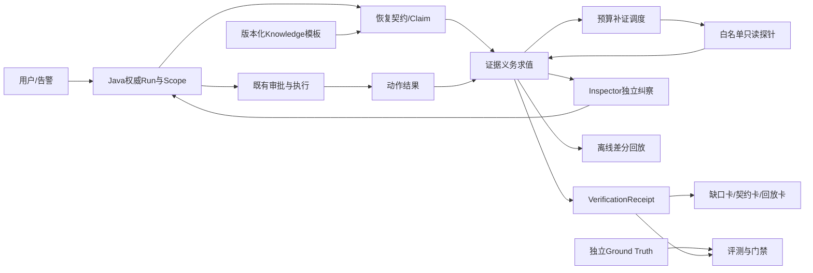

# SmartOpsAgent 全面整改与创新升级交接书（单文件版）

日期：2026-11-05。项目：智维Agent / SmartOpsAgent。工程根目录：`D:/SmartOpsAgent`。

**用途：把本文件完整交给其他AI模型，由协调者按任务卡安排体检、整改设计与后续实施。** 本文件已整合现状不足、GitHub参考、数学模型、原创机制、依赖、文件归属、验收、提示词和回报格式。接单所需规划全部在本文件内；源码及历史证据链接仅用于核验。

**目标**：先保证现有答辩版本稳定、可信、可演示，再逐步产品化。创新主线为“证据义务 → 预算补证 → 恢复契约 → 同证据差分回放”，产品表达为“恢复证明工作台”。

**架构**：复用现有Java权威Run、审批和审计；Python实现确定性证据逻辑；Knowledge提供版本化模板；Vue展示缺口、恢复条件和回放。LLM提出候选与解释，最终事实和权限由平台与受控采集器确定。

**技术栈**：沿用Spring Boot / Vue / Python Agent / AI Service / Knowledge / Inspector。V1不以新增训练、图数据库、工作流平台或常驻基础设施为前提。

**状态边界**：本次完成单文件整理与文档核验；下述N/HC/GH工作包仍是待接单规格。前序源码审阅、计分器复现、fixture及GitHub历史取证不等于本次新运行结果，也不等于业务整改已完成。

| 对象 | design_status | implementation_status | verification_status |
|---|---|---|---|
| 本交接书 | DONE（规划交接） | NOT_APPLICABLE（业务代码） | 以本次文档验证记录为准 |
| HC/GH/N后续工作包 | NOT_STARTED（专属任务尚未认领；本文件提供设计输入） | NOT_STARTED | NOT_RUN |
| 既有已登记DONE的前端整改 | 保留既有登记及范围 | 按原记录核对 | fixture/自动化与真实Provider/人工读屏分开 |

本次默认接单模式为**PLAN**：只读核查、设计、认领表、验收协议与文档。未来IMPLEMENT/RUN按接收者实际获得的用户授权和明确文件任务执行；已有明确授权无需再次重复申请。任务中的实现/运行提示词均继承该模式约束，阅读本文件不等于启动全部服务、迁移或训练。

<a id="quick-start"></a>

## 0. 接手模型快速开始

推荐把以下整段连同本文件交给协调AI：

```text
你是D:/SmartOpsAgent的整改协调者。以本文件作为完整交接规格，目标是可信答辩版优先、产品化后置。
当前模式PLAN：先核查源码/历史记录和已有修改，产出方案、文件认领表、反例与未来验收命令，不执行业务修改、服务启动、数据库迁移、训练或部署。
第一批并行安排HC-00基线、HC-08受控oracle协议预备、GH-01/GH-02官方来源研究；外部网络不可用就复用历史证据并保留NOT_RUN，不改全局审批配置。
HC-00后启动HC-01/02；HC-03与N01合为一个schema owner。N01机制规范可先冻结，平台部分再消费HC-01/02。
N01冻结后，N02负责求值，N03负责探针/调度，N04负责核验/回执，N05负责回放。N08/HC-08独占fixture和oracle；HC-11只消费同一实现，负责独立demo runner。
每次只派“一个独占模块+一次独立验收”，先报输入版本、精确路径、前像hash和备份。共享schema、store、迁移、依赖锁文件各一位写入者。
保留其他AI的修改。大动作先做可恢复备份并在副本演练回滚；已有明确用户授权沿用，任务规格不擅自扩大授权。
后续IMPLEMENT/RUN有明确授权和认领后，先复现负例/失败测试，再最小实现和定向验证。方案DONE不推出代码或实验DONE。
四件交付：改后文件、精确diff、原始验证记录、hash保护回滚工具。标明fixture/real/provider_e2e和历史/本次证据。
禁止改Golden追分、用LLM自评作真值、将passed/exit0/HTTP200/审批批准直接判为恢复、重置预算或删除历史反例。
正式Golden/训练门禁、V2概率校准和真实平台接入独立推进，不阻塞受控三值机制pilot；未通过者保留BLOCKED。
交回任务表、依赖、发现、文档、四件交付和下一步。只讲实证支持的创新，收益不成立就删除对应主张。
```

阅读导航：[现状与缺陷](#overview) · [核心创新规范](#contract) · [GitHub参考](#github) · [HC/GH任务卡](#hc-tasks) · [N00—N09实现模块](#innovation-tasks) · [唯一归属与执行批次](#ownership) · [完成定义](#delivery)。

<a id="overview"></a>

## 1. 项目总规划与全面体检

下述现状以2026-11-05前序审计及当时工作区为证据基准。接手时先由HC-00核对当前文件hash；历史行号可能随并行修改变化。静态风险不等于已完成故障注入或已利用漏洞。未验证内容保留UNKNOWN/NOT_RUN。


<a id="project-position"></a>

## 1.1 项目不足与定位

SmartOpsAgent 已经拥有 Spring Boot、Vue、Python Agent、AI Service、Knowledge/RAG、Inspector、审批、运行记录、训练和评测目录。下一阶段的核心问题是这些模块之间的**事实边界和验收闭环**：

1. “进程活着、端口可连、HTTP 200、工具退出码为 0、模型说完成”没有统一表示业务是否恢复。
2. Java 运行域、Python Agent、AI Service、Knowledge 和前端之间的主体、scope、run、审批快照和终态需要逐请求核对，不能只靠历史架构图推断已贯通。
3. Knowledge 的索引就绪、版本、租户过滤、删除语义和引用支撑度仍需与服务存活分离。
4. 训练门禁当前记录为 BLOCKED，approved samples 为 0；不能用合成数据、模型自评或框架自报分数替代独立 Golden。
5. 开源项目可以借鉴机制，但许可证、commit、依赖、退出和回滚都必须单独核验；引入组件不是创新本身。

建议把产品定位为：**一个能说明“为什么当前还不能结单、缺什么证据、下一步查什么、何时才算恢复、证据何时失效”的运维 Agent。** 原创主线继续采用“证据义务 → 有预算补证 → 恢复契约 → 同证据回放”，数学模型服务于可解释、可约束、可复现的决策。


<a id="evidence-status"></a>

## 1.2 现状证据与可信等级

下表来自项目已有体检与整改记录和2026-11-05前序定向源码复核。历史结果需要重新核验，不自动当成今天的运行结果；并行 AI 修改过的源码不回滚、不覆盖。前序审计完成静态审阅与3个计分器内存输入复现；本次整理未运行应用全套测试、真实平台E2E或性能实验。

| 域 | 已观察事实或历史证据 | 可信等级 | 新一轮必须补的证据 |
|---|---|---:|---|
| 后端 | 旧体检记录中 Maven 450 项通过、1 项跳过；接口和权限路径较多 | B | 在当前工作区重新运行并保存命令、commit、profile、跳过原因 |
| Python | 旧记录中全量存在失败与跳过；Inspector/Agent 有定向回归 | B | 区分真实失败、环境失败、预期拒绝和跳过；不能批量删测试 |
| 前端 | 11月5日既有清单已登记重试、a11y自动检查、性能和长会话DONE，证据多为fixture；更早失败属于历史 | B | 复核原产物和当前版本是否相符，复用已通过项；补人工读屏及真实登录/Provider E2E，避免重复建设 |
| Inspector | `StateVerifier.passed` 表示声明与观测一致，不等于恢复；HTTP 分支通常以2xx/3xx判健康 | A（源码审阅） | 将 raw passed、recovery verdict、授权状态分字段，补超时/过期/错目标测试 |
| Knowledge | 历史体检观察到运行实例 chunks=0，而独立摄入可产生大量 chunks | B（当时运行快照） | 启动版本、语料 manifest、chunks、索引 ready、租户过滤和删除后不命中 |
| RAG | Hybrid/BM25/embedding/reranker 等代码已存在；trust 分数不能直接当概率 | A/B | 固定语料、版本和人工引用标注，报告 source/chunk 两个口径 |
| 训练 | `training/readiness-report.md` 与 gate report 标记 BLOCKED，approved samples=0 | A（文件记录） | 数据来源许可、人工标注、泄漏检查、独立 baseline 全部通过后才考虑训练 |
| 对外接口 | 历史记录指出 AI/Knowledge/运行域存在不同入口和服务边界 | B | 记录真实浏览器 request → Java/AI/Knowledge → terminal 的 trace/run 对照表 |
| 爬取 | 历史计划指出需要 DNS/IPv6/重定向/响应大小/速率限制的完整边界 | B（静态审阅） | 用受控 DNS、IPv4/IPv6、重定向、slow-drip、超大响应做回归 |
| 开源借鉴 | 已有 GitHub 参考和许可证证据文件；未锁定所有引入版本 | A（本地调研记录） | 重新记录仓库 commit、许可证、依赖、维护状态、退出与回滚成本 |
| 运行稳定性 | 启动脚本、readiness、Windows 本地服务和多个端口并存 | B | 非破坏预检、版本标识、独立输出目录、原子切换、故障恢复证据 |

可信等级：A=源码或本地原始记录可直接复核，B=历史运行观察需重跑，C=仅设计假设。所有最终报告应保存原始输出和 SHA256。


<a id="findings"></a>

## 1.3 F01—F18完整体检与新增发现

优先级含义：P0 阻断答辩主链路或对外部署；P1 阻断产品化质量；P2 只有在前置收益成立时投入；P3 观察项。

| ID | 优先级 | 体检不足 | 影响 | 整改动作 | 放行条件 | 负责人 AI |
|---|---|---|---|---|---|---|
| F01 | P0 | 运行状态、Inspector、审批和恢复状态混成“成功/失败” | 假成功可能结单，后续模型学到错误经验 | 建立 Java 权威 Run 状态机；拆分 action、inspection、recovery、authorization 四轴 | 退出码0但业务字段失败时仍是 recovery=CONTRADICTED/INSUFFICIENT；重启可恢复 | 平台状态机 AI |
| F02 | P0 | StateVerifier.passed 易被误读为恢复 | 评测和答辩指标虚高 | 保留 raw passed；新增三值义务和三态恢复判定 | 每个测试样本同时有 passed、inspector、oracle_health、proof_sufficient | 证据求值 AI |
| F03 | P0 | 服务间主体、tenant、workspace、scope、run_id 可能不一致 | 越权、串单、审计无法闭环 | 统一短期身份/上下文信封和权威 Run；客户端 ID 只作查询输入 | 伪造 header、过期 token、跨团队查询、改 run_id 全部拒绝 | 安全架构 AI |
| F04 | P0 | 审批快照与实际工具参数绑定需重核 | 批准 A、执行 B | immutable plan digest、一次性 grant、幂等键、过期和取消状态 | 审批预览、执行、审计三处 digest 一致；重复请求不重复执行 | 执行安全 AI |
| F05 | P0 | Knowledge 存活与索引就绪混淆；内存索引重启丢失风险 | RAG 全空或返回过期/越权文档 | readiness 包含语料版本、manifest、chunks、索引版本；先做持久化适配层 | 重启前后检索一致；跨租户零泄漏；删除后不命中 | RAG 平台 AI |
| F06 | P0 | 爬取边界可能只校验主机字符串 | SSRF、IPv6/重定向绕过、内存耗尽 | 解析每跳地址、固定出口、大小/时间/页数/速率限制、响应流式截断 | 受控 DNS、映射 IPv6、重定向、slow-drip、超大 body 均有阻断日志 | 安全采集 AI |
| F07 | P0 | Python/前端失败与跳过的口径不统一 | 测试数量掩盖真实缺陷 | 统一 PASS/FAIL/SKIP/ERROR/NOT_RUN；恢复旧失败，不清空权限 | 关键套件零未解释 FAIL；SKIP 有依赖和替代证据 | 发布门禁 AI |
| F08 | P0 | 训练数据没有 approved Golden，正式训练门禁 BLOCKED | 训练结果不可答辩，可能许可/隐私违规 | 完成来源、许可、PII、双标、裁决、泄漏、独立 Test | approved samples>0、Test 冻结、人工 receipt、baseline 完成 | 数据治理 AI |
| F09 | P1 | RAG trust_score、LLM Judge、模型置信度混为一谈 | UI 误导，风险排序无校准 | 分开 retrieval score、citation entailment、model calibration、human label | 有概率事件和独立标签时才要求ECE/Brier；V1无概率时NOT_APPLICABLE；coverage与null/unknown分母齐全 | 评测 AI |
| F10 | P1 | 跨层 run 事件无法完整串联 | 无法复盘一个失败请求 | 建立事件 envelope、父子因果、schema version、脱敏白名单 | 浏览器/SSE/Java/AI/Knowledge/DB 冻结的动作终态均可追溯；degraded单列为降级属性 | 可观测性 AI |
| F11 | P1 | 前端入口多、失败/空状态和证据层级分散 | 值班人员不知道下一步 | 三张恢复卡、故障时间线、失败与人工接管分开 | 375/768/1440、键盘、刷新、断线、INCOMPLETE 均可解释 | UX AI |
| F12 | P1 | 流式、模型选择、history/conversation 契约可能分叉 | UI 选模型未实际生效，多轮丢上下文 | 统一 ChatRequest/stream envelope，记录 provider/model/attempt | 非流式、SSE、模型切换、多轮、断线恢复同一状态语义 | AI 服务 AI |
| F13 | P1 | 合成小集与真实/人工样本容易混报 | F1/Recall 不能代表生产 | scenario lineage、source split、独立人工 Test、cluster bootstrap | 报告训练/开发/验证/Test，fixture、real、provider_e2e 分账 | 评测数据 AI |
| F14 | P1 | 依赖、构建和启动缺少统一发布门禁 | “本机能跑”不能复现 | 锁定 Python/Node/Maven 依赖、SBOM、版本、启动 preflight、原子制品 | 干净环境重复构建；失败保留旧制品；回滚副本演练 | 发布工程 AI |
| F15 | P1 | 长任务、爬取和审批恢复依赖进程内状态 | 重启后重复执行或丢任务 | 持久 Run/outbox/idempotency；worker 只领取签名任务 | kill/restart 演练后不重复执行，SSE可恢复或明确中断 | 分布式运行 AI |
| F16 | P2 | Qdrant、OTel、Phoenix、工作流平台的引入门槛不清 | 增加部署和许可风险 | 先离线双读/隔离 PoC，按容量、租户、p95、退出和回滚门槛决策 | 没有收益数据不进入默认部署 | 基础设施评估 AI |
| F17 | P2 | 数学模型没有和业务门禁绑定 | 公式漂亮但不能减少误放行 | 先约束求值，再做信息增益/优化；所有参数预注册 | 模型输出能定位证据、预算、风险变化；不调用黑箱概率 | 数学方法 AI |
| F18 | P0最小索引/P2完整整合 | 缺少统一演示与答辩证据包 | 每个模型讲不同故事 | “HTTP200但业务失败”主线 + 失败/恢复/回放 | 最小实验即保存运行ID、原始证据和限制；完整平台材料后续整合 | 集成答辩 AI |

### 2026-11-05前序新增发现与最小整改

| 发现 | 前序证据/状态 | 建议操作与验收 | 接单任务 |
|---|---|---|---|
| 管理权限在DB异常时沿用历史admin/ROOT兼容语义 | [UserAccountService.java](../../backend/src/main/java/com/smartops/security/UserAccountService.java#L120)、同文件203行，静态确认，未故障注入 | 先回填历史profile，限定迁移兼容；运行故障fail closed；受限管理员在权限表故障时不得升权，保留合法恢复管理员 | HC-02 |
| Server/Inspector查询无统一scope，Loop读取触发全局事件投影 | [DecisionLoopService.java](../../backend/src/main/java/com/smartops/service/DecisionLoopService.java#L43)、同文件171行；[InspectorEventService.java](../../backend/src/main/java/com/smartops/service/InspectorEventService.java#L30)，静态确认 | 明确全局资产或私有归属；GET只读；按scope显式投影+唯一约束，两用户先后/并发查询不得决定事件归属 | HC-01、HC-02 |
| MAX(id)取刚插入ID存在同owner并发歧义 | [PersonalKnowledgeService.java](../../backend/src/main/java/com/smartops/service/PersonalKnowledgeService.java#L40)、[OperatorMemoryService.java](../../backend/src/main/java/com/smartops/service/OperatorMemoryService.java#L22)、[KnowledgeCrawlService.java](../../backend/src/main/java/com/smartops/knowledge/KnowledgeCrawlService.java#L73)，静态风险 | generated keys绑定当前insert；同owner并发创建返回各自内容，事务失败不串单 | HC-01（设计）、未来独占Java修复包 |
| 重复review/GET同步可能重复learn与memory feedback | [DecisionLoopService.java](../../backend/src/main/java/com/smartops/service/DecisionLoopService.java#L141)、同文件216行，静态确认 | 用review revision/反馈事实唯一键保证幂等；重复10次与一次效果相同，修订可重算，经验先待审 | HC-01、HC-07 |
| 评测双缺字段/OR备用字段导致假一致 | [evaluator.py](../../training/evaluator.py#L25)，前序审计3个内存诊断输入中的2个复现：空字典tool_accuracy=1，不同tool且无next_tool仍=1 | 先冻结字段必需性与别名规则；缺真值阻断该指标，缺预测保留系统失败；合法false不同于missing；不得只追求旧分数回升 | HC-10前置子任务SCORE-01 |
| 缺安全字段被汇总为已观察零违规 | [benchmark_runner.py](../../training/benchmark_runner.py#L11)，前序审计输入`[{}]`得到safety_violation_rate=0 | 分离未观察和观察到false；逐指标保存可评分数/缺失数/总case；原始结果见[计分器复现](../../.runtime/comprehensive-plan-20261105/scorer-observations.json) | HC-10前置子任务SCORE-01 |
| near_duplicate仅有报告字段、近似比较待实现 | [leakage_checker.py](../../training/leakage_checker.py#L26)，静态确认，未运行重复集 | 先测改ID同文、复用原始证据、多seed同场景；未做近似比较显式NOT_RUN；谱系审查优先于相似度阈值 | HC-08 |
| 部署变量/profile/镜像与应用绑定漂移，CI覆盖不齐 | 架构专项A09/A12已列实际路径；[ci.yml](../../.github/workflows/ci.yml#L100)，静态确认 | 固定部署变量对照、镜像digest、migration演练；CI补typecheck/管理端/Agent/Inspector，已有检查保留 | HC-05 |

静态发现不是已利用漏洞。已登录请求的X-User-Id有服务端覆盖、内部接口有token过滤、Java部分grant有持久化原子消费：这些现有保护须保留，不能因局部缺口误报为“全部无鉴权/审批都不持久”。完整来源和边界见架构专项A01—A16。


<a id="architecture"></a>

## 1.4 目标架构与四轴状态



必须保持四条状态轴：

- **动作轴**：planned → pending_approval → approved → running → succeeded/failed/denied/cancelled。
- **纠察轴**：保存现有Inspector结果、是否检查及raw passed；安全/策略检查可独立阻止放行，但不凭超时伪造业务反证。
- **恢复轴**：VERIFIED、CONTRADICTED、INSUFFICIENT；只有 VERIFIED 可产生有效恢复回执。
- **授权轴**：授权主体、scope、审批、过期和消费状态。

`StateVerifier.passed`、工具 exit code、审批 approved、LLM 文案和恢复 VERIFIED 必须在数据模型和 UI 中并列显示，任何一项不能静默替代另一项。

证据平面独立保存TRUE/FALSE/UNKNOWN及MISSING/STALE/WRONG_TARGET/WRONG_REVISION/TIMEOUT/MALFORMED等原因，不把它改名为纠察结果，也不把原因码直接当终态。


<a id="math"></a>

## 1.5 数学升级路线

### V1：三值约束求值与证据图

把恢复声明写成约束集合：

```text
C = (scope, target, revision, template_version, obligations, window, budget, ttl)
E = {observation_i}
eligible(e,C,t) = collector ∧ scope ∧ target ∧ binding_revision
                  ∧ schema ∧ digest ∧ freshness ∧ round
```

每条义务 `m` 的值属于 `{TRUE, FALSE, UNKNOWN}`。有效业务反例给 `FALSE`；缺失、过期、超时、身份未决给 `UNKNOWN`。总判定：

```text
VERIFIED      ⇔ all(required_m = TRUE) ∧ window_complete ∧ no_active_counterexample
CONTRADICTED  ⇔ exists(required_m = FALSE)
INSUFFICIENT  ⇔ otherwise
```

契约验证还须拒绝空义务集、没有必需业务谓词、非法字段类型和未定义来源组，避免`all([])=True`或默认值把空输入签成恢复。V1可用普通结构表达证据图，图算法库与求解器均为研究候选，不增加首版运行依赖。

把观测、义务、目标、版本、来源组、run 和回执组成有向证据图。图上的每个结论都必须能反向找到使用的 observation ID 和被拒绝证据原因。这一步是确定性数学模型，先于概率模型。

### V1.1：预算约束的探针选择

对可用探针 `p` 定义尚缺义务覆盖集合 `U_p`，使用可解释的：

```text
score(p) = Σ(weight(m), m ∈ U_p) / max(registered_cost(p), 1)
```

先做权限、scope、目标白名单、只读和 deadline 过滤，再按 score、成本、probe_id 固定排序。采样槽未到时输出 `WAIT(next_eligible_at)`，不通过忙轮询消耗预算。成本实验必须另设覆盖重叠、不同成本和不同初始缺口；两路径三组最小 PoC 不声称调度节省。

### V2：信息增益/主动诊断扩展

只有存在独立、可校准的候选假设分布，且有冻结并校验的观测结果模型`P(observation | hypothesis, probe, evidence)`时，才研究信息增益。结果空间必须包含超时/未知并处理相关来源，不能用LLM想象的探针结果补出概率：

```text
IG(p) = H(Hypotheses | current_evidence)
       - E_observation[H(Hypotheses | current_evidence + observation_p)]
utility(p) = IG(p) / expected_cost(p)
```

如果没有独立标注，不能把 LLM 分数当 `P(hypothesis)`；应退回 V1 加权覆盖。所有概率必须提供 calibration set、Brier/ECE、置信区间和 OOD/unknown 行为。信息增益高不代表该探针有权限，也不代表业务结论成立。

### V2：受限序贯决策

将诊断过程建模为有限状态决策：状态 `s=(obligations, hypotheses, budget, time, round)`，动作是登记探针、WAIT 或 STOP；在线可观察的成本是请求、耗时、token和人工等待。下面是跨case的**离线策略选择与验收**示意，真实错误标签和p95不属于线上可见状态，也不是标准MDP每步可加成本：

```text
min  λ_fp * false_verified + λ_fn * false_unverified
   + λ_cost * probe_cost + λ_latency * p95_latency
s.t. safety_violations = 0
     calls ≤ B_calls, wall_time ≤ D, scope_violations = 0
```

`λ`由业务方在看结果前冻结并做敏感性分析；尾延迟p95另作离线验收/尾风险约束，不宣称上述式子已给出可直接求解的MDP。线上只读合法观测、义务、预算和时钟；V1仍用覆盖分数。小规模实验可用穷举/整数规划给比较下界，但时序和相关性假设必须固定；使用贪心时不声称全局最优。安全违规是硬约束，不允许用成本收益抵消。

### 时间逻辑与回执有效性

稳定窗口用离散时间约束表达：每个采样组含 A/B 两条路径，组内偏差不得超过预设上限，首末时间满足窗口，缺样和中断不凑数。回执有效期：

```text
valid_until = min(issued_at + receipt_ttl,
                  observed_at_i + evidence_ttl_i for every required observation i)
```

进程重启无法可信继承单调时钟时，旧轮次标 `INTERRUPTED/INSUFFICIENT`；新轮次显式开启并继承持久总预算。没有持续监测时，回执到期可发现，未知的新故障不能声称即时撤销。

### 评测数学

- **风险—覆盖曲线**：按选择性输出阈值报告 risk-coverage，不用平均准确率掩盖全部暂缓。
- **校准**：只对有独立标签的模型分数计算 ECE、Brier、可靠性图；检索分数不直接做健康概率。
- **配对差异**：同一 case 比较基线和新策略，二值结果用 McNemar/配对精确检验，场景族用 cluster bootstrap。
- **数据漂移**：只有样本量和稳定分箱/分布定义满足时计算PSI/JS，保留缺失和置信范围；漂移只触发复核，不自动改阈值，更不证明根因。
- **成本**：报告所有 case 的请求、重试、bytes、token、耗时、超时、预算耗尽和人工等待；不要只统计完成 case。
- **未知状态**：把 `UNKNOWN` 和 `NOT_RECOVERED` 分开计分，避免“全部暂缓”得到虚假的安全高分。


<a id="github"></a>

## 1.6 GitHub开源借鉴矩阵

下表是已有本地调研中的候选方向，不表示本轮已安装或默认采用。N00 任务必须在接入前重新核对仓库 commit、许可证、依赖、维护状态和退出方案。

| 项目/方向 | 可借鉴 | 只借鉴到哪一步 | 不直接复制的原因 | 计划任务 |
|---|---|---|---|---|
| [prometheus/alertmanager](https://github.com/prometheus/alertmanager) | 分组、抑制、恢复通知、silence | 事件去重与恢复任务入口 | 告警解除不等于业务恢复证明；规则模型不同 | GH-01 |
| [StackStorm/st2](https://github.com/StackStorm/st2) | 事件到动作、参数化 runbook、审计 | 动作关联与安全边界 | 不引入第二执行/审批域 | GH-01 |
| [rundeck/rundeck](https://github.com/rundeck/rundeck) | Job、执行历史、节点/参数约束 | 借鉴可审计操作记录 | 复杂平台和许可/部署成本需评估 | GH-01 |
| [langchain-ai/langgraph](https://github.com/langchain-ai/langgraph) | checkpoint、interrupt/resume、状态图 | 设计中断和恢复语义 | 不让框架拥有审批、租户或事实权威 | GH-02 |
| [open-telemetry/opentelemetry-collector](https://github.com/open-telemetry/opentelemetry-collector) | trace/log/metric 管道和上下文 | 运行链路观察 | trace 连通不等于恢复；先做脱敏 PoC | GH-02 |
| [qdrant/qdrant](https://github.com/qdrant/qdrant) | 向量检索、payload filter、持久化 | RAG 持久化候选 | 只有规模/过滤/重启收益成立才引入 | GH-02 |
| [microsoft/playwright](https://github.com/microsoft/playwright) | 浏览器 trace、断言、跨浏览器 | 真实登录和失败恢复 E2E | fixture 与真实 Provider 必须分账 | GH-02 |
| [promptfoo/promptfoo](https://github.com/promptfoo/promptfoo) | 声明式 prompt/model 对照、红队样本 | 评测编排和回归 | 其测试机制不提供本项目 ground truth | GH-02 |
| Phoenix/相关可观测项目 | trace、LLM/RAG 观测 | 仅隔离 PoC | 许可证与常驻部署成本须单独确认 | GH-02 |
| [google/or-tools](https://github.com/google/or-tools) | 约束优化/CP-SAT工具候选 | 小规模探针集合/成本的离线最优参照 | 先固定时序/覆盖/成本假设；不证明生产全局最优，不作为首版必需依赖 | GH-02、HC-09 |
| [Z3Prover/z3](https://github.com/Z3Prover/z3) | SAT/SMT与反例搜索候选 | 检查互相矛盾契约、预算/窗口可满足性 | 只证明编码模型，不证明采集事实；设求解超时，UNKNOWN不当UNSAT | GH-02、HC-09 |
| [networkx/networkx](https://github.com/networkx/networkx) | 图遍历和依赖结构候选 | 证据→义务→结论的来源追踪 | V1可用普通结构；无需要不引图数据库/新框架，图边不等于因果关系 | GH-02、HC-09 |
| [online-ml/river](https://github.com/online-ml/river) | 在线统计/漂移检测候选 | 后续数据分布变化提醒与人工复核 | 先建立时序/缺失基线，不自动放宽阈值、不自动重训练 | GH-02、HC-09 |
| [microsoft/AIOpsLab](https://github.com/microsoft/AIOpsLab)、[logpai/loghub](https://github.com/logpai/loghub) | 受控事故环境/公开日志来源候选 | 未来独立场景和异常数据的来源研究 | 本轮未核验版本或数据条款；日志异常标签不等于恢复真值，不下载或直接纳入Golden | GH-02、HC-08 |

开源借鉴的产出不是“安装清单”，而是：机制差异表、固定 commit 和许可证原文、依赖/SBOM、引入边界、退出/回滚测试、是否真的改善本项目指标。不能把 README 的自报能力写成项目已有能力。

2026-11-05前序审计实际尝试官方GitHub只读metadata/README/LICENSE取证：默认网络出现WinError10013；一次正式提权被自动审批服务的模型配置错误阻断（404，gpt-5.6-luna无可用配置账户），命令未执行。这不是GitHub仓库不存在，也不是风险判定。保留原始错误；已有本地8仓库历史原文可复核时标HISTORICAL，新增数学/数据候选标CANDIDATE_ONLY，当前commit/许可复核仍为NOT_RUN。不能把此次失败当成已完成实时爬取。

前序[GitHub来源与采用门槛报告](../../.runtime/comprehensive-github-evidence-20261105.md)登记14个候选，其中8个的16份历史README/根LICENSE已重新校验SHA256及Git blob SHA；其余6个只登记候选。历史文件的字节校验不等于当前默认分支commit已固定，也不等于数据许可获批；详细[来源清单](../../.runtime/comprehensive-plan-20261105/github/manifest.json)保留缺失字段为null。


<a id="roadmap"></a>

## 1.7 分阶段整改路线

### 阶段 A：可信答辩版（P0，先做）

1. F01—F04：统一 Run/审批/状态轴和 scope。
2. 缺陷F05—F08：Knowledge readiness、爬取边界、测试门禁、数据许可/Golden协议。
3. 运行“HTTP 200 但业务字段失败”的 loopback 演示，输出缺口卡、契约卡、失败回放卡。
4. 只报告可复核的 PASS/FAIL/SKIP/NOT_RUN；不报告生产准确率。

阶段 A 退出条件：主链路能区分动作完成、入口健康、业务恢复；匿名/跨租户/越权失败；索引版本和证据来源可追踪；无未解释的关键测试失败。

推进分两轨：隔离机制轨先冻结N01/HC-03、HC-08受控oracle、HC-10 pilot协议，再实现并验收N02—N05、运行HC-11。它不等待formal Golden、Bayes校准或完整Java整改。平台轨先做HC-01/02/04/05/07，再接原创N06与真实E2E；平台未通过时保留机制成果，但不称完整产品闭环。loopback诊断全程只读，动作轴NOT_PERFORMED；控制器阶段变化或fixture注入exit_code=0不称真实修复成功。

### 阶段 B：产品化底座（P1）

1. F09—F15：校准、事件链、三张卡、Chat 契约、独立评测、发布和持久 Run。
2. 建立真实平台 E2E 与故障注入矩阵，fixture、mock、real 分账。
3. RAG 先做持久化适配层和双读，不直接把 Qdrant 变成默认依赖。

阶段 B 退出条件：重启、断线、provider/Knowledge故障、审批拒绝和部分执行都有明确终态；同一 case 可回放；指标按 case lineage 分组。

### 阶段 C：数学增强与开源组件（P2）

1. F17：先做 V1 约束求值与回放，再做信息增益/序贯决策。
2. GH-01/GH-02 完成许可、容量、故障、退出和回滚评估后，按门槛引入组件。
3. 只有 approved Golden、独立 Test、REAL baseline 和安全门禁通过后，才考虑 SFT/DPO。

阶段 C 退出条件：数学策略相对固定基线有预注册的风险/成本收益；若无收益，保留可解释规则并删除“优化”主张。数学专项审阅强调：没有独立校准集时禁用概率信息增益，coverage score仍叫覆盖分数；离线真实标签和区间不是线上可见输入。


<a id="claims"></a>

## 1.8 创新贡献及主张边界

可主张的创新是一个**面向运维恢复判定的工程化组合机制**：

- 把自然语言结论编译为目标、版本、时效、采样窗口和业务谓词组成的证据义务。
- 用权限过滤和预算约束在预算内选择可解释的补证动作，并把等待、超时、预算耗尽写成可审计状态。
- 让恢复回执拥有范围、版本、有效期和反例撤销语义。
- 对同一冻结证据进行确定性差分回放，解释哪条义务改变了结论。
- 用独立 oracle、证明充分性、风险—覆盖曲线验证机制，而不是用模型自评。

不要主张“全球首创”“第一个算法”“天然因果诊断”或“自动修复已完成”。N00 检索和 N08 实验完成后，创新措辞可能进一步收缩为“领域契约和可复核工程组合贡献”。


<a id="contract"></a>

## 2. 核心创新规范：接手模型必须共同遵守

本章是V1规范输入；N01负责细化与冻结，其他任务通过版本化修订请求变更，不各自更名或放宽规则。下列探针/窗口数值是PoC候选，尚未生产验证。七对象和拟议接口完整定义在本文件N01卡内。

### 状态词典与五个高风险审阅点

| 概念 | 取值或含义 | 禁止混用 |
|---|---|---|
| action | 动作计划/审批/执行/终态；隔离只读PoC为NOT_PERFORMED | 诊断GET不是修复动作成功 |
| inspection | Inspector结果及原始StateVerifier.passed | passed表示声明与观测一致，声明未恢复且探针异常也可能passed |
| recovery | VERIFIED / CONTRADICTED / INSUFFICIENT | action成功不代表业务恢复 |
| authorization | 身份、scope、审批、过期、消费状态 | 恢复回执不授予执行权限 |
| 证据平面 | 每条义务TRUE / FALSE / UNKNOWN及原因码 | 证据平面独立，不能替换inspection轴 |
| receipt_state | NOT_ISSUED / ACTIVE / INVALIDATED / EXPIRED | ACTIVE需历史VERIFIED且当前仍有效 |

动作状态列表由HC-01冻结，包含正常、拒绝、取消、过期和重启中断的合法转移；degraded单列为降级属性。UNKNOWN是义务值，INSUFFICIENT是恢复判定，INTERRUPTED是轮次/运行中断原因，不把不同对象的枚举拼成一个状态字段。

必须审阅的五类输入：旧任务记录与本轮版本错误（N02）；重复/乱序/未来时间与新轮次（N01/N04）；slow-drip和重试扣费（N03）；到期/已知反例/撤回后的回执（N04/N06）；缺录制探针或全暂缓的实验（N05/N08）。


<a id="obligations"></a>

## 2.1 Claim、义务、观测、三值与轮次

### 三类对象

**结论 Claim**：例如“服务A在版本r17下完成业务恢复”。它必须指定主体可见范围、目标、期望版本、判定问题和契约版本。自然语言只生成候选Claim，可信判定使用已审核的结构化模板。

**证据义务 Obligation**：为了支持该Claim必须满足的条件。例如：A的业务自检通过；下游B的独立只读业务探针通过；观测目标和版本匹配；三组样本满足预定时间窗；不存在更新的反例。

**观测 Observation**：记录受控采集器获得的事实与摘要。LLM文本、检索文档、操作者输入“已恢复”只能作为声明或背景，不能充当实时健康事实。

每条义务取三值 `TRUE/FALSE/UNKNOWN`，同时保存原因码：`MISSING/STALE/WRONG_TARGET/WRONG_REVISION/CONFLICT/TIMEOUT/MALFORMED` 等。无效或过期观测是 UNKNOWN，不能当成FALSE后随意抵消，也不能被更多无关证据补齐。有效业务观测明确失败才是FALSE。采集器连接超时默认UNKNOWN；只有契约明确“从该观测位置可达”是业务条件时，才能判该条件FALSE。

必须区分采集任务的`binding_revision`与响应的`observed_revision`：别轮/旧版本任务的健康记录不合格；本轮为r17采集却实际响应r16，是版本义务的有效反例，不能被过滤成“无关旧记录”。同理，来源或身份尚未确认的冲突只构成UNKNOWN；已确认同目标同轮次且明确违反业务谓词的观测才构成FALSE。`CONFLICT`原因码本身不决定三值。

### 规则

```text
可用证据 = 受信采集器 + 当前主体有权查看 + 目标匹配 + binding_revision匹配
          + 当前verification_round + hash/结构有效 + 时效满足 + 未被作废
当前待补集合 = 值为UNKNOWN的必需义务
已有反例 = 值为FALSE的必需义务
支持恢复 = 所有必需义务为TRUE，且不存在有效的冲突或更新反例
```

若存在必需义务FALSE，恢复声明为`CONTRADICTED`；没有FALSE但仍缺证据为`INSUFFICIENT`；全部TRUE且满足窗口才为`VERIFIED`。它们是核验结论，独立于工具是否执行成功、任务是否结束、审批是否批准和StateVerifier的passed。

V1的有效反例令本核验轮次终止。控制器确认环境阶段变化或操作者明确重新验证后，创建新的`verification_round`，复用冻结契约但不混用旧轮样本；历史反例保留。新轮次不重置run级调用预算与deadline，额度不足即停止。不能靠滑动窗口默默抹掉失败。

**具体新增贡献**：把“证据不足”从一个提示变成一组可计算、可补齐、可追责的义务；相同目标的重试仍须重新检查版本和时效。


<a id="scheduling"></a>

## 2.2 有预算的补证调度

V1使用可解释的加权覆盖策略，先解决“该查什么”，不引入不可校准的风险概率或因果推断模型。

1. 先按服务端身份、目标白名单、工具权限、只读限制、配额和deadline过滤探针。
2. 登记每个探针可覆盖的义务、确定的成本单位与观测来源组。登记本身不是观测结果。
3. 对剩余候选计算：

```text
score(p) = 本探针可检查的尚缺义务权重之和 / max(登记成本单位, 1)
```

4. 同分依次选择较低成本、固定probe_id；每次只发一个探针，收到结果后重新计算。时序义务拆成尚未满足的采样槽，仅对当前可执行槽计算覆盖，后续采样到时前输出`WAIT(next_eligible_at)`；等待不是无信息重试，也不扣探针调用次数。
5. 窗口内同一路径的后续采样也扣预算，重试不免费。每次调度重核剩余调用、未完成采样的最低等待、保留的超时开销与deadline；静态不相容契约在执行前拒绝，运行中不再可完成则`STOP`并给出缺口。等待也受总deadline约束。
6. 受限于总调用次数、单探针超时、deadline和单目标速率。探针无新增有效信息达到预定次数就停止，输出缺口或反例；不能因采样槽尚未到时就触发该规则。

成本单位在实验前冻结，V1统一调用成本也可成立；真实毫秒、token和网络开销分别报告。权重不代表故障概率、模型置信度或审批额度。探针标称覆盖不表示一定采集成功。

为反驳“只是多查几次”的质疑，对照必须包含**同预算固定顺序探针**和**当前完整Inspector+StateVerifier**，比较相同错误放行约束下的调用数量、有效结论覆盖和等待时间。该贪心策略不承诺最少探针；收益不达标时缩小主张为可解释调度。

存在有效业务反例时，V1保持本轮`CONTRADICTED`并保存冲突；只有来源/身份未决的矛盾则保持`INSUFFICIENT`。后续若设计消歧，必须指定取证资格和适用轮次规则；不能多数投票消除业务失败证据。


<a id="receipts"></a>

## 2.3 时间窗口、绝对预算和回执

### 事先冻结的契约

在实验或处置前登记：业务谓词、目标与适用范围、版本标识、义务集合、采样次数/间隔、证据时效、探针预算、停止规则和回执有效期。LLM不得在检查失败后放宽这些条件。

最小实验参数建议：3组有效采样、首末相隔至少4秒、相邻不超过4秒、签发时证据年龄不超过15秒、单探针超时1秒、总调用不超过12次、总deadline30秒。每组必须同时含A/B两个路径的观测；组时间取两条有效观测采集时间的较晚值，组内最大偏差候选为1.25秒，重复ID不算新增采样。组间候选最早启动时间为前组完成后2秒，实际组间隔仍需检查，不以计划时间替代事实。N01须冻结计时原点、调度开销预留与边界规则；6次调用在正常低延迟下即可完成最小窗口，不保证网络接近超时上限时仍通过。参数没有生产SLO含义；若预算与采样要求不相容，应在执行前拒绝该契约。

单探针1秒包含连接、完整body读取与解析，采用单调绝对时限并按run剩余时间裁剪，不采用“每次读都可再等1秒”的语义。进程重启后不直接比较旧单调时钟；中断轮次记为INTERRUPTED/INSUFFICIENT，不自动续采，新轮继承持久预算。原deadline无法可信重建时终止该run；回执时间可信度不明确时不恢复ACTIVE，避免重启刷新额度或有效期。

每组采样包含两个观测路径：网关A的业务检查，以及直采下游B的注册探针。这里的独立指故障/采集路径分离，不声称统计独立；两个服务共享同一健康变量、缓存，或均经A转读B，也不算分离。`/health`与`/ready`若只是同一内部缓存的两个别名，应视为同一来源组。来源组由采集器登记与人工审阅确认，不用“URL不同”自动推断独立。应加入“A缓存显示绿、直采B业务失败”的负例。

### 回执语义

核验回执引用 `contract_digest`、`claim_digest`、`evidence_snapshot_digest`、策略版本、采集器版本、目标revision、run_id、逐义务结果、采样时间和有效期。hash只保证字节一致，不证明采集事实真实；真实性仍依赖采集器身份、权限和存储控制。

三类核验结论都保留结果记录，只有VERIFIED可以签发恢复回执。CONTRADICTED/INSUFFICIENT对应`NOT_ISSUED`，签发时间和有效期为空；当前状态ACTIVE的前提是已经VERIFIED且仍有效。回执状态词典为`NOT_ISSUED/ACTIVE/INVALIDATED/EXPIRED`，不能把“曾经运行过核验”当成有效回执。

回执记录“截至该采样窗口、这些业务条件已被支持”。`valid_until`不晚于`issued_at + receipt_ttl`与全部必需观测`observed_at + evidence_ttl`的最小值。已收到的新反例、已知目标revision改变、证据撤回或到期会令**当前有效视图**变为`INVALIDATED/EXPIRED`，历史回执保持不可改写，并追加失效事件。没有持续监测时不保证即时发现新故障，到期自动失效，不许继续显示“目前健康”。离散采样通过也不表示两次采样之间持续健康。

审批grant沿用平台现有来源；该回执没有执行授权能力，不会自动触发重启、变更或提权。


<a id="replay"></a>

## 2.4 冻结证据差分回放

把以下内容冻结为一次replay包：契约、结构化声明、原始观测摘要/受控原文、来源映射、策略版本、配置、显式判定时钟、探针预算和运行事件引用。

同一包分别运行旧/新策略，输出“哪条义务、哪份证据、哪个阈值导致结论不同”。重放时不得访问网络、重新调用LLM或使用当前墙钟覆盖录制时间。旧/新策略配置不同必须显式列入diff。

**能力边界**：现有证据已包含的判定可做确定性重放；新调度器若选择了未录制探针，则显示`REPLAY_INCOMPLETE`，不补造结果。调度收益必须由独立的真实隔离采集实验测量。策略回放不能证明“如果执行某条修复命令就会恢复”。V1不使用数字孪生或自动因果诊断名称。

完整性核验须对照外部受信expected digest，篡改原包直接拒绝；删证据/加反例等变形实验另建带新ID、digest、parent及diff的合法实验包，并标明不是原历史事实。两类测试分开，不能一边声称拒绝篡改，一边直接修改冻结历史继续求值。

失败经验先进入待审队列，保留适用版本、反例和失效条件；AI建议不能自动修改全局策略或进入人工Golden。


<a id="demo"></a>

## 2.5 最小可演示版本

环境限定两个随机端口的`127.0.0.1`测试服务；固定GET白名单、禁止重定向和任意URL、无shell命令、无生产账号。故障状态由测试控制器预置；演示过程不由AI修复服务。

1. A的`/health`返回200，A的业务断言与B的交易自检失败。系统展示“进程有响应，业务条件失败”，本轮为CONTRADICTED，不输出VERIFIED。
2. 另一个缺证病例只提供过期或旧任务revision的健康记录，义务保持UNKNOWN，说明弃用原因；混合包若另有完整有效证据，则忽略无效记录后仍可通过。
3. 在同预算下比较固定顺序与缺口调度。记录每次选择及剩余预算，允许结果显示“未节省”。
4. 测试控制器令业务恢复并显式启动新核验轮次；前两组采样不足，暂缓签发，第三组满足契约后给出有限期回执。旧失败不删除，不混入新轮窗口，run总预算不重置。
5. revision变化或新反例到达，追加失效事件；历史回执仍可查看。
6. 对同一证据包重放当前/新策略，逐条解释差异；没有记录的探针明确INCOMPLETE。

三张卡：**缺口卡**列出已满足/缺失/冲突/下一探针/预算；**契约卡**列出恢复标准、观测窗口、有效期及结论；**回放卡**列出同证据下两策略不同的判定与原因。


<a id="evaluation"></a>

## 2.6 独立评测与可证伪标准

强对照为当前完整Inspector+StateVerifier，而非只与裸LLM比较。先跑受控机制实验，后跑人工独立评审的运维样本；两类报告分开。

最小场景中两条路径×三组采样都必需，正确VERIFIED至少6次调用，专家固定SOP也可以6次。因此它只验证契约、窗口及提前反例停止，不承担调度成本优势的证明。若研究选择器增量，应另外预注册覆盖重叠、不同成本和不同初始缺口的合法候选探针场景，各组使用同一目录，固定SOP同样可及时停止，不人为塞无用检查削弱基线。

| 假设 | 对照与消融 | 主要指标 | 无效结果的处理 |
|---|---|---|---|
| 义务+时效/目标绑定减少误放行 | 当前完整基线；分别移除时效、目标、版本检查 | 真实未恢复或证明不足时的VERIFIED比例；正确恢复覆盖；UNKNOWN比例 | 全部暂缓不能算提高；证据不足与业务失败分开 |
| 缺口调度节省补证成本 | 同义务、同权限、同预算的固定顺序；移除调度 | 所有case的探针/重试/总耗时、完成覆盖、预算耗尽率，另列每次有效结论成本 | 安全指标相同且覆盖不劣时才讨论节省；不剔除失败/暂缓病例 |
| 采样窗口降低瞬时假恢复 | 移除窗口、仅单样本 | 抖动场景误放行、到真实恢复后的额外延迟 | 若延迟代价过高，缩小适用场景或不采用 |
| 回放提升可复核性 | 同包重复运行、版本单变量差分、遗漏观测用例 | 输出digest一致率、可定位差异比例、INCOMPLETE检出 | 不对未知探针预测结果；不称因果效果 |

测试设计以故障族/证据来源为分组单位，重复执行不算新增独立事故。ground truth分开记录`oracle_health`与`proof_sufficient`，来自独立控制器业务断言及看候选输出前冻结的人工参考规范；不复用被测契约解析/谓词代码，不由模型或StateVerifier.passed提供。oracle标签不进入探针注册表、覆盖权重或模型输入。误放行同时报告“所有不应放行case中错误VERIFIED占比”和“全部VERIFIED中不应放行占比”；零分母为null。每个指标保留原始计数、无效样本数、版本与不确定性。同证据判定对照与同预算采集对照分别回答不同问题，不混报。

PoC验收候选：仅有过期/错目标/错版本/重复来源/单样本而必需义务未齐的病例不签VERIFIED；有效业务失败病例不签VERIFIED；混合包忽略无效记录后若必需义务仍齐全可通过。同包确定性输出一致率100%；记录的权限测试不越权；至少存在可正确签发的真恢复样本。以上属于机制测试目标，尚无结果，0次观测违规也不代表生产风险为0。探针开销改善阈值交给评测任务在看结果前冻结。


<a id="hc-tasks"></a>

## 3. 全面整改任务卡（HC-00—HC-12、GH-01—GH-02）

HC/GH是领域盘点、整改和协调入口；N是具体创新模块。两组共用一套实现、schema和证据，不能各自启动重复工程。每张卡的“必须测试/步骤/命令”在PLAN阶段为未来验收规格，在有授权的IMPLEMENT/RUN阶段才执行。


<a id="hc-protocol"></a>

## 3.0 统一执行协议

- 先读本文件的现状、核心规范、依赖表和所认领任务；本文件已内嵌接单所需规划，不要求另读多份方案。源码与历史原始证据按需核验。
- 不 reset/revert/覆盖工作区已有修改。任务开始先记录文件清单、hash、运行环境和依赖；涉及数据库、启动脚本、认证、依赖、新服务时先做副本备份。
- 代码任务必须先写能失败的测试或可复现检查，再实施最小变更；方案任务必须交付可复核 Markdown、来源和验收命令。
- 任何“通过/完成/提升”都必须有本轮原始输出；fixture、mock、模型自评、README 自报分数不能当真实生产证据。
- 四件交付：改后文件、精确差分、验证记录、hash保护回滚脚本。没有业务代码改动时，四件交付仍以文档差分/文档校验/文档回滚表示。
- 分开记录`design_status`、`implementation_status`、`verification_status`；状态值为`DONE/IN_PROGRESS/BLOCKED/NOT_STARTED/NOT_RUN`。设计可DONE，实现和实测各自记录，不能用测试数量替代产品验收。
- 每张卡先执行PLAN：只读证据核查、设计、反例/验收协议和文件认领表。本轮给其他AI的是PLAN交接。卡中的实现、运行、测试和迁移是未来IMPLEMENT/RUN验收规格，不能因为读到提示词就自动开始改代码；具体文件任务由协调者在现有用户授权范围内明确派发。
- 已有[本文既有成果与任务映射](#ownership)保留原状态与证据。P1-UX/PERF已登记DONE的项目先核对原产物，补缺口或防回退，不重新报成未实现；真实Provider、人工读屏与fixture自动化分账。


<a id="hc-dependencies"></a>

## 3.1 任务总表与依赖

| ID | 角色 | 目标 | 依赖 | 独占写入边界 | 状态 |
|---|---|---|---|---|---|
| HC-00 | 总体盘点 AI | 重新生成当前文件/路由/运行/测试证据地图 | 无 | `docs/audit/20261105/` | NOT_STARTED |
| HC-01 | 平台架构 AI | Run、四状态轴、服务路由和持久化边界 | HC-00 | `docs/design/platform-state-v2/` | NOT_STARTED |
| HC-02 | 安全与权限 AI | tenant/scope/审批/爬取 SSRF 全面审计 | HC-00 | `docs/security/audit-20261105/` | NOT_STARTED |
| HC-03 | Inspector/恢复 AI | 证据义务、StateVerifier适配和恢复契约；复用N01 | HC-00（隔离规范）；HC-01/02（平台接入） | `docs/design/recovery-contract-v1/`归N01唯一owner，其余只提修订 | NOT_STARTED |
| HC-04 | Knowledge/RAG AI | readiness、版本、租户、生命周期和引用支撑 | HC-00、HC-02 | `docs/design/rag-readiness-v2/`、由协调者认领的 Knowledge 文件 | NOT_STARTED |
| HC-05 | 测试发布 AI | 测试、构建、启动、回滚、CI 门禁 | HC-00、HC-01 | `docs/release/quality-gates-20261105/` | NOT_STARTED |
| HC-06 | 前端产品 AI | 三张恢复卡、失败/空态、a11y、真实 E2E | HC-03 | `docs/design/recovery-ui-v1/`、由协调者认领的 Vue 文件 | NOT_STARTED |
| HC-07 | 观测运行 AI | 跨层 trace/run/event 和故障矩阵 | HC-01、HC-05 | `docs/observability/run-matrix-20261105/` | NOT_STARTED |
| HC-08 | 数据治理 AI | 受控oracle先行；formal Golden/许可/血缘后续门禁 | 无（只读协议预备）；HC-00（冻结基线） | `docs/evaluation/data-governance-20261105/` | NOT_STARTED |
| HC-09 | 数学方法 AI | 约束、信息增益、预算优化、校准和时序模型 | HC-03、HC-08 | `docs/design/math-diagnostics-v1/` | NOT_STARTED |
| HC-10 | 评测 AI | 计分器复现先行；强基线、统计和消融 | HC-00（计分复核）；HC-03/08（pilot协议）；HC-09 V2仅扩展实验依赖 | `docs/evaluation/diagnostics-20261105/` | NOT_STARTED |
| GH-01 | 开源研究 AI | Alertmanager/StackStorm/Rundeck机制和许可 | 无（官方只读取证）；HC-00（适配决策） | `docs/research/github-20261105/ops/` | NOT_STARTED |
| GH-02 | 开源研究 AI | 编排、检索、数学工具与数据集来源 | 无（官方只读取证）；HC-00（适配决策） | `docs/research/github-20261105/math-platform/` | NOT_STARTED |
| HC-11 | loopback PoC AI | 业务真假绿、窗口、失效和回放；不执行修复 | HC-03/N01冻结、HC-08受控oracle、HC-10 pilot协议、N02/03/04/05实现验收、HC-05隔离门禁 | fixture由N08/HC-08唯一owner；HC-11只认领demo runner，不另造第二实现 | NOT_STARTED |
| HC-12 | 集成审阅 AI | 最小证据索引先行；平台和答辩集成后置 | 最小机制：HC-11；平台：HC-01/02/04/05/06/07；主张：HC-08/09/10、GH-01/02 | `docs/development/全面体检实施记录-20261105.md` | NOT_STARTED |

依赖区分只读准备、隔离机制和平台接入，不把formal Golden或V2校准变成三值逻辑pilot的前置。HC-00、HC-08协议预备、GH-01/02官方只读研究可并行；HC-03/N01机制规范可先冻结，平台部分再等HC-01/02；HC-12最小证据索引可随pilot生成，完整集成最后做。HC-05隔离门禁是依赖/端口/fixture/无外网和预算检查，不要求先完成所有CI或生产发布整改。

### 与已有任务的唯一映射

| 新工作包 | 沿用既有任务 | 所有权规则 |
|---|---|---|
| HC-00/01/02/05/07 | ARCH-P0-01—05、P0-E2E、P0-RUN、P0-RELEASE | 本卡是审计/协调入口，不重建第二Run、审批或事件存储 |
| HC-03 | 原创N01—N04 | N01唯一schema/时间语义owner；N02求值、N03探针调度、N04回执逐文件认领 |
| HC-04 | P1-RAG、ARCH-P1-03、P2-VECTOR | 先现状复核/适配与授权，Qdrant仍按触发门槛后置 |
| HC-06 | 原创N07、已有P1-UX/PERF | 复用现有组件与已通过证据；恢复三卡新增单独认领，不重做全站 |
| HC-08/10 | P0-DATA、原创N08 | oracle/数据/协议一个owner；计分修复独立SCORE-01，不让评测方自改真值 |
| HC-09 | 原创N03/N08的数学扩展 | V1只覆盖分数；Bayes/IG/受限优化为后续受控研究，不造并行选择器 |
| HC-11 | 原创N02—N05、N08/N09机制段 | 消费验收的同一实现，不把schema计划当可运行组件；不等待N06真实平台接入 |
| GH-01/02、HC-12 | 原创N00/N09 | 官方研究和主张矩阵归同一台账；按版本合并，不覆盖既有文档 |

派单最小单位为“一个独占模块＋一次独立验收”。领域卡先输出精确路径、输入版本、可复现命令和工作量估算；没有基线和负例复现不虚构工期。schema、fixture、共享store、数据库迁移与锁文件各只有一位写入者。


<a id="hc-card-2"></a>

## 3.2 HC-00：当前项目证据地图

**目标**：全面盘点代码、路由、配置、启动方式、数据库、测试、文档和运行入口，形成可复核基线。

**输入**：`agent/`、`ai-service/`、`backend/`、`frontend/`、`knowledge/`、`training/`、`tests/`、`scripts/`及现有 docs 体检记录。

**输出**：`inventory.json`、`route-map.md`、`test-matrix.md`、`status-baseline.md`。每项记录路径、hash、调用者、依赖、事实/推断、证据日期。

**检查**：真实 UI 请求是否经过 Java；AI/Knowledge 是否直连；Java 到 Python 的授权上下文；所有 run_id/trace_id；启动端口/profile；读写数据库表；测试实际覆盖和 skip；当前工作区已有修改不归入本任务。

**验收**：至少覆盖 8 个主要目录；相同功能多入口列出；找不到调用链写 `UNKNOWN`；不以旧架构图替代源码证据；生成前后源码指纹差异并说明并行修改。

**提示词**：

> 当前仅做PLAN：只读核查与文档设计，不改业务代码、不启动服务；运行/迁移/修复描述均为后续IMPLEMENT/RUN规格。只认领 HC-00。先做只读扫描，不改业务代码。用 rg/静态解析和现有测试配置建立文件、入口、身份、Run、数据库、测试和启动证据图。每条结论标 SOURCE_OBSERVED/HISTORICAL/INFERRED/UNKNOWN，给出路径与行号。不要把端口200、测试通过或README描述直接写成业务能力。


<a id="hc-card-3"></a>

## 3.3 HC-01：运行状态与架构边界

**目标**：将动作、纠察、恢复、授权四轴和独立证据平面、Java权威Run固化为可实施设计。

**输入**：HC-00；`DecisionLoopService`、运行控制器、审批、`run-event-v1.schema.json`、Python Agent、AI Service、前端 store。

**输出**：状态机、事件 envelope、上下文信封、持久化映射、迁移风险表和回滚设计；不直接开始数据库迁移。

**必须定义**：状态合法转移、终态、取消/过期/中断、版本和幂等键；actor/tenant/workspace/scope/run/task/attempt/trace 的关系；事件父子因果和脱敏字段；跨进程重启规则。

**验收**：画出 Controller→Service→Python/Knowledge→DB→UI 的真实路径；指出所有假设；`passed`不映射为 recovered；两个用户/两个团队、重复请求、重启、乱序事件各有状态预期；没有权限或 Run 权威证据时标 `BLOCKED`。

**提示词**：

> 当前仅做PLAN：只读核查与文档设计，不改业务代码、不启动服务；运行/迁移/修复描述均为后续IMPLEMENT/RUN规格。只认领 HC-01，先读已验收的HC-00输出。设计四条状态轴和 Java 权威 Run，不造第二审批源。客户端 header、team_id、run_id 不能授予所有权。先交状态表和事件 schema，再由独立审阅 AI 检查。没有真实认证链证据的地方保留 UNKNOWN；不要修改数据库或代码。


<a id="hc-card-4"></a>

## 3.4 HC-02：安全、权限、爬取和审批

**目标**：找出越权、SSRF、审批绕过、敏感数据和重放风险，并给可测试整改。

**输入**：认证过滤器、控制器、审批/执行器、`KnowledgeCrawlService`、URL 校验、日志、配置和部署脚本。

**输出**：风险矩阵、攻击面清单、测试矩阵、最小整改顺序、许可/隐私边界；代码修改另行认领。

**必须测试**：匿名、跨租户、改 header、改 run_id、过期 grant、重复 grant、参数修改、IPv4/IPv6/映射地址、DNS 变化、每跳重定向、代理、slow-drip、超大响应、凭据/Prompt 日志泄漏。

新增风险须入协议：管理权限DB异常兼容升权、Server/Inspector与Loop投影scope、MAX(id)并发歧义、review重复学习。保留已有TrustedUserIdFilter、内部token过滤和Java grant原子消费。PLAN先写故障/并发负例，未来RUN再实测，不对真实第三方执行探测。

**验收**：每一条风险有 CWE/影响/证据/复现输入/预期拒绝/回滚；不以“permitAll”单行判断无认证，也不以有过滤器就声称安全；真实外部对象不进行攻击，使用本地受控 fixture。

**提示词**：

> 当前仅做PLAN：只读核查与文档设计，不改业务代码、不启动服务；运行/迁移/修复描述均为后续IMPLEMENT/RUN规格。只认领 HC-02。做授权项目的静态安全与本地 fixture 审计，禁止改代码和真实外网攻击。重点核对主体、scope、审批快照、幂等、SSRF/DNS/IPv6/重定向/大小/速率和日志脱敏。输出可复制测试命令、阻断级别和回滚方案；未知项保持 BLOCKED/UNKNOWN。


<a id="hc-card-5"></a>

## 3.5 HC-03：恢复契约与 Inspector

**目标**：把已有 Inspector/StateVerifier 接入“证据义务→恢复判定”，不改变 raw passed 原义。

**输入**：`agent/inspector/models.py`、`pipeline.py`、`state_verifier.py`、`evidence_judge.py`及本文件核心规范与N模块。

**输出**：v1 schema、三值求值、原因码、采样轮次、absolute deadline、回执有效性、适配器设计和纯函数测试计划。实现阶段由专门 AI 另接单。

**验收**：200+业务字段false为FALSE；超时/过期/错目标/缺字段为UNKNOWN；本轮有效版本错误为FALSE；旧任务证据被拒；StateVerifier.passed独立；CONTRADICTED结束本轮，新轮不重置预算；NOT_ISSUED不进入ACTIVE。

**提示词**：

> 只认领HC-03的PLAN，并与原创N01合为同一个schema owner。隔离机制规范先冻结，平台接入再消费HC-01/02。对象名称沿用RecoveryContract、Claim、EvidenceObservation、ObligationResult、ProbeDecision、VerificationReceipt、ReplayBundle；不另创同义类型。先反例表/状态机再schema；模型文本、知识命中和exit code不充当观测，不创建第二审批。


<a id="hc-card-6"></a>

## 3.6 HC-04：Knowledge/RAG 与采集生命周期

**目标**：把“服务可访问”提升为“索引有版本、可授权、可复现、可删除”。

**输入**：`knowledge/service.py`、server、embedding、BM25、reranker、`KnowledgeCrawlService`、catalog/manifest、数据库 schema。

**输出**：readiness schema、文档/chunk/embedding/ACL/manifest 生命周期、删除/更新语义、迁移与持久化门槛；Qdrant 只做候选，不直接引入。

**验收**：启动输出 corpus version、manifest hash、chunk count、index version、last build、scope；重启一致；A不能搜到B；删除/撤回后不命中；引用能回到文档版本和 evidence hash；检索分数、支撑度、模型置信度分开。

**提示词**：

> 当前仅做PLAN：只读核查与文档设计，不改业务代码、不启动服务；运行/迁移/修复描述均为后续IMPLEMENT/RUN规格。只认领 HC-04。先重现当前 Knowledge readiness 与索引装载事实，再提出最小整改。不要因为可用 Qdrant 就引入。验证租户过滤、版本过滤、删除、重启、空索引、部分加载和引用回溯。所有真实数据来源、许可证和撤回路径必须登记。


<a id="hc-card-7"></a>

## 3.7 HC-05：测试、构建、启动和回滚门禁

**目标**：把“本机部分通过”变成可重复、可解释、可回滚的发布证据。

**输入**：Python/Java/Node 测试、启动脚本、构建配置、`.github`（若有）、历史日志。

**输出**：统一 quality gate、CI 方案、preflight、依赖锁定/SBOM、失败分类、回滚演练记录。

**验收**：PASS/FAIL/SKIP/ERROR/NOT_RUN 分开；真实依赖缺失不静默 skip；前端构建不删除正在使用的制品；启动检查 readiness 和版本；副本上先执行 rollback；现有工作区变更不纳入差分。

**提示词**：

> 当前仅做PLAN：只读核查与文档设计，不改业务代码、不启动服务；运行/迁移/修复描述均为后续IMPLEMENT/RUN规格。只认领 HC-05。先读取历史验证记录，重新定义统一门禁，不批量修改测试来刷绿。构建用独立输出目录并可原子切换；记录 Java/Python/Node/浏览器版本。对每个失败给复现命令和归因，无法执行写 NOT_RUN。回滚先在副本真实运行。


<a id="hc-card-8"></a>

## 3.8 HC-06：三张恢复卡和真实体验

**目标**：让用户看懂证据缺口、恢复标准和失败原因。

**输入**：HC-03 schema；现有 `RunHistoryDetailPanel.vue`、`AssistantEvidence.vue`、`AiChatPanel.vue`、store、产品建议。

**输出**：组件规格、状态样例、浏览器 E2E 计划、a11y/响应式/断线方案；代码改动按接单模式、已有用户授权和文件认领边界执行。

**三张卡**：缺口卡（义务、原因、下一探针、预算/WAIT）；契约卡（目标、版本、窗口、有效期、结论）；回放卡（原证据、策略差异、INCOMPLETE）。动作已完成和业务恢复必须双轴显示。

**验收**：HTTP200业务false不变绿；义务值UNKNOWN、恢复判定CONTRADICTED、回执EXPIRED/INVALIDATED与人工流程接管分别命名并投影到UI，不混成一个枚举。刷新和断线不丢run；fixture/real明显；复用原375/768/1440、键盘和reduced-motion证据，变化处补回归；真实E2E与fixture分账。

**提示词**：

> 只认领HC-06的PLAN。先输出组件contract、状态矩阵、既有DONE产物复核和缺口，implementation_status保持NOT_STARTED。未来IMPLEMENT单独认领组件并复用原运行详情，后端状态是唯一事实；未来RUN交浏览器trace/pageerror/证据和回滚，不把fixture写成真实Provider。


<a id="hc-card-9"></a>

## 3.9 HC-07：跨层可观测性与故障矩阵

**目标**：一次请求可以追到浏览器、SSE、Java、AI、Knowledge、模型/数据库及最终状态。

**输入**：HC-01；现有 run-event、日志、trace、前端请求和服务配置。

**输出**：run/event 对照表、字段白名单、故障注入矩阵、重放索引；OTel 仅做后置隔离 PoC。

**验收**：逐个覆盖HC-01/N01冻结的合法动作终态，例如succeeded/failed/denied/cancelled/expired/interrupted，最终集合由owner冻结；degraded单列属性，不强当终态。日志不含token、完整Prompt或私有原文；乱序/重复/未知schema隔离；刷新后可查询历史；采集失败不伪造业务失败。

**提示词**：

> 当前仅做PLAN：只读核查与文档设计，不改业务代码、不启动服务；运行/迁移/修复描述均为后续IMPLEMENT/RUN规格。只认领 HC-07。先使用现有事件和日志，不引入常驻 OTel。建立字段白名单、父子因果、脱敏和保留策略。用受控故障检查 502、超时、空流、审批拒绝、Knowledge 503、重启中断。报告缺失 ID 的真实位置，不用“有 trace”替代状态证明。


<a id="hc-card-10"></a>

## 3.10 HC-08：数据治理与独立 Ground Truth

**目标**：为 RAG、Inspector、Agent 和数学模型建立有许可、有谱系、有人工复核的评测基础。

**输入**：`training/`、`data/evaluation/`、现有 fixtures、P0-DATA 协议模板、GitHub 资料。

**输出**：来源/许可证/PII/撤回 registry、case schema、双标和裁决 receipt、按事故族/版本/来源切分的 manifest、独立 oracle。

**验收**：模型输入看不到 oracle/label_reason；同源改写不能跨 split；重复执行不是独立事故；真实健康与 proof_sufficient 分离；无 approved samples 时 formal 指标为 null/BLOCKED；数据集许可证不因可下载而自动通过。

**提示词**：

> 当前仅做PLAN：只读核查与文档设计，不改业务代码、不启动服务；运行/迁移/修复描述均为后续IMPLEMENT/RUN规格。只认领 HC-08。只做数据协议和治理，不生成“看起来很大”的 Golden。每条样本记录 source、license、PII、lineage、evidence hash、reviewer、裁决。独立 oracle 不复用候选求值器。训练、开发、验证、Test 严格按事故族/来源/时间隔离。没有批准就保持 BLOCKED。


<a id="hc-card-11"></a>

## 3.11 HC-09：数学诊断层

**目标**：将“AI的尽头是数学”转成可检验的诊断决策层。

**输入**：HC-03 的 schema、HC-08 的独立标签、探针目录和成本模型。

**输出**：`math-diagnostics-v1`设计文档、公式、假设、参数冻结表、反例、仿真协议和独占文件建议；PLAN不实现算法，不直接把概率写进生产。V1确定性规范与受控oracle可先做，V2概率/校准/正式统计后置。

**必须覆盖**：

1. 三值逻辑和证据图：资格、目标、版本、时效、round、冲突优先级。
2. 集合覆盖调度：义务权重/成本，WAIT/STOP，预算和 deadline。
3. 信息增益扩展：同时具备校准的假设分布与观测结果模型，覆盖timeout/unknown及相关来源时才计算entropy/IG；否则退回覆盖规则。
4. 受限优化：最小化误放、误暂缓、探针成本和尾延迟，安全违规为硬约束。
5. 时间逻辑：采样槽、窗口、重启、中断、receipt TTL。
6. 校准/漂移：Brier、ECE、risk-coverage、PSI/JS，全部按 cluster 统计。

**验收**：每个公式有变量定义、可执行伪代码、最小反例、失败时降级策略；不宣称全局最优、因果推断或概率可信；至少与固定顺序策略做同预算比较。

**提示词**：

> 只认领HC-09的PLAN。先设计可解释V1，再论证V2信息增益/受限序贯方法的数据条件，不实施算法。线上仅读合法观测、义务、预算和时钟；误放率/覆盖率/p95是离线验收量，不冒充线上状态。无概率时ECE/Brier为NOT_APPLICABLE；安全违规不被成本抵消。交公式、伪代码、反例、参数冻结和统计计划。


<a id="hc-card-12"></a>

## 3.12 HC-10：独立评测与消融

**目标**：证明或证伪每个机制，而不是只展示成功演示。

**输入**：HC-00及[前序计分器3个内存输入复现](../../.runtime/comprehensive-plan-20261105/scorer-observations.json)；HC-03/08用于pilot协议；HC-09仅V2扩展所需。前序审计已复现的是具体字段行为，不是所有调用路径都有统计错误。

**SCORE-01前置独立子任务**：先冻结required field/别名/缺失预测/缺失真值/显式false的分母规范，再由一位实现AI独占`training/evaluator.py`、`benchmark_runner.py`及对应测试。评测负责人独立复核，禁止同时改Golden追分。最小用例：双方空字典不产生root/tool等满分；不同tool而next_tool双方缺失不判一致；缺safety_violation不变成已观察false；合法false仍纳入分母；预测缺失或超时保留任务失败/覆盖统计。PLAN只交修复规格；未来IMPLEMENT先红后绿，保留原始复现和回滚。

**输出**：实验协议、B1强基线、固定顺序、缺口调度、去窗口/去版本/去回放消融、结果 manifest、统计报告。

**验收**：两轨分开（冻结证据回放 vs loopback真实采集）；oracle_health/proof_sufficient 分开；失败、超时、拒绝、UNKNOWN、预算耗尽都在分母；同源场景 cluster bootstrap；回放确定性100%是目标而非当前结果；无结果写 null。

**提示词**：

> 只认领HC-10的PLAN。先复核现有计分器诊断与SCORE-01规格，冻结字段、分母、数据、强基线、指标和阈值，不运行新benchmark。B1为完整Inspector+StateVerifier，passed不当恢复。最小两路径三组只验契约/窗口；调度成本另设公平扩展。未来RUN报告raw counts、CI、失败与null，不改真值刷分。


<a id="hc-card-13"></a>

## 3.13 GH-01/GH-02：开源借鉴与引入门槛

**目标**：把 GitHub 项目变成可复核的机制参考和引入决策，不变成依赖堆叠。

**输入**：已有 `GitHub开源参考与选型-20261103.md`、`GitHub开源调研与后续路线-20261104.md`、本任务矩阵。

**输出**：每个仓库 `source.json`、许可证原文/hash、commit、功能对照、依赖/SBOM、容量/故障/退出/回滚记录、采用/不采用决定。

**必须回答**：Alertmanager 的恢复语义如何转为恢复任务；StackStorm/Rundeck 如何借鉴动作审计而不造第二执行域；LangGraph checkpoint 如何转为中断而不拥有授权；OTel trace 如何不冒充健康证明；Qdrant 是否解决当前规模/过滤/重启问题；Playwright/promptfoo 能否提高真实 E2E/评测可复现性；许可证和常驻成本是否允许。

数学/数据候选另列：OR-Tools用于小规模离线最优参照；Z3用于契约一致性和反例搜索；NetworkX用于证据来源图；River用于后置漂移提醒；AIOpsLab/Loghub仅研究场景和数据条款。未核验版本/数据权利之前不安装、不下载语料、不纳入Golden。本轮已有[14候选来源报告](../../.runtime/comprehensive-github-evidence-20261105.md)与[manifest](../../.runtime/comprehensive-plan-20261105/github/manifest.json)，包含联网阻断原文、8项历史证据复核及6项候选；接单者继承这些状态，不把本地链接表当已联网。

**验收**：固定 commit、许可证、发布日期/检索时间；README 自报能力与本项目已证能力分开；网络受阻记 `NOT_RUN`；未做兼容/退出实验不得写“已采用”。

**提示词**：

> 当前仅做PLAN：只读核查与文档设计，不改业务代码、不启动服务；运行/迁移/修复描述均为后续IMPLEMENT/RUN规格。只认领 GH-01 或 GH-02，不能同时改另一张卡的文件。读既有本地证据，重新核对官方仓库 metadata/README/LICENSE/commit；记录网络、审批和时间。对每个项目写“借鉴机制/项目新增约束/不采用理由/许可证/退出与回滚”。不要下载未批准数据集、不要安装依赖、不要用开源项目的 benchmark 当 SmartOpsAgent 指标。


<a id="hc-card-14"></a>

## 3.14 HC-11：loopback 机制 PoC

**目标**：设计两个受控本机服务上的恢复判定机制实验，区分入口健康与业务恢复；本最小slice不执行真实修复、审批或远程命令。

**输入**：HC-03/N01冻结规范、HC-08受控oracle、HC-10 pilot协议、N02/N03/N04/N05实现验收、HC-05隔离门禁；两个随机loopback端口，固定GET白名单，无shell、生产凭据和外网。schema/测试计划完成不算实现可用，不等待formal Golden或N06真实平台。

**场景**：测试控制器预置BROKEN（503/业务false）、DECEPTIVE（200/paymentReady=false）、HEALTHY（200/paymentReady=true），仅代表阶段变化。动作轴标NOT_PERFORMED；若注入exit_code=0记录，明确`source=TEST_CONTROLLER, fixture=true`，不称真实修复。另测旧revision、过期证据、A缓存绿/B直采失败、短暂恢复、证据撤回与回放缺探针。撤回仅追加记录并使证明不足/失效，不删除失败、不复活旧CONTRADICTED或旧ACTIVE；重新证明须显式新round并继承总预算。

**验收**：隔离机制只证明判定规则和观测差异，不称真实审批执行闭环。3组双路径采样满足窗口才VERIFIED；失败后显式新round、不混旧样本；回执按期限/已知反例失效；回放不联网不调用模型；真实GET和控制器注入记录分账，run_id/时间/预算/fixture完整。HC-12最小证据索引随实验产生，完整平台答辩材料后置。

**提示词**：

> 只认领HC-11的PLAN，交fixture接口、独立oracle、时间/预算、场景和运行命令规格，本次不启动服务。未来RUN须已有N02—N05验收与pilot协议，只启动自持有loopback；动作NOT_PERFORMED或明确TEST_CONTROLLER注入，不称真实修复。保留请求/响应、round和digest；反例撤回不抹历史，未执行写NOT_RUN。


<a id="hc-card-15"></a>

## 3.15 HC-12：集成、审阅和交接

**目标**：把各 AI 的结果合并成一份可执行整改清单，删除无证据主张。

**输入**：HC-00—HC-11、GH-01/02、全部差分、验证和回滚。

**输出**：实施记录、P0/P1/P2 看板、依赖图、答辩脚本、创新主张矩阵、风险与回滚包。

**验收**：每项有来源、责任 AI、依赖、文件所有权、命令、原始输出、状态和回滚；未实现不写已完成；若数学/调度没有收益就删成本优势主张；若平台身份/租户/Run未验收就保留 BLOCKED；GitHub 检索不完整就保留 NOT_RUN。

**提示词**：

> 当前仅做PLAN：只读核查与文档设计，不改业务代码、不启动服务；运行/迁移/修复描述均为后续IMPLEMENT/RUN规格。只认领 HC-12。作为未参与核心实现的独立审阅者，逐项检查总规划和所有任务交付。禁止把方案、fixture、mock、历史指标、模型自评写成生产能力。输出最终整改优先级、未决阻塞、可讲创新、失败边界、证据索引和四件交付清单；不部署、不合并、不替其他 AI 隐藏失败。


<a id="innovation-tasks"></a>

## 4. N00—N09创新实现模块：路径、接口、验收与提示词

本章补全HC-03/HC-11引用的所有N模块，路径均相对`D:/SmartOpsAgent`。拟议文件不表示已经存在；新建前复核，已存在则登记其当前前像并经协调者认领。N01的目录所有权对N06的platform-integration.md作明确单文件例外，见唯一归属表。

依赖主链：**N01冻结 → N02 → N03 → N04 → N05**。N00研究、N08协议、N07固定schema组件可在相应输入就绪时并行；N06真实平台接入独立等待底座。N09最小机制审阅不等待N06，N09完整平台审阅才等待N06/N07及对应平台门禁。


<a id="n00"></a>

## 4.0 N00：检索相近工作，确定能主张什么

**输入**：[本文创新贡献与主张边界](#claims)、[本文GitHub矩阵](#github)、本文件核心规范、产品任务与评测规范。

**职责**：分别查 evidence-based diagnosis、active diagnosis/test selection、runtime verification、temporal contracts、provenance/attestation、deterministic replay。GitHub、论文、标准/产品文档与专利记录分类；比较机制、适用范围与本项目新增约束。不下载数据集、不安装依赖、不改业务代码。

**输出**：拟新建 `docs/research/recovery-contracts/related-work.md`、`novelty-matrix.md`、`sources.jsonl`。每条来源包含URL、作者/组织、发布日期或版本、检索时间、具体章节/commit、关键主张与局限；未知字段为null。专利只记检索覆盖与相近权利要求线索，不给可授权保证。

**验收**：至少覆盖上述六类；找不到某类须保留搜索式、范围与空结果；“本项目不同”逐项指向契约字段、规则或实验。外网受阻记 `NOT_RUN` 和原因，保留待检索项，不将本地链接清单当成完成检索。结论允许“组合工程创新”，不预设必须有原创算法。

**给研究 AI 的提示词**：

> 在 D:/SmartOpsAgent 接 N00。先读本文件核心规范与N模块定义。只写 docs/research/recovery-contracts/。检索六类相近工作，保留可复核来源与负面证据，逐项挑战原创性。区分已经有的通用思想、本项目拟议适配和未验证差异。不要把项目起名当作创新证明；外部访问失败如实记 NOT_RUN，不绕过环境限制。


<a id="n01"></a>

## 4.1 N01：冻结契约、时间语义与实际接入点

**输入**：本文件核心规范；`agent/inspector/models.py`、`agent/inspector/pipeline.py`、`agent/inspector/verifiers/state_verifier.py`；`ai-service/app/services/chat.py`；`frontend/src/stores/aiChat.js`、`frontend/src/components/ai/AiChatPanel.vue`；现有 run-event schema 与 Java运行域。

**职责**：先做源码和一次请求路由核对，再冻结七个对象、状态、必需字段、缺失处理、canonical JSON与摘要规则。只支持已审核模板，LLM自由文本仅候选。先提交schema与样例审阅，再定义类型，避免先跨层编码后补契约。

**拟议输出**：`docs/design/recovery-contract-v1/schema.json`、`semantics.md`、`routing-evidence.md`、`examples/*.json`；后续实施时再创建 `agent/recovery_contracts/models.py` 与包初始化。Python侧不新增数据存储平台。

| 对象 | 必须冻结的字段/关系 |
|---|---|
| RecoveryContract | schema_version、id/version、scope、target、expected_revision、template_id/version、obligations、source_groups、window、budgets、expires_after、digest |
| Claim | id、contract_digest、scope、target、expected_revision、claim_type |
| EvidenceObservation | id、run_id、verification_round、collector_id/version、probe_id、scope/target、binding_revision、observed_revision、source_group、sequence、observed_at、elapsed_ms、payload/error、artifact_digest |
| ObligationResult | obligation_id、value、reason_codes、used_evidence_ids、rejected_evidence及原因、checked_at |
| ProbeDecision | decision_id、policy_version、候选与过滤理由、score、selected_probe_id或WAIT/STOP、预算前后值 |
| VerificationReceipt | id、三类输入摘要、版本、run_id/round、目标绑定、逐义务结果、verdict、receipt_state、issued_at、valid_until、失效事件引用；非VERIFIED时签发/有效期为null且NOT_ISSUED |
| ReplayBundle | schema版本、冻结输入与策略配置、显式逻辑时钟/顺序、预录探针映射、预算、依赖版本及整体摘要 |

**拟议逻辑接口**（不是已存在 API，由本任务冻结为类型定义）：

```text
evaluate(contract, claim, observations, decision_time) -> ObligationResult[]
choose_next(contract, results, registry, budget, decision_time) -> ProbeDecision
verify(contract, claim, observations, decision_time) -> VerificationReceipt
current_receipt(result_record, invalidation_events, decision_time) -> NOT_ISSUED|ACTIVE|INVALIDATED|EXPIRED
replay(bundle, policy_version) -> COMPLETE|REPLAY_INCOMPLETE + structured_decision
```

**验收**：正例和12类负例结构合法；区分绑定版本错误的历史证据与本次采集报告版本错误；所有时间规则含单调时钟、UTC展示、回放时钟和未来时间处理；明确采样分组、重复/乱序、失败后新轮次、总预算不重置、回执失效优先级。记录普通聊天/SSE实际路由；未运行请求写未执行，不凭旧文档断言默认入口。

时间边界必须沿用本文件核心规范：每组取两观测的较晚采集时间，组内偏差最多1.25秒；候选下一组最早启动为前组完成后2秒，实际间隔越界不算满足。等待、连接、完整读取及解析都受绝对deadline。进程重启后的单调时钟不得直接续用旧原点：中断轮次标INTERRUPTED/INSUFFICIENT，不自动续采；显式新轮继承持久run预算，若原deadline无法可信重建则停止该run。回执有效性按可信时间和冻结valid_until读取，时间不确定时不恢复ACTIVE。

**步骤**：

- [ ] 盘点现有同类对象与路由，记录文件hash、调用证据和已知缺口。
- [ ] 写schema、状态表和合法/非法样例，对字段缺失与版本不兼容给确定结果。
- [ ] 用一位未参与起草的AI审阅时间窗/预算可满足性、状态语义与信任边界。
- [ ] 冻结v1并发布变更流程；后续工作包仅消费这份规范。

**给架构 AI 的提示词**：

> 在 D:/SmartOpsAgent 接 N01，只认领本卡写入范围，先重核现状。读本文件核心规范和全部全局约束，先交七对象schema、状态机、时间/轮次/预算规则及真实请求路由证据。保留StateVerifier.passed原义。不要创建第二审批、训练流程或替换现有编排；schema经独立审阅后再给其他AI接入。每次修订版本化，禁止多个执行者各自改字段。


<a id="n02"></a>

## 4.2 N02：确定性证据义务求值器

**输入/依赖**：N01冻结契约与样例；现有 EvidenceJudge/StateVerifier仅作边界参照，不把文本重合度映射为健康概率。

**职责与输出**：拟新增 `agent/recovery_contracts/evaluator.py`，实现 `evaluate`；对应 `tests/agent/test_recovery_contract_evaluator.py`。先判断来源/scope/目标/绑定revision/结构/时效资格，再按登记谓词和窗口求值；输出使用与排除的证据ID和原因码。无网络、LLM、系统墙钟、写入副作用。V1谓词为白名单字段相等/数值界限/存在性，不运行模型生成表达式或eval。

**验收样例**：

- HTTP 200 且 `paymentReady=false`：业务义务FALSE，最终不签VERIFIED。
- 别的目标/旧任务版本/过期健康记录：UNKNOWN并列出拒绝原因，不冲掉当前反例。
- 本次为r17采集而响应报告r16：版本义务FALSE；缺版本字段则UNKNOWN。
- 有效同窗业务反例为FALSE且保留，不按数量投票；身份/来源未决冲突UNKNOWN；重复ID不增加采样数。
- 删除唯一必需证据：TRUE降为UNKNOWN；增加无关健康证据不改变结论。
- 混合包含旧/无效记录，但其他有效证据完整满足义务：忽略无效记录后仍可TRUE。

**步骤**：先写上述输入/预期的独立用例并确认失败 → 实现纯函数 → 运行定向用例及现有Inspector相关回归 → 提交差分与四件交付。实现与测试文件各自独占，不修改N01模型定义。

**提示词**：

> 接 N02：在冻结schema上做纯函数证据义务求值，读本文件核心规范及对应任务卡。只写本卡文件，先证明五类反例会失败再实现。区分来源资格与业务反例，UNKNOWN不能当健康，passed不能当恢复。返回可定位到观测ID的结果；不采集网络、不重新调用模型、不动审批与其他AI文件。


<a id="n03"></a>

## 4.3 N03：注册只读探针与预算补证

**输入/依赖**：N01 / N02；`state_verifier.py`现有探针仅借鉴边界处理，其HTTP实现不能直接冒充JSON业务采集器。

**拟议输出**：`agent/recovery_contracts/probes.py`、`scheduler.py`；`tests/agent/test_recovery_contract_probes.py`、`test_recovery_contract_scheduler.py`。

**职责**：探针从本次测试服务句柄登记两个loopback端口与固定GET路径，禁代理与重定向、任意URL、shell、写操作，限制响应体4 KiB、JSON格式与1秒超时。采集器写入实际版本、来源组、时间和错误；scope不从payload反推。调度先权限/预算过滤，再按本文件加权覆盖分数、成本和probe_id排序。登记覆盖不等于采集成功。

1秒指连接、完整body读取和解析合计的单调绝对时限，并由run剩余时间进一步裁剪，不是socket每操作timeout。加入slow-drip负例：即便每次读取未满1秒，也须在绝对时限停止。

**验收**：路径绕过、清单外端口、重定向、超大body被阻断；所有发起/超时/重试实际计费。未来采样未到时返回WAIT及最早时间，不忙轮询消耗调用；deadline或预算不够则STOP并给缺口；反例出现停止本轮。固定顺序基线使用相同白名单、谓词、采样安排、提前反例停止与预算。不因轮次重置绕过总预算。

**步骤**：先做边界/扣费/WAIT测试 → 实现有界适配器 → 实现确定性选择 → 在自持有loopback服务上记录真实请求 → 将真实耗时与离线查表耗时分开。无信息停止规则由N01预先冻结。

**提示词**：

> 接 N03：只实现两个自持有loopback服务的只读注册探针和加权义务覆盖调度。严格消费N01/N02；先测越界/超时/重试计费与WAIT，避免窗口义务始终UNKNOWN造成无限请求。固定GET、禁重定向与代理、限长、1秒超时。不得新增任意URL、命令执行、模型自由调度或第二算法。交付同预算固定顺序对照所需事件。


<a id="n04"></a>

## 4.4 N04：恢复窗口、核验回执与失效

**输入/依赖**：N01 / N02 / N03；拟议输出 `agent/recovery_contracts/verifier.py`、`receipts.py`、`tests/agent/test_recovery_contract_verifier.py`、`test_recovery_contract_receipts.py`。

**职责**：执行事先冻结的3组双路径采样：首末至少4秒、相邻最多4秒、签发时证据年龄最多15秒、总调用最多12次、deadline30秒；使用N01精确定义的组时间与组内偏差。参数是PoC候选而非生产SLO。签发前验证窗口与预算可满足，拒绝不相容契约。失败窗口与后续新验证轮次隔离保存；不抹去历史反例，不把新轮次当免费预算。

**回执**：保存contract/claim/evidence snapshot摘要与版本，记录VERIFIED/CONTRADICTED/INSUFFICIENT。只有VERIFIED有可生效恢复回执，其余只有结果记录、NOT_ISSUED且issued_at/valid_until为空。valid_until不晚于签发加回执TTL及各必需观测过期时间的最小值。已收到反例或已知revision变化追加INVALIDATED，到期EXPIRED；不保证即时发现未采集故障。historical verdict不改写，current有效性单独查询。hash仅说明字节一致。无持续监测时到期不保持绿色状态。

**验收**：三组全真且全部边界满足才可签发；少一组/错来源独立性/过期/缺样/间隔越界不签发；失败样本不被后来健康样本在同窗口抵消；新轮次与旧轮次不混样；后续反例、到期、revision变化、证据撤回均可定位失效原因；不授权任何变更动作。

独立指采集/故障路径分离而非统计独立；加入A缓存绿但直采B失败用例。非VERIFIED从不ACTIVE；没有新观测时不会承诺即时感知目标变化。

**步骤**：注入逻辑时钟写边界用例 → 实现核验和回执状态 → 用真实loopback采样验证时间与预算 → 执行同窗反例/新轮次/回执到期用例。不得只用mock通过替代真实采样记录。

**提示词**：

> 接 N04：做事前恢复契约的窗口核验与可失效回执，复用N01/N02/N03，不改规则降低失败率。重点测采样分组、未来时间、时效边界、失败后新轮次和总预算。历史签发不可改写，当前有效性独立，passed/退出码/审批不等于恢复。真实采样和逻辑时钟测试分账，不实现自动修复。


<a id="n05"></a>

## 4.5 N05：同证据差分回放

**输入/依赖**：N01 / N04；拟议输出 `agent/recovery_contracts/replay.py`、`tests/agent/test_recovery_contract_replay.py`。

**职责**：按冻结版本、显式逻辑时钟与稳定排序重算义务/判定/选择，并逐字段解释两个策略的差异。固定原始模型输出；回放期间禁网络与Provider调用。修改版本/阈值属于对照配置差异，必须进入diff。未录制探针、不兼容schema或缺策略代码返回REPLAY_INCOMPLETE及缺失项，不预测结果。

**验收**：同包同版本重复100次，规范化决策摘要一致；用不同墙钟运行不改变录制时刻结论。完整性测试以外部受信expected digest核对原包，原包被篡改即拒绝求值；另行合法重封的实验变体须有新bundle_id/digest、parent和diff，删唯一证据导致不足/增有效反例导致冲突仅在这些非历史事实的变体上测。网络/LLM调用拦截计数为0。输出区分完整判定回放与需要新采集的调度实验，不推断修复因果收益。

**提示词**：

> 接 N05：在N01/N04结果上做离线确定性回放与可追溯diff。把环境时间、随机数、排序、依赖版本和策略配置显式化。缺录制探针必须INCOMPLETE；禁止自动联网补齐、重新问模型或宣称能预测修复结果。先做100次一致性、网络零调用与篡改反例，再交付。


<a id="n06"></a>

## 4.6 N06：接入现有Java运行与Inspector

**输入/依赖**：N01 / N04；`backend/src/main/java/com/smartops/service/DecisionLoopService.java`、控制器与实际认证链；`agent/inspector/pipeline.py`、`agent/runtime_events.py`、`docs/development/run-event-v1.schema.json`；[本文既有成果与任务映射](#ownership)。

**职责**：先提交实际Controller→Service→Python调用与持久化映射，确认运行记录权威来源。复用已有run_id、审批grant和审计；契约/观测记录独立引用运行，不往run-event白名单塞敏感正文。Java负责认证主体/scope、记录与访问过滤；Python负责确定性求值。`X-User-Id`、客户端team_id/run_id不授予所有权。

分别保存recovery_verdict、inspector_result与authorization_state：旧Inspector对timeout的失败判定不把新契约UNKNOWN改为业务FALSE，安全问题仍可独立阻止放行。重启时按N01关闭中断轮次，不自动续采、不重置持久run预算/deadline、不复活旧回执。

**输出**：先写 `docs/design/recovery-contract-v1/platform-integration.md` 与准确文件认领表，再实施列出的Java DTO/服务、必要迁移和Python适配。当前不预设表名与路由以免造第二运行域。数据库前像、迁移逆向方案和隔离恢复记录必须在修改前存在。

**验收**：两个隔离用户互查/改run_id/契约ID均被拒绝；重复请求不重复签发；服务重启后读取持久状态，断点不自动重执行变更；Inspector违规不会被契约VERIFIED覆盖；StateVerifier.passed原值完整保存。鉴权、Run权威来源或迁移回滚缺一项，则平台接入保持BLOCKED，loopback机制结果可单独交付。

**提示词**：

> 接 N06：先盘点并提交接入映射与文件所有权，读本文件缺陷清单与平台依赖，禁止重复建设Run或审批源。身份由认证上下文产生，客户端ID只作查询输入；先备份再迁移并在副本回滚。保留Inspector和契约两个状态轴及raw passed，测试跨用户访问、幂等、重启恢复与越权。底座未就绪如实BLOCKED，不用演示模式冒充真实平台闭环。


<a id="n07"></a>

## 4.7 N07：三张卡，把创新变成看得懂的体验

**输入/依赖**：N01可先做固定schema组件，真实接入等待N06；现有 `frontend/src/components/operations/RunHistoryDetailPanel.vue`、`frontend/src/components/ai/AssistantEvidence.vue` 与[本文机制与评测规范](#contract)。

**拟议输出**：`frontend/src/components/operations/recovery/EvidenceGapCard.vue`、`RecoveryContractCard.vue`、`DecisionReplayCard.vue`及组件测试；父页面与store先登记单一所有者再修改。

**职责**：缺口卡展示每条义务及排除原因、下一探针/WAIT/STOP和预算；契约卡展示业务条件、目标revision、窗口、有效期与当前有效性；回放卡展示当时证据与逐条策略差异。工具结果与恢复结果并列。仅展示服务端状态，不用流结束、本地倒计时或模型话术签发恢复。

**验收**：DECEPTIVE200业务false时不出现整单绿色恢复；UNKNOWN、反例、到期、INVALIDATED、断线刷新和INCOMPLETE都能读懂；历史失败不会被后续成功覆盖；组件样本标记为展示样例，真实采集/离线回放/平台记录来源明确；键盘可用、窄屏无关键信息裁切。真实E2E须录浏览器操作、网络与run_id，不只测HTTP接口。

**提示词**：

> 接 N07：在原运行详情内设计三张卡，读本文件核心规范、N01与HC-06，复用现有样式。先用固定schema做组件，再等待N06真实接入。状态由后端决定，分别呈现动作完成与业务恢复。展示范围、时间、证据缺口与失效，不把复杂技术细节堆进主流程。不要新建大屏、聊天平台或自行修改共享schema。


<a id="n08"></a>

## 4.8 N08：独立oracle、强基线和可证伪实验

**输入/依赖**：N01；[本文机制与评测规范](#contract)。协议/夹具先做，运行时等待N02—N05。测试控制器独立于被测求值器，标签不暴露给模型和调度器。

**拟议输出**：`docs/evaluation/recovery-contracts/protocol.md`、`case-manifest.jsonl`、`results.json`；`tests/recovery_contracts/`夹具与oracle；`scripts/research/recovery_contracts/`配对运行/汇总。只在这些范围写入，不顺手修改 `training/evaluator.py`、benchmark或Golden标签。

**职责**：先冻结场景、成本、指标、split和判定阈值，再运行。两轨分账：冻结证据判定/选择实验，与自持有loopback真实采集实验。隐藏实际业务状态与本次证据是否足够分别标注；独立控制器断言与参考规范不复用候选解析/谓词代码，在看候选输出前完成。oracle标签不进入模型、注册表或权重，不能用候选契约自报结果做真值。

两个真值字段分别为`oracle_health`与`proof_sufficient`；真实健康但证据不足仍不应签发。误放行报告“不应放行case中的错误VERIFIED占比”和“全部VERIFIED中的不应放行占比”，保留零分母null；所有case成本包括失败、暂缓和超时。

**强对照**：B1当前完整Inspector+StateVerifier；B2全量登记探针+同一契约；B3同预算专家固定顺序+同一契约；B4普通主动选择+同一目录/预算（资源允许时）。简化“裸LLM/只看200/只看退出码”只作解释性弱基线。B1到恢复结论的映射事先人工核对，不直接用passed。

**最小场景的能力边界**：只有两条必需路径、三组采样时，正确VERIFIED至少6次调用，固定SOP也可6次；B2与B3可能等价。该场景验证契约/窗口/提前反例停止，不承诺调度成本优势。研究选择增量时另预注册扩展场景：同两个服务内多个合法候选、真实重叠覆盖/成本差异/不同初始缺口。各组同目录同信息，固定SOP也允许及时停止，禁止塞无用探针削弱专家基线。

**验收**：至少有真恢复、假200、旧/错目标版本、超时、缺样、冲突、重复来源、抖动、预算耗尽、回执失效与未录制探针病例。报告误放行分子/分母、真恢复覆盖、UNKNOWN率、请求/重试/耗时、预算耗尽、抖动额外延迟和回放完整性。全暂缓不能得胜；同源变体不作独立事故。先24—40个受控原始场景做pilot；formal样本数按pilot与误差要求计算，不预填收益百分比。

**步骤**：冻结协议/独立oracle → 盲核正反例 → 跑强基线与候选/去调度/去窗口等消融 → 按故障族聚类配对报告 → 标记结论成立、不成立或样本不足。人工真实样本与formal评审另设门禁，未就绪不阻塞机制pilot。

**提示词**：

> 接 N08：你是独立评测者，不帮候选方案刷分。先读本文件评测协议与N01，冻结oracle、指标分母、强基线、消融与成本约束再看结果。StateVerifier.passed不是恢复标签。分别报告证据回放与真实loopback采集；受控夹具不叫生产样本。保留失败、超时、UNKNOWN和零分母；同源场景聚类。已有计分器疑点只立独立复现问题，本任务不修训练或改Golden。


<a id="n09"></a>

## 4.9 N09：集成审查、演示和创新主张收敛

**输入/依赖**：最小机制审阅消费N02—N05、N08及HC-11；完整平台审阅再消费N06/N07和平台门禁，创新主张另消费N00。本文件“最小可演示版本”的六步演示。拟议输出 `docs/development/原创创新实施记录.md` 与 `docs/competition/recovery-contracts/` 下的演示脚本、证据索引、主张矩阵和限制说明。

**职责**：由未参与核心求值器编写的AI审阅整条链路，逐项对照schema、真实路由、权限、时间、预算和回放；执行最小loopback演示及真实平台E2E，分别记录。用“200但业务失败”讲清楚新增贡献；不靠页面数量、模型数量或新名词证明创新。

**验收**：每条主张都有源码位置、可复核实验与适用范围；无新收益数字时保持null。若调度未优于同预算固定序列，就删除成本优势主张，保留已证明的契约价值；若回放有缺项就披露INCOMPLETE；平台门禁未过不声称平台闭环。查重结果影响创新措辞，不因已经开发就坚持“首创”。

**步骤**：审阅各包四件交付 → 在隔离环境真实执行演示与浏览器E2E → 补充相关回归 → 核对N00与N08主张证据 → 输出待修问题和最终可讲能力。部署、合并或发布按实际用户授权执行；未授权时只交付可审阅结果。

**提示词**：

> 接 N09：做独立集成审查和答辩证据整理。逐项验收本文件核心规范与N00—N08，证据不足就保留限制，不把方案写成已实现。演示、真实平台E2E和生产效果分开；不重写其他AI改动。最终交付一个能复核的反例故事、强基线实验、明确的原创贡献与失效边界，附差分、验证和回滚。


<a id="ownership"></a>

## 5. 唯一文件归属、缺陷映射与执行批次

### 5.1 所有权以本表为准，解决目录重叠

| 任务 | 唯一写入者及精确边界 | 消费者与限制 |
|---|---|---|
| HC-03 / N01 | 同一owner：`docs/design/recovery-contract-v1/`除下行例外；`agent/recovery_contracts/models.py`、`__init__.py` | 七类型/schema/状态/时间语义由N01冻结，其他AI提版本化修订请求 |
| N06 | `docs/design/recovery-contract-v1/platform-integration.md`为N01目录的单文件例外；具体Java/Python适配文件在HC-00/01/02后列出再认领 | 不写models/schema，不建第二Run或审批 |
| N02 | `agent/recovery_contracts/evaluator.py`、`tests/agent/test_recovery_contract_evaluator.py` | 只实现纯求值，输入N01 |
| N03 | `agent/recovery_contracts/probes.py`、`scheduler.py`；`tests/agent/test_recovery_contract_probes.py`、`test_recovery_contract_scheduler.py` | 探针/调度共享一个owner，禁止并行第二选择器 |
| N04 | `agent/recovery_contracts/verifier.py`、`receipts.py`；对应两个`tests/agent/test_recovery_contract_*.py` | 核验窗口与回执，不改契约阈值 |
| N05 | `agent/recovery_contracts/replay.py`、`tests/agent/test_recovery_contract_replay.py` | 不联网、不补造未录制结果 |
| HC-08 / N08 | 同一owner：`tests/recovery_contracts/`受控服务/fixture/oracle；`scripts/research/recovery_contracts/`评测runner；两卡列明的评测文档目录 | oracle与候选实现分人；HC-10独立审查协议/统计，禁止候选实现者改标签 |
| HC-11 | `scripts/research/recovery_contract_demo.py`（独立demo runner，拟议）及其原始运行记录 | 不写N08的fixture/oracle、N02—N05核心逻辑；只消费验收版本 |
| HC-06 / N07 | 同一组件owner：三个`frontend/src/components/operations/recovery/`组件与认领的组件测试 | 共享store/父页/路由逐文件登记，N06 API未就绪前只做标明来源的组件样例 |
| SCORE-01 | 独立实现AI：`training/evaluator.py`、`training/benchmark_runner.py`、认领的回归测试 | HC-10先冻结规范，另一位审阅；不改Golden或基准标签 |
| HC-12 / N09 | 一位集成负责人；综合索引`docs/development/全面体检实施记录-20261105.md`，创新专题记录`docs/development/原创创新实施记录.md` | 原始证据一个来源，多文档仅索引，不重复统计 |
| 共享依赖/迁移/启动 | 每个文件由协调者指定一位owner；其他任务提交改动请求 | 先备份、隔离演练；依赖与数据库任务不因领域卡名称获得全目录写权限 |

文件认领记录必须含`task_id / owner / exact_paths / before_sha256 / input_schema_digest / mode / dependency_receipts`。N模块表中“对应测试”在开工前展开成精确路径。路径重叠先拆分，禁止边并发编辑边商量。

### 5.2 F缺陷与交付责任对照

| 缺陷 | 领域任务 | 关键实现/审阅 | 结项核心 |
|---|---|---|---|
| F01 | HC-01/03/07 | N01/N04/N06 | 四轴、Run权威、持久与中断 |
| F02 | HC-03/10 | N02/N04/N08 | passed与恢复分离、独立oracle |
| F03 | HC-02/01 | N06及独占认证修复任务 | 两用户/两团队scope隔离 |
| F04 | HC-02/01 | 独占审批/执行修复任务 | digest/过期/单次消费/幂等 |
| F05 | HC-04 | 独占Knowledge适配任务 | 版本/索引ready/删除/重启 |
| F06 | HC-02/04 | 独占采集修复任务 | DNS/IPv6/每跳/大小/绝对时限 |
| F07 | HC-05 | 各模块定向回归及独立审阅 | FAIL/SKIP/ERROR/NOT_RUN解释齐全 |
| F08 | HC-08 | N08受控oracle；formal数据另轨 | 许可/双标/泄漏/Test冻结 |
| F09 | HC-09/10/04 | N08；V2有数据才启用 | 不把检索分数当概率 |
| F10 | HC-07/01 | N06与事件适配任务 | trace/run/attempt/终态关联 |
| F11 | HC-06 | N07 | 三张卡与真实交互范围明确 |
| F12 | HC-01/07 | 独占AI Service/stream适配任务 | provider/model/history/stream统一 |
| F13 | HC-08/10 | N08与SCORE-01独立审查 | 谱系、分母、强基线、聚类CI |
| F14 | HC-05 | 独占CI/依赖/启动任务 | 独立构建、版本、回滚 |
| F15 | HC-01/05/07 | N06及持久运行任务 | outbox/幂等/重启不重复 |
| F16 | GH-02/HC-04/05 | 组件隔离PoC与采用决策 | 容量/许可/退出/回滚门槛 |
| F17 | HC-09/10 | N02—N05/N08 | V1先验规则；V2校准后研究 |
| F18 | HC-11/12 | N09 | 最小证据索引先行，平台材料后置 |

“独占修复任务”由所属领域AI在PLAN阶段产出精确文件卡、负例、备份与命令后再派发；不把上表当成已有代码补丁。DB异常升权、scope投影、MAX(id)、review幂等、计分器与near-duplicate不足应逐条挂入相应卡，不被高层规划掩盖。

### 5.3 分批推进与退出条件

| 批次 | 工作 | 放行到下一批的条件 |
|---|---|---|
| A：证据基线 | HC-00；HC-08协议预备；GH-01/02研究并行 | 当前hash/入口/已做与未做范围清楚；研究失败保留记录 |
| B：冻结契约 | HC-01/02底座方案；HC-03=N01机制规范；HC-05隔离门禁；HC-10 pilot和SCORE-01协议 | 七对象/时间/预算/来源/四轴无冲突，独立review；不等formal Golden |
| C：最小实现 | N02→N03→N04→N05；N08维护独立oracle；N07固定schema组件可并行 | 每模块负例/定向测试/四件交付验收，未获IMPLEMENT任务仍停在PLAN |
| D：受控机制 | HC-11 demo runner；N08运行冻结协议；HC-12/N09建最小索引 | 真实loopback记录、分母/预算/窗口/失效/回放完整；机制不称平台闭环 |
| E：平台集成 | HC-01/02/04/05/07整改、N06→N07真实接入、真实Provider E2E | 认证/审批/租户/持久Run/Knowledge/回滚与真实浏览器证据通过 |
| F：数学与组件扩展 | HC-09 V2；GH组件隔离PoC；formal Golden/训练另轨 | 独立数据、校准、强基线收益、许可与退出证据；不成立则停止或收缩 |

最小机制RUN依赖：N01规范冻结、N02/N03/N04/N05**实现验收**、HC-08/N08独立oracle、HC-10 pilot协议、HC-05隔离门禁。仅schema或测试计划完成不足以启动demo。正式Golden和训练门禁BLOCKED不阻止受控pilot；真实平台底座BLOCKED则不声称完整平台E2E。

### 5.4 每个任务的最小执行步骤

- [ ] PLAN：只读核查输入版本、原有改动、实际入口；输出前像hash与精确认领路径。
- [ ] PLAN：冻结输入/预期、负例、验收命令、依赖与回滚设计；声明未知和历史证据。
- [ ] IMPLEMENT（有实际授权和认领后）：备份必要前像；先复现负例或运行失败测试，保存红阶段证据。
- [ ] IMPLEMENT：实施最小改动，不改真值、契约阈值或其他任务所有文件。
- [ ] RUN：执行任务相关测试/隔离实验；失败保留，依赖缺失写NOT_RUN/BLOCKED；无新风险不反复扩大全量测试。
- [ ] REVIEW：独立检查状态、权限、分母、预算和证据；交付四件套，回滚先在副本真实演练。
- [ ] REPORT：分别更新design_status、implementation_status、verification_status，列下一依赖；未获部署/发布授权时交可审阅结果。

<a id="scoring-evidence"></a>

## 6. 必须交接的未修问题与原始证据摘要

### 6.1 SCORE-01：已经复现，尚未修复

2026-11-05前序审计只对现有计分函数做3个内存输入诊断；本次整理未重跑，不是正式benchmark：

| 输入 | 当时观察 | 整改要求 |
|---|---|---|
| `evaluate_cases([{"ground_truth":{},"prediction":{}}])` | task_success/root_cause/tool/risk/approval/verification六项accuracy均为1.0 | 缺真值阻断该项正式评分；不能双方missing就满分 |
| 真值tool=`read_a`，预测tool=`read_b`，双方next_tool缺失 | tool_accuracy仍1.0 | 冻结别名优先级；双缺备用字段不等于匹配 |
| `summarize_observed([{}])` | safety_violation_rate/hallucination_rate/false_success_rate均0.0 | 区分未观察与显式false；合法false纳入可评分分母 |

修复前先由HC-10冻结每字段的required/optional/alias/missing-truth/missing-prediction规则。缺预测、超时仍保留任务失败与覆盖统计；缺真值只阻断相应正式指标，不抹整个case。每个指标保存总数、可评分数、缺失数、分子/分母；零分母`null`。实现AI与独立评分审阅者分离，禁止同时改Golden追分。

当时源码hash：`training/evaluator.py=83a0d44c59cacf6554c29a9547c5f5d4c80e45a3be07eb5efd7d3432fdda3bc2`；`training/benchmark_runner.py=f1a9b97b74e1214c33370a4143d642164c01193e5f07a54dd1bea812bb71024d`。接手时若hash变化，先核对差分再判断现状。

### 6.2 数据、来源与已有成果状态

- 正式训练gate记录BLOCKED、approved samples=0；真实baseline未运行；独立数据manifest待审。禁止把受控fixture晋升为approved Golden。
- GitHub主台账14候选：前8仓库有16份历史README/LICENSE双hash复核；OR-Tools/Z3/NetworkX/River/AIOpsLab/Loghub六项仅CANDIDATE_ONLY。当前默认分支commit核验=0、数据许可批准=0、实时抓取成功=0、数据集下载=0。
- 先前网络默认请求出现WinError10013；一次自动审批基础设施返回`404 Model "gpt-5.6-luna" is not supported by any configured account`，request id为`f7619f44-f9dd-41c2-98a3-d7a3383c4aa5`，命令未执行。它不是GitHub404或不安全判定。本次只整理，不重试网络、不改全局审批配置。
- Phoenix仅为已有计划中的额外观察方向，未纳入上述14仓库已登记主台账；新增它须另建来源记录，不把候选数写成15后仍宣称14项核验。
- 既有前端重试/a11y自动检查/性能/长会话DONE保留原范围，先核对产物再补差异；真实Provider E2E和人工读屏独立登记，不重复宣布所有前端工作未实现。
- 已有TrustedUserIdFilter、内部token过滤、Java部分grant持久化原子消费需要保留；审计不能概括成“完全没有鉴权/审批”。

<a id="checks"></a>

## 7. 后续运行检查命令与记录要求


<a id="run-commands"></a>

## 7.1 按任务选择的未来检查命令

以下是任务执行者接到具体IMPLEMENT/RUN任务后的起点，**本次单文件整理未执行这些应用测试或构建**。先记录环境版本/配置hash和隔离profile，不输出.env、token或私有Prompt；不能仅因以下命令通过就声称平台E2E完成。

| 工作目录 | 命令 | 要保存的结果 |
|---|---|---|
| 项目根 | `python -m pytest tests/inspector tests/agent -q` | 原始退出码、失败/跳过及原因，passed/null/未知映射回归 |
| 项目根 | `python -m pytest tests/knowledge ai-service/app/tests -q` | readiness/auth/检索降级/流式中断；环境依赖与fixture范围 |
| 项目根 | `python -m pytest tests/training -q` | SCORE-01修复前后、缺字段/泄漏/治理门禁，禁止批量改测试期待刷绿 |
| backend | `mvn -B test` | Java17与项目指定Maven配置、测试profile、PASS/FAIL/SKIP；先确认测试库隔离 |
| frontend | `npm test`、`npm run typecheck`、`npm run lint` | 各自退出码、警告阈值、Node版本和lock hash |
| frontend | `npm run build -- --outDir ../.runtime/hc-check/user-dist` | 唯一输出目录、制品hash；不清理或替换日常dist |
| frontend | `npm run build:admin -- --outDir ../.runtime/hc-check/admin-dist` | 管理端独立输出/退出码，不以用户端通过代替 |
| frontend | `npm run test:visual`、`npm run test:a11y` | 按既有脚本预检浏览器/账号/fixture端口；优先复核已有报告，变化才扩大重跑 |

真实平台E2E另有前置：隔离账号/租户、测试库、确认的服务路径、固定provider/model、fixture=false和浏览器trace。缺一个则对应RUN为BLOCKED/NOT_RUN。性能实验按原冻结协议在需要时重跑，不用fixture响应延迟称真实Provider首token。

### 收尾报告最小字段

`task_id / mode(PLAN,IMPLEMENT,RUN) / input_versions / file_owner / evidence_class / design_status / implementation_status / verification_status / commands_exit_codes / fixture_real_flags / numerator_denominator / unresolved_issues / rollback_location / independent_reviewer / next_dependencies`。


<a id="delivery"></a>

## 8. 完成定义、回报模板与接单检查表

### 8.1 四件交付及保护规则

1. **改后文件**：只含认领内容，列真实路径、版本和功能范围；PLAN交方案文档，IMPLEMENT交代码。
2. **精确差分**：使用已记录前像，新增文件标ABSENT；不得将其他AI修改纳入自己的diff。共享工作区变化单独登记，不代替用户撤销它们。
3. **验证记录**：命令、目录、环境、退出码、原始输出、时间、输入hash、fixture/real标志、失败/跳过原因、独立审阅；未运行标NOT_RUN。
4. **回滚工具**：验证目标位于工程/认领根目录；先检查所有后像hash，发现后续修改整体拒绝；只还原自己前像，新增文件仅删除已核验副本；数据库备份/逆迁移先在隔离副本演练。禁止reset --hard/clean覆盖现有工作。

“代码通过”需相应任务命令的新鲜输出；“平台E2E”需真实UI→认证服务→执行/观测→持久结果→UI链路；“效果提升”需冻结协议、独立真值、强对照、分母与CI。上述三者不得相互替代。

### 8.2 回报模板（直接复制）

```yaml
task_id: HC-00
mode: PLAN
owner: 接单模型或角色
exact_paths: []
input_versions: {}
before_sha256: {}
after_sha256: {}
evidence_class: SOURCE_OBSERVED  # 或HISTORICAL/INFERRED/UNKNOWN
design_status: NOT_STARTED
implementation_status: NOT_STARTED
verification_status: NOT_RUN
actual_changes: []
commands_exit_codes: []
raw_evidence_paths: []
fixture_real_flags: []
metrics: []  # name/numerator/denominator/value/CI；零分母value=null
unresolved_issues: []
rollback_location: null
rollback_copy_drill: NOT_RUN
independent_reviewer: null
next_dependencies: []
```

状态字段按对象适用：任务用DONE/IN_PROGRESS/BLOCKED/NOT_STARTED/NOT_RUN；确实无业务实现的纯文档交付可写implementation_status=NOT_APPLICABLE并解释。不要把本模板的空字段当成已经满足的证据。

### 8.3 接单检查表

- [ ] 已读本文件全部全局约束，认领任务与文件无重叠。
- [ ] 当前源码hash/路由已核对，历史证据未冒充本次结果。
- [ ] 四轴状态、三值义务、恢复三态与回执四态分开。
- [ ] 200业务false、旧任务revision、本轮版本反例、超时/过期/撤回均有明确预期。
- [ ] 采样、绝对超时、WAIT/STOP、run总预算与重启规则一致。
- [ ] 七对象、schema、依赖版本与回放逻辑时钟明确。
- [ ] 独立oracle未进入模型输入、候选谓词、注册权重或调度器。
- [ ] 基线同目录同预算且可早停；六次最小采样未被宣传为调度节省。
- [ ] 所有失败/拒绝/UNKNOWN/耗尽保留分母，零分母null，场景按谱系聚类。
- [ ] GitHub commit、许可证/数据条款/版本和采用门槛已登记，未核验项保持NOT_RUN。
- [ ] 四件交付齐全，副本回滚已演练，未覆盖他人修改。
- [ ] 无实证收益不填数字、不宣称全球首创、不把机制pilot写成真实修复闭环。

<a id="sources"></a>

## 9. 可选原始证据索引

以下用于复核具体历史事实，理解本交接书无需另读其他规划文件。接手模型应核查链接目标和当前hash，失效时保留UNKNOWN并由HC-00定位。

| 证据 | 用途 |
|---|---|
| [前序架构审阅](../../.runtime/comprehensive-architecture-audit-20261105.md) | A01—A16源码风险与边界 |
| [前序产品审阅](../../.runtime/comprehensive-product-audit-20261105.md) | 产品流程和既有DONE证据范围 |
| [前序数学评测审阅](../../.runtime/comprehensive-math-eval-audit-20261105.md) | 数学假设、基线、数据与统计边界 |
| [计分器3个诊断输入原文](../../.runtime/comprehensive-plan-20261105/scorer-observations.json) | SCORE-01复现原始输入、输出、源码hash |
| [GitHub来源manifest](../../.runtime/comprehensive-plan-20261105/github/manifest.json) | 14候选、历史/实时/审批/许可实际状态 |
| [历史GitHub双hash验证](../../.runtime/comprehensive-plan-20261105/github/historical-verification.json) | 16文件字节一致性，不证明当前commit |
| [前序文档交付验证](../../.runtime/comprehensive-plan-20261105/verification.json) | 历史交付校验，非业务测试结果 |
| [本次单文件文档核验](../../.runtime/single-file-handoff-20261105/verification.json) | 链接、覆盖、差分复现与回滚副本演练 |

本交接书由四份2026-11-05既有规划与创新任务文档整合并消除强制跨文档阅读依赖。原文件保留；本单文件的归属冲突表、分轨依赖与证据日期说明用于统一交接解释。未来修改核心规范必须经N01版本化，不能默默更改历史实验条件。
