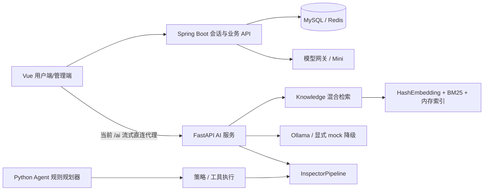

# SmartOpsAgent 全面体检与分阶段优化方案

检查日期：2026-11-03。对象：`D:/SmartOpsAgent` 当前工作区，Git 基线 `48b8af4`。工作区包含大量已有修改，本报告按实际文件与本轮日志判断，不把其他任务的代码归入本轮成果。

## 1. 结论与取舍

项目已经具备较完整的运维平台基础：后端会话与权限控制、模型网关、团队空间、知识管理、哨兵、Agent 与纠察接口均有实现，后端本轮测试 450 项、0 失败。现阶段最需要补齐的是**跨模块契约、执行验证和演示数据就绪**。

推荐沿用当前 Spring Boot + Vue + Python 架构，先做稳定演示，再逐步产品化。现阶段整体重写、全面微服务化、同时引入多个 Agent/RAG 框架，会增加启动、调试和答辩解释成本。

| 路径 | 结果与代价 | 决策 |
|---|---|---|
| 保持架构，修复证据链和主流程 | 保留既有能力；少量改动即可逐项回归 | 本轮及下一阶段采用 |
| 局部引入持久检索、观测、工作流组件 | 可解决重启丢索引、长任务恢复等具体问题；需新增部署与维护 | 主流程稳定后按门槛引入 |
| 全量重构/全面替换 Agent 或 RAG | 接口、迁移、权限、演示脚本均需重新验证 | 当前不采用 |

**当前仍未达到“所有测试通过/完整演示验收完成”。** 本轮已落地一批 AI 故障透明化修复，其余项目按下文明确的优先级执行。

## 2. 检查范围与证据

证据目录：[`health-audit-20261103-223606`](../../.runtime/health-audit-20261103-223606/)。该目录包含原始日志、健康快照、行为复现、源码快照与本批差分。计数反映扫描时文件，不代表接口或业务能力数量。

| 范围 | 本轮检查 | 边界 |
|---|---|---|
| 源码与架构 | 后端主代码、前端、AI、Agent、Knowledge、测试、启动脚本和文档 | 静态审阅与重点路径行为复现，非逐行形式化证明 |
| 后端 | 离线 Maven 完整 test、会话/内部令牌/网关校验路径 | 未以真实用户身份做浏览器全流程 |
| Python | 修复前完整 tests + AI tests，修复后相关回归 | API/E2E 依赖当前本地服务，故障归因与单元测试分开 |
| 前端 | 完整 npm test、类型检查、用户端/管理端构建、SSE 行为测试 | 未完成有登录态的视觉/交互验收 |
| 运行环境 | 本地端口、HTTP 健康、Knowledge 装载对照 | 未重启或替换现有进程；TCP/UP 不代表业务可用 |
| 安全 | 权限边界、爬取地址校验、有限密钥模式扫描 | 未运行在线依赖漏洞数据库扫描；不声称“无漏洞” |
| GitHub | 尝试公共仓库元数据和 README 抓取；生成候选表与重试脚本 | 在线抓取被环境和审批服务阻断，实时许可/活跃度待核验 |

扫描时主要规模：后端主目录 268 文件/220 源码，后端测试 92/89，前端 src 269/263，Agent 217/175，AI 服务 25 个 Python 文件，Knowledge 150/77，docs 161 文件。详见 [inventory.json](../../.runtime/health-audit-20261103-223606/inventory.json)。

## 3. 实测结果

| 核验 | 本轮实际结果 | 原始证据/解释 |
|---|---|---|
| 后端 `mvn ... test` | 450 项，0 失败、0 错误、1 跳过；BUILD SUCCESS | [backend-tests.log](../../.runtime/health-audit-20261103-223606/backend-tests.log)，Java 17、项目内离线 Maven 仓库设置 |
| 修复前 Python 全量 `pytest tests ai-service/app/tests` | 16 失败、125 通过、7 跳过 | [python-full.log](../../.runtime/health-audit-20261103-223606/python-full.log)；失败集中于旧匿名 API 测试与现有鉴权不一致 |
| 修复后 Python 全量，同一命令 | 16 失败、151 通过、7 跳过 | [python-full-after.log](../../.runtime/health-audit-20261103-223606/python-full-after.log)；26 项新增行为回归通过，原有失败未隐藏 |
| 修复前前端完整测试 | 464 项：462 通过、2 失败 | [frontend-tests.log](../../.runtime/health-audit-20261103-223606/frontend-tests.log)；不是旧轮次 458 项 |
| 修复后 AI 完整测试 | 39 通过 | [ai-tests-after.log](../../.runtime/health-audit-20261103-223606/ai-tests-after.log)，含 26 项新行为回归 |
| 修复后纠察/脚本回归 | 42 通过 | [inspector-scripts-after.log](../../.runtime/health-audit-20261103-223606/inspector-scripts-after.log) |
| 修复后前端定向回归 | 23 项通过 | [frontend-resilience-green.log](../../.runtime/health-audit-20261103-223606/frontend-resilience-green.log)，含 7 项新增流式/消息保留回归 |
| 修复后前端完整测试 | 471 项：469 通过、2 失败 | [frontend-tests-after.log](../../.runtime/health-audit-20261103-223606/frontend-tests-after.log)；两项已有失败仍存在 |
| 前端类型检查 | 通过 | [frontend-typecheck-after.log](../../.runtime/health-audit-20261103-223606/frontend-typecheck-after.log) |
| 默认用户端构建 | 失败于清理旧 dist/assets，ENOTEMPTY | [frontend-build.log](../../.runtime/health-audit-20261103-223606/frontend-build.log)；保留旧目录，未强删 |
| 最终用户端独立输出目录构建 | 通过，9.91s | [frontend-build-user-final.log](../../.runtime/health-audit-20261103-223606/frontend-build-user-final.log)，有大于 500kB chunk 警告 |
| 最终管理端独立输出目录构建 | 通过，5.06s | [frontend-build-admin-final.log](../../.runtime/health-audit-20261103-223606/frontend-build-admin-final.log) |
| 有限凭据模式扫描 | 已跟踪文本中 0 条模式命中 | [secret-pattern-scan.json](../../.runtime/health-audit-20261103-223606/secret-pattern-scan.json)，未覆盖全部历史、二进制和运行配置 |

Python 的 16 项失败不可通过取消登录、CSRF 或权限校验解决。正向 CRUD 测试应使用隔离账号和会话；匿名请求则单独验证 401/403。7 项跳过涉及旧端口、Agent 地址、登录凭据、MySQL/Redis Python 驱动等前置条件。

前端两项失败：`heartbeat.test.mjs` 仍引用已经被其他改动删除的 heartbeat.js；导航测试仍预期 3 个哨兵子项，当前有第 4 项 SentinelGuardian。下一批应确认退役功能后同步测试范围，并补充 Guardian 导航行为测试，保留变更意图。

### 运行状态与知识数据

11434、3306、6379、8080、8001、8002、5173 在监听；5174 未监听。8080 actuator、8001 AI、8002 Knowledge、5173 页面均 HTTP 200。

但是，**运行中的 Knowledge chunks=0**。本地参考目录有 61 个 Markdown，同样内容摄入新建内存实例得到 **2,465 chunks**。这说明“服务存活”和“知识已就绪”已经分离；尚未归因到具体进程启动时间、环境或加载版本，不能直接断定代码种子逻辑失效。见 [装载对照](../../.runtime/health-audit-20261103-223606/knowledge-seed-characterization.json)。

### 评测与材料口径

| 评测 | 本次实测 | 正确解释 |
|---|---|---|
| 假成功检测 | n=50，47 可评分、3 未评分；TP=26、TN=21、FP=0、FN=0；F1=1.0 | 同一冻结合成夹具上的回归结果；检测器已有扩展，不是独立泛化验证 |
| 检索 | n=14，Recall@3=.5000，MRR=.4286 | 现有 HashEmbedding/BM25、小种子集、首切片索引；不代表大规模产品性能 |

对应 [假成功 CSV](../../.runtime/health-audit-20261103-223606/eval_false_success.csv)、[检索 CSV](../../.runtime/health-audit-20261103-223606/eval_retrieval.csv)。冻结夹具 SHA256：`28c757cdabcfd24d69e27cb4bc3abdbd185d793ea3d5dbe4340093cacf86d45a`。

此前 F1=.6667、检索 Recall@3=.6429 是更早工作区版本的历史结果。当前不修改评测样本以追分，也不直接把跨版本数字差异视为统计显著变化；后续固定语料、分词/embedding 配置、评测器与代码哈希后再对照。至少建立独立人工审阅集，和开发回归集隔离。

## 4. 当前架构与能力边界



图中是源码可见路径，不表示每条边已通过真实用户全链路测试。尤其 Python Agent、后端业务工作流、Mini 与直连 AI 流式不是同一个已经统一的执行闭环。

| 能力 | 目前可证实 | 后续需要 |
|---|---|---|
| 用户/管理员安全 | 会话、CSRF、账号状态、内部令牌、可信用户上下文、模型网关 Bearer 校验 | 跨服务入口收敛、部署边界验收、限额与留存规则 |
| Agent 规划 | 基础规则规划；重启分支写死 nginx | 显式目标绑定、参数校验、审批与执行目标一致 |
| 四级纠察 | 规则、证据、可插拔 AI Judge、探针验证 | AI Judge 默认空实现需披露；未核验/不确定不可被汇总为执行已成功 |
| RAG | 混合检索、版本过滤、证据输出 | 就绪装载、持久化、租户过滤、删除/更新、分数校准 |
| 对话与图片 | 非流式助手入口、独立 AI 流式；图片当前仅文件名 | provider/history 契约统一；真实图像处理后再展示识别完成 |
| 运维执行 | 多个业务模块具备执行/审批/审计代码 | 固定主流程验收，确认任务状态能跨重启恢复、重复请求不重复执行 |

## 5. 问题清单：按影响与证据排序

P0 表示在相关演示主链路或对外部署前解决；P1 表示近期工程质量；P2 表示数据证明收益后引入。静态风险与实际复现分开标注。

| ID / 优先级 | 发现及影响 | 证据 | 处置与验收 |
|---|---|---|---|
| A01 / P0，已修 | RAG 网络/HTTP 错误原来被吞成空命中，且继承宿主代理；坏 JSON 可能异常 | [rag.py:18](../../ai-service/app/services/rag.py#L18) | 禁用环境代理；区分 ok/empty/unavailable/invalid_response；两种对话模式均返回 RAG 状态 |
| A02 / P0，已修 | 模型实例降级标记残留；真实流中断后追加 mock；空流/缺 done 可假完成 | [llm.py:55](../../ai-service/app/services/llm.py#L55) | 每次调用重置；部分输出后错误不混流；协议结束校验；输出 error 而非 done |
| A03 / P0，已修 | SSE 忽略 error、坏 JSON 和提前 EOF，前端可能显示成功；失败时丢弃部分真实回答 | [stream.ts:79](../../frontend/src/api/stream.ts#L79)、[aiChat.js:304](../../frontend/src/stores/aiChat.js#L304) | 显式拒绝失败流；兼容 LF/CRLF/分包；保留部分回答与错误；增加账号代际检查 |
| A04 / P1，已修 | 固定展示视觉识别/规划/风险判定，与实际动作不符 | [chat.py:192](../../ai-service/app/services/chat.py#L192) | 仅展示附件文件名接收、实际检索摘要与回答步骤；移除人为进度延时 |
| V01 / P0，已复现 | 缺少 probes 或未知结论+502，可汇总为 PASS | [pipeline.py:143](../../agent/inspector/pipeline.py#L143)、[行为复现](../../.runtime/health-audit-20261103-223606/behavior-characterization.json) | 执行验证显式区分 verified/unverified/uncertain；后两者不得触发执行成功或自动关闭告警；单独校验 requires_human |
| G01 / P0，已复现 | “重启 mysql”生成 nginx restart；虽有审批，目标仍错 | [planner.py:47](../../agent/planner/planner.py#L47)、同一行为复现 | 明确允许目标与参数解析；未知目标不执行；审批内容与工具参数同一不可变计划 |
| K01 / P0，实测 | Knowledge 健康 UP 但 chunks=0，演示 RAG 可能全空 | [health/seed 对照](../../.runtime/health-audit-20261103-223606/knowledge-seed-characterization.json) | 启动摘要包含语料版本/文件/chunks；增加 readiness；确认现有进程再切换并核验检索命中 |
| C01 / P0，对外部署前 | AI/Knowledge 自身无鉴权；开发 /ai 直接代理 Python，未经过后端会话链 | [stream.ts](../../frontend/src/api/stream.ts)、AI OpenAPI 快照 | 演示先限定本机；产品统一认证网关、内部令牌、限流和体积限制；验证匿名拒绝与账户隔离 |
| C02 / P0，对外爬取开放前，静态 | 爬取只按主机字符串拒绝部分私网，未解析 DNS/完整 IPv6；响应先完整入内存再截断 | [KnowledgeCrawlService.java:185](../../backend/src/main/java/com/smartops/knowledge/KnowledgeCrawlService.java#L185)、[291](../../backend/src/main/java/com/smartops/knowledge/KnowledgeCrawlService.java#L291) | 校验解析地址和每次重定向，覆盖 IPv4/IPv6/映射地址；连接目标与已校验地址一致；限制字节/时间/页数；本地受控 DNS 和 HTTP 测试 |
| T01 / P0，验收门槛 | Python 16 项失败、前端 2 项失败；旧默认端口导致跳过 | [测试配置:53](../../tests/conftest.py#L53)、原始测试日志 | 正向 API 使用隔离登录/CSRF；反向授权保留；默认 8001/8002；显式报告依赖跳过，不通过清空权限或批量 skip 达标 |
| F01 / P1 | 流式捕获 providerKey 但请求不传选中模型，也不带 history/conversation_id，可能和非流式行为不同 | [aiChat.js:320](../../frontend/src/stores/aiChat.js#L320)、[stream.ts](../../frontend/src/api/stream.ts) | 统一后端助手契约；模型选择、上下文、多轮、账户切换均做真实请求级测试 |
| K02 / P1 | 内存索引，重启需重建；缺少明确租户过滤、删除/更新语义 | [KnowledgeService](../../knowledge/service.py) | 先明确生命周期与授权，再评估本地持久化/Qdrant；用户 A 的搜索不得返回 B 文档，删除后不命中 |
| K03 / P1 | trust_score 用 bool(results) 代替 answer_supported，结果存在不等于回答有证据 | [service.py:199](../../knowledge/service.py#L199) | UI 标注为检索启发分；独立计算回答支撑度和引用覆盖，不包装成准确率/概率 |
| D01 / P1，静态 | createSource 用 SELECT MAX(id) 找新记录，有同用户并发串单风险 | [KnowledgeCrawlService.java:73](../../backend/src/main/java/com/smartops/knowledge/KnowledgeCrawlService.java#L73) | GeneratedKeyHolder/返回生成主键；并发创建返回各自源，失败回滚不污染另一任务 |
| D02 / P1，静态 | 多个 InitializingBean 手动补表/列；hasColumn 缺 TABLE_SCHEMA，跨 schema 可误判 | [AssistantWorkspaceConfig.java:82](../../backend/src/main/java/com/smartops/config/AssistantWorkspaceConfig.java#L82) | 先约束当前 schema；测试空库/已有库/多 schema；数据库备份后再引入 Flyway 基线，禁止重复执行历史补表 |
| O01 / P1 | 同步爬取最多 50 页，单页超时与间隔叠加；中断状态可能仍成功 | [爬取服务](../../backend/src/main/java/com/smartops/knowledge/KnowledgeCrawlService.java) | 异步任务、幂等键、取消/部分成功状态、速率限制；重试不重复入库 |
| O02 / P1 | 未见 .github CI；Python 依赖范围未充分锁定；构建依赖本地离线缓存设置 | 目录与依赖清单扫描 | 先项目内统一检查命令，再 CI；固定版本、缓存来源与制品；在线后补依赖审计/SBOM，不臆测 CVE |
| O03 / P1 | 端口存活与业务就绪混用；旧 dist 清理失败；启动和运行版本不易对应 | 健康与构建日志 | 非破坏启动检查、PID/版本标识、HTTP readiness、独立构建目录后原子切换；失败保留旧制品 |
| U01 / P1/P2 | 页面大、入口密度高，存在多条相似工作台路径；Three chunk 超 500kB | ConnectionsView 1363 行、SentinelService 1257 行；构建警告 | 演示先固定 3 条任务路线；之后按领域抽取组件/服务，懒加载大依赖，按实测首屏/交互收益验收 |
| E01 / P1 | 合成小集、历史指标与当前实现易混用；AI Judge 默认无模型 | [ai_judge.py:32](../../agent/inspector/judges/ai_judge.py#L32)、评测 CSV | 公开能力矩阵与日期；冻结版本、独立人工集；缺失 Judge 标记 skipped，不说已完成模型评判 |

后端安全已有基础不应被误报：Spring 层 internal permitAll 后还有 InternalTokenAuthenticationFilter 校验；`/v1/chat/completions` 在控制器/服务校验 Bearer key；TrustedUserIdFilter 用会话身份替换客户端 X-User-Id。不能只凭 permitAll 就认定这些接口无认证。

## 6. 执行路线与验收门槛

以下为单人有效工作量估算，不含网络恢复、外部材料和长时间人工评审。每批必须独立备份、记录差分、测试、可回滚，不把全部重构放到一次发布。

### 第一批：故障透明化（本轮已落地）

范围 A01—A04：3 个 AI 服务文件、2 个前端源文件、行为回归。无数据库改动、无新依赖。测试与构建结果见第 3 节。**现有在线 AI 进程尚未重启，本轮验证证明当前源码与构建，不宣称在线实例已加载更新。**

### 第二批：答辩稳定版（优先，约 2—4 人日）

执行次序：V01/G01 → K01/O03 → T01/F01 → 演示验收。

1. `agent/inspector/pipeline.py`、StateVerifier 和 `tests/inspector/test_pipeline.py`：补无 probes、未知结论+失败探针、观测过期/目标错配的用例；明确定义未核验状态。已有已验证健康与明确假成功用例保持正确。
2. `agent/planner/planner.py`、策略/执行入口：限定可识别服务；测试 mysql/nginx/未知服务/歧义目标，确保从审批到执行参数一致。业务上不支持的目标回到询问/知识路径，不能默认操作 nginx。
3. `knowledge/server.py`、Windows 启动/状态脚本：先识别当前进程来源，加入索引就绪与语料版本；演示前只读查询验证命中。不将个人库自动混入公共参考语料。
4. `tests/conftest.py` 与 API/E2E 测试：修正端口；隔离库和账号，清理自己创建的数据；覆盖匿名拒绝/登录成功/CSRF/越权。确认 heartbeat 功能退役后同步对应测试，Guardian 菜单与路由一致。
5. `frontend/src/api/stream.ts`、助手网关与 ChatRequest：先统一模型与历史契约，再跑多轮和模型选择验收，避免 UI 选择与实际 provider 不一致。

退出条件：全部自动测试无未解释失败；必需集成项不依赖默认 skip；完成下面 7 条有录像/截图或结构化日志的人工演示，失败分支也可解释。

| 场景 | 必须看到的结果 |
|---|---|
| 登录/普通用户/管理员 | 正确权限；匿名和越权访问被拒绝 |
| 主机/监控 | 数据来源、采集时间明确；缺数据呈 unknown |
| 带知识的问答 | 可点击来源、文档版本、真实检索命中 |
| 模型故障 | 清晰显示降级或中断，保留部分内容，不冒称真实模型成功 |
| 运维操作 | 目标、参数、风险、审批一致；无审批不执行 |
| 假成功/无观测 | 502 拒绝成功；未核验不显示已通过执行验证 |
| 冷启动/恢复 | 服务版本可识别、索引就绪；故障日志和回滚入口可用 |

### 第三批：产品化底座（约 5—10 人日，分模块交付）

- 对外开放前先完成 C01/C02：统一鉴权、内部通信边界、爬取出口/响应限制及配额。测试包含受控域名解析私网、IPv6、重定向、超大正文与超时。
- D01/D02：先修主键与 schema 查询，再备份数据库并演练空库/旧库迁移及回滚；真实库迁移单独执行，不随应用启动盲目补结构。
- K02/K03/E01：文档/分块/索引版本、租户过滤、删除语义、持久化与引用评价；先构建独立评测基线，再比较算法。当前 n=14 的单次提升不作为架构替换依据。
- O01/O02：统一可恢复任务状态与幂等；CI 跑后端、Python、前端测试与双构建；增加依赖审计、制品清单及配置说明。
- 观测：每次请求贯穿 request_id / task_id / run_id；记录 provider、degraded、rag_status、验证状态、耗时与错误类别；禁止把凭据、完整敏感提示和私有文档默认送进日志。

### 第四批：有数据再投入（约 2—4 周，按需选）

评估持久向量库、长任务 checkpoint/人工恢复、告警去重与静默、离线评测平台。每个外部组件先做一个真实缺口的试验，量化启动成本、内存、延迟、维护、许可证与退出成本；验收不过则保留现有实现。界面整理与大文件拆分按真实任务完成率和改动频率决定。

开源候选与具体借鉴点见 [GitHub 开源参考与选型](GitHub开源参考与选型-20261103.md)。

## 7. 备份、变更与回滚

本次实施前生成 [source-snapshot.zip](../../.runtime/health-audit-20261103-223606/source-snapshot.zip)，含当前工作区 1,750 个文件，包括符合范围的已有修改/未跟踪文件。排除运行缓存、构建依赖、非示例 .env 与常见私钥/证书文件；不是数据库、运行配置或 Git 历史的灾备替代。

源码快照 SHA256：`6c00af1445e267f0b6b14acde907ccca50f42eaa2aa8c72b90b139465cb0b029`。

四件交付：

1. 改后文件：[changed-files.zip](../../.runtime/health-audit-20261103-223606/changed-files.zip)。
2. 逐文件对照：[changes.patch](../../.runtime/health-audit-20261103-223606/changes.patch)，以本批备份为前像，包含已有脏文件上的增量；为方便审阅统一差分行尾，ZIP/哈希保留精确字节。
3. 验证记录：[verification.json](../../.runtime/health-audit-20261103-223606/verification.json) 与本报告/原始日志。
4. 回滚工具：[change_bundle.py](../../.runtime/health-audit-20261103-223606/change_bundle.py)，默认只显示清单；`rollback` 先核对全部后像哈希，有后续修改则停止，避免覆盖其他工作。

```powershell
# 从 D:/SmartOpsAgent 执行；仅在确需撤销本批时使用
python .runtime/health-audit-20261103-223606/change_bundle.py rollback
```

已在临时项目副本演练 13 个清单文件的回滚，逐字节恢复前像；另一次故意制造后续修改，工具在任何写入前停止。源码包和改后包完整性、当前后像哈希均通过，见 [bundle-validation.json](../../.runtime/health-audit-20261103-223606/bundle-validation.json)。未在实际工作区执行回滚。全仓源码包用于人工恢复参考；自动回滚仅针对清单中的本批文件。

独立只读审阅发现 2 项响应边界问题（非有限 citation/evidence 分数、非布尔 done），均补充失败回归后修复并经复核闭合；26 项韧性回归通过，见 [审阅记录](../../.runtime/health-audit-20261103-223606/code-review.json)。

## 8. 未完成项与环境阻塞

GitHub 在线抓取在工具执行前被自动审批服务的模型配置故障阻断：审批请求 `gpt-5.6-luna`，当前账号组不支持该模型，返回 404。此前普通网络读取也遭到 WinError 10013。此次没有下载候选仓库，未核验其当前许可证、更新、stars 或漏洞；没有绕过审批或修改全局控制。

本地已生成标准库采集脚本并验证 `--help`，待网络与审批恢复后执行；候选表当前是工程方向建议，不是“已抓取并验证”的结论。审批修复准备工作仍见 [既有诊断](../../.runtime/defense-v2/审批故障诊断与修复.md)，本轮没有宣称全局修复成功。

此外，真实登录浏览器流程、在线依赖审计、运行进程切换、数据库备份/迁移、独立人工评测与材料逐项匿名审核均不计为本轮已完成。
