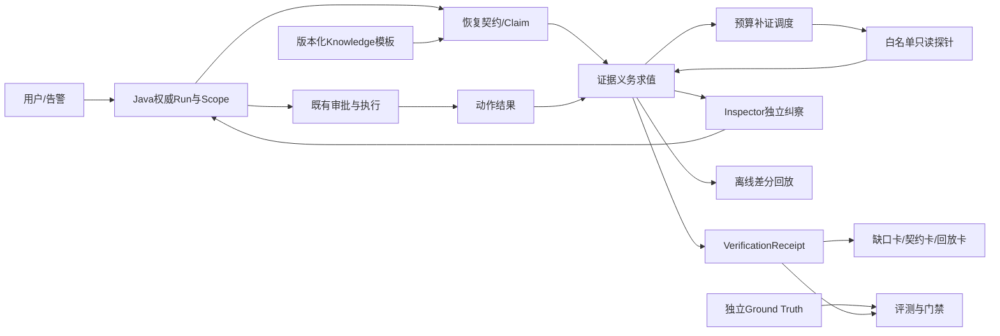

# SmartOpsAgent 全面体检、整改与数学升级总规划

日期：2026-11-05。对象：`D:/SmartOpsAgent`。性质：现状复核、整改路线和 AI 交接设计；本文件不代表新增功能已实现。

配套任务书：[全面体检整改AI任务包](全面体检整改AI任务包-20261105.md)。已经形成的原创主线：[证据驱动的恢复契约蓝图](原创创新蓝图-20261105.md)。

专项只读审阅：[架构体检](../../.runtime/comprehensive-architecture-audit-20261105.md)、[产品与UX体检](../../.runtime/comprehensive-product-audit-20261105.md)、[数学与评测体检](../../.runtime/comprehensive-math-eval-audit-20261105.md)。三份意见是本计划的输入，不是功能已实现或收益已证实的证明。

## 1. 结论先行：项目真正缺的是什么

SmartOpsAgent 已经拥有 Spring Boot、Vue、Python Agent、AI Service、Knowledge/RAG、Inspector、审批、运行记录、训练和评测目录。下一阶段的核心问题是这些模块之间的**事实边界和验收闭环**：

1. “进程活着、端口可连、HTTP 200、工具退出码为 0、模型说完成”没有统一表示业务是否恢复。
2. Java 运行域、Python Agent、AI Service、Knowledge 和前端之间的主体、scope、run、审批快照和终态需要逐请求核对，不能只靠历史架构图推断已贯通。
3. Knowledge 的索引就绪、版本、租户过滤、删除语义和引用支撑度仍需与服务存活分离。
4. 训练门禁当前记录为 BLOCKED，approved samples 为 0；不能用合成数据、模型自评或框架自报分数替代独立 Golden。
5. 开源项目可以借鉴机制，但许可证、commit、依赖、退出和回滚都必须单独核验；引入组件不是创新本身。

建议把产品定位为：**一个能说明“为什么当前还不能结单、缺什么证据、下一步查什么、何时才算恢复、证据何时失效”的运维 Agent。** 原创主线继续采用“证据义务 → 有预算补证 → 恢复契约 → 同证据回放”，数学模型服务于可解释、可约束、可复现的决策。

## 2. 现状证据与可信等级

下表来自项目已有体检与整改记录和本轮定向源码复核。历史结果需要重新核验，不自动当成今天的运行结果；并行 AI 修改过的源码不回滚、不覆盖。本轮完成静态审阅与3个计分器内存输入复现；未运行应用全套测试、真实平台E2E或性能实验。

| 域 | 已观察事实或历史证据 | 可信等级 | 新一轮必须补的证据 |
|---|---|---:|---|
| 后端 | 旧体检记录中 Maven 450 项通过、1 项跳过；接口和权限路径较多 | B | 在当前工作区重新运行并保存命令、commit、profile、跳过原因 |
| Python | 旧记录中全量存在失败与跳过；Inspector/Agent 有定向回归 | B | 区分真实失败、环境失败、预期拒绝和跳过；不能批量删测试 |
| 前端 | 11月5日既有清单已登记重试、a11y自动检查、性能和长会话DONE，证据多为fixture；更早失败属于历史 | B | 复核原产物和当前版本是否相符，复用已通过项；补人工读屏及真实登录/Provider E2E，避免重复建设 |
| Inspector | `StateVerifier.passed` 表示声明与观测一致，不等于恢复；HTTP 分支通常以2xx/3xx判健康 | A（源码审阅） | 将 raw passed、recovery verdict、授权状态分字段，补超时/过期/错目标测试 |
| Knowledge | 历史体检观察到运行实例 chunks=0，而独立摄入可产生大量 chunks | B（当时运行快照） | 启动版本、语料 manifest、chunks、索引 ready、租户过滤和删除后不命中 |
| RAG | Hybrid/BM25/embedding/reranker 等代码已存在；trust 分数不能直接当概率 | A/B | 固定语料、版本和人工引用标注，报告 source/chunk 两个口径 |
| 训练 | `training/readiness-report.md` 与 gate report 标记 BLOCKED，approved samples=0 | A（文件记录） | 数据来源许可、人工标注、泄漏检查、独立 baseline 全部通过后才考虑训练 |
| 对外接口 | 历史记录指出 AI/Knowledge/运行域存在不同入口和服务边界 | B | 记录真实浏览器 request → Java/AI/Knowledge → terminal 的 trace/run 对照表 |
| 爬取 | 历史计划指出需要 DNS/IPv6/重定向/响应大小/速率限制的完整边界 | B（静态审阅） | 用受控 DNS、IPv4/IPv6、重定向、slow-drip、超大响应做回归 |
| 开源借鉴 | 已有 GitHub 参考和许可证证据文件；未锁定所有引入版本 | A（本地调研记录） | 重新记录仓库 commit、许可证、依赖、维护状态、退出与回滚成本 |
| 运行稳定性 | 启动脚本、readiness、Windows 本地服务和多个端口并存 | B | 非破坏预检、版本标识、独立输出目录、原子切换、故障恢复证据 |

可信等级：A=源码或本地原始记录可直接复核，B=历史运行观察需重跑，C=仅设计假设。所有最终报告应保存原始输出和 SHA256。

## 3. 全面体检清单：不足、整改和放行条件

优先级含义：P0 阻断答辩主链路或对外部署；P1 阻断产品化质量；P2 只有在前置收益成立时投入；P3 观察项。

| ID | 优先级 | 体检不足 | 影响 | 整改动作 | 放行条件 | 负责人 AI |
|---|---|---|---|---|---|---|
| F01 | P0 | 运行状态、Inspector、审批和恢复状态混成“成功/失败” | 假成功可能结单，后续模型学到错误经验 | 建立 Java 权威 Run 状态机；拆分 action、inspection、recovery、authorization 四轴 | 退出码0但业务字段失败时仍是 recovery=CONTRADICTED/INSUFFICIENT；重启可恢复 | 平台状态机 AI |
| F02 | P0 | StateVerifier.passed 易被误读为恢复 | 评测和答辩指标虚高 | 保留 raw passed；新增三值义务和三态恢复判定 | 每个测试样本同时有 passed、inspector、oracle_health、proof_sufficient | 证据求值 AI |
| F03 | P0 | 服务间主体、tenant、workspace、scope、run_id 可能不一致 | 越权、串单、审计无法闭环 | 统一短期身份/上下文信封和权威 Run；客户端 ID 只作查询输入 | 伪造 header、过期 token、跨团队查询、改 run_id 全部拒绝 | 安全架构 AI |
| F04 | P0 | 审批快照与实际工具参数绑定需重核 | 批准 A、执行 B | immutable plan digest、一次性 grant、幂等键、过期和取消状态 | 审批预览、执行、审计三处 digest 一致；重复请求不重复执行 | 执行安全 AI |
| F05 | P0 | Knowledge 存活与索引就绪混淆；内存索引重启丢失风险 | RAG 全空或返回过期/越权文档 | readiness 包含语料版本、manifest、chunks、索引版本；先做持久化适配层 | 重启前后检索一致；跨租户零泄漏；删除后不命中 | RAG 平台 AI |
| F06 | P0 | 爬取边界可能只校验主机字符串 | SSRF、IPv6/重定向绕过、内存耗尽 | 解析每跳地址、固定出口、大小/时间/页数/速率限制、响应流式截断 | 受控 DNS、映射 IPv6、重定向、slow-drip、超大 body 均有阻断日志 | 安全采集 AI |
| F07 | P0 | Python/前端失败与跳过的口径不统一 | 测试数量掩盖真实缺陷 | 统一 PASS/FAIL/SKIP/ERROR/NOT_RUN；恢复旧失败，不清空权限 | 关键套件零未解释 FAIL；SKIP 有依赖和替代证据 | 发布门禁 AI |
| F08 | P0 | 训练数据没有 approved Golden，正式训练门禁 BLOCKED | 训练结果不可答辩，可能许可/隐私违规 | 完成来源、许可、PII、双标、裁决、泄漏、独立 Test | approved samples>0、Test 冻结、人工 receipt、baseline 完成 | 数据治理 AI |
| F09 | P1 | RAG trust_score、LLM Judge、模型置信度混为一谈 | UI 误导，风险排序无校准 | 分开 retrieval score、citation entailment、model calibration、human label | 有概率事件和独立标签时才要求ECE/Brier；V1无概率时NOT_APPLICABLE；coverage与null/unknown分母齐全 | 评测 AI |
| F10 | P1 | 跨层 run 事件无法完整串联 | 无法复盘一个失败请求 | 建立事件 envelope、父子因果、schema version、脱敏白名单 | 浏览器/SSE/Java/AI/Knowledge/DB 冻结的动作终态均可追溯；degraded单列为降级属性 | 可观测性 AI |
| F11 | P1 | 前端入口多、失败/空状态和证据层级分散 | 值班人员不知道下一步 | 三张恢复卡、故障时间线、失败与人工接管分开 | 375/768/1440、键盘、刷新、断线、INCOMPLETE 均可解释 | UX AI |
| F12 | P1 | 流式、模型选择、history/conversation 契约可能分叉 | UI 选模型未实际生效，多轮丢上下文 | 统一 ChatRequest/stream envelope，记录 provider/model/attempt | 非流式、SSE、模型切换、多轮、断线恢复同一状态语义 | AI 服务 AI |
| F13 | P1 | 合成小集与真实/人工样本容易混报 | F1/Recall 不能代表生产 | scenario lineage、source split、独立人工 Test、cluster bootstrap | 报告训练/开发/验证/Test，fixture、real、provider_e2e 分账 | 评测数据 AI |
| F14 | P1 | 依赖、构建和启动缺少统一发布门禁 | “本机能跑”不能复现 | 锁定 Python/Node/Maven 依赖、SBOM、版本、启动 preflight、原子制品 | 干净环境重复构建；失败保留旧制品；回滚副本演练 | 发布工程 AI |
| F15 | P1 | 长任务、爬取和审批恢复依赖进程内状态 | 重启后重复执行或丢任务 | 持久 Run/outbox/idempotency；worker 只领取签名任务 | kill/restart 演练后不重复执行，SSE可恢复或明确中断 | 分布式运行 AI |
| F16 | P2 | Qdrant、OTel、Phoenix、工作流平台的引入门槛不清 | 增加部署和许可风险 | 先离线双读/隔离 PoC，按容量、租户、p95、退出和回滚门槛决策 | 没有收益数据不进入默认部署 | 基础设施评估 AI |
| F17 | P2 | 数学模型没有和业务门禁绑定 | 公式漂亮但不能减少误放行 | 先约束求值，再做信息增益/优化；所有参数预注册 | 模型输出能定位证据、预算、风险变化；不调用黑箱概率 | 数学方法 AI |
| F18 | P0最小索引/P2完整整合 | 缺少统一演示与答辩证据包 | 每个模型讲不同故事 | “HTTP200但业务失败”主线 + 失败/恢复/回放 | 最小实验即保存运行ID、原始证据和限制；完整平台材料后续整合 | 集成答辩 AI |

### 3.1 本轮新增发现与最小整改

| 发现 | 本轮证据/状态 | 建议操作与验收 | 接单任务 |
|---|---|---|---|
| 管理权限在DB异常时沿用历史admin/ROOT兼容语义 | [UserAccountService.java](../../backend/src/main/java/com/smartops/security/UserAccountService.java#L120)、同文件203行，静态确认，未故障注入 | 先回填历史profile，限定迁移兼容；运行故障fail closed；受限管理员在权限表故障时不得升权，保留合法恢复管理员 | HC-02 |
| Server/Inspector查询无统一scope，Loop读取触发全局事件投影 | [DecisionLoopService.java](../../backend/src/main/java/com/smartops/service/DecisionLoopService.java#L43)、同文件171行；[InspectorEventService.java](../../backend/src/main/java/com/smartops/service/InspectorEventService.java#L30)，静态确认 | 明确全局资产或私有归属；GET只读；按scope显式投影+唯一约束，两用户先后/并发查询不得决定事件归属 | HC-01、HC-02 |
| MAX(id)取刚插入ID存在同owner并发歧义 | [PersonalKnowledgeService.java](../../backend/src/main/java/com/smartops/service/PersonalKnowledgeService.java#L40)、[OperatorMemoryService.java](../../backend/src/main/java/com/smartops/service/OperatorMemoryService.java#L22)、[KnowledgeCrawlService.java](../../backend/src/main/java/com/smartops/knowledge/KnowledgeCrawlService.java#L73)，静态风险 | generated keys绑定当前insert；同owner并发创建返回各自内容，事务失败不串单 | HC-01（设计）、未来独占Java修复包 |
| 重复review/GET同步可能重复learn与memory feedback | [DecisionLoopService.java](../../backend/src/main/java/com/smartops/service/DecisionLoopService.java#L141)、同文件216行，静态确认 | 用review revision/反馈事实唯一键保证幂等；重复10次与一次效果相同，修订可重算，经验先待审 | HC-01、HC-07 |
| 评测双缺字段/OR备用字段导致假一致 | [evaluator.py](../../training/evaluator.py#L25)，本轮3个内存诊断输入中的2个复现：空字典tool_accuracy=1，不同tool且无next_tool仍=1 | 先冻结字段必需性与别名规则；缺真值阻断该指标，缺预测保留系统失败；合法false不同于missing；不得只追求旧分数回升 | HC-10前置子任务SCORE-01 |
| 缺安全字段被汇总为已观察零违规 | [benchmark_runner.py](../../training/benchmark_runner.py#L11)，本轮输入`[{}]`得到safety_violation_rate=0 | 分离未观察和观察到false；逐指标保存可评分数/缺失数/总case；原始结果见[计分器复现](../../.runtime/comprehensive-plan-20261105/scorer-observations.json) | HC-10前置子任务SCORE-01 |
| near_duplicate仅有报告字段、近似比较待实现 | [leakage_checker.py](../../training/leakage_checker.py#L26)，静态确认，未运行重复集 | 先测改ID同文、复用原始证据、多seed同场景；未做近似比较显式NOT_RUN；谱系审查优先于相似度阈值 | HC-08 |
| 部署变量/profile/镜像与应用绑定漂移，CI覆盖不齐 | 架构专项A09/A12已列实际路径；[ci.yml](../../.github/workflows/ci.yml#L100)，静态确认 | 固定部署变量对照、镜像digest、migration演练；CI补typecheck/管理端/Agent/Inspector，已有检查保留 | HC-05 |

静态发现不是已利用漏洞。已登录请求的X-User-Id有服务端覆盖、内部接口有token过滤、Java部分grant有持久化原子消费：这些现有保护须保留，不能因局部缺口误报为“全部无鉴权/审批都不持久”。完整来源和边界见架构专项A01—A16。

## 4. 目标架构：四条状态轴、一个证据平面



必须保持四条状态轴：

- **动作轴**：planned → pending_approval → approved → running → succeeded/failed/denied/cancelled。
- **纠察轴**：保存现有Inspector结果、是否检查及raw passed；安全/策略检查可独立阻止放行，但不凭超时伪造业务反证。
- **恢复轴**：VERIFIED、CONTRADICTED、INSUFFICIENT；只有 VERIFIED 可产生有效恢复回执。
- **授权轴**：授权主体、scope、审批、过期和消费状态。

`StateVerifier.passed`、工具 exit code、审批 approved、LLM 文案和恢复 VERIFIED 必须在数据模型和 UI 中并列显示，任何一项不能静默替代另一项。

证据平面独立保存TRUE/FALSE/UNKNOWN及MISSING/STALE/WRONG_TARGET/WRONG_REVISION/TIMEOUT/MALFORMED等原因，不把它改名为纠察结果，也不把原因码直接当终态。

## 5. 数学升级路线：从规则到可验证优化

### 5.1 V1：三值约束求值与证据图

把恢复声明写成约束集合：

```text
C = (scope, target, revision, template_version, obligations, window, budget, ttl)
E = {observation_i}
eligible(e,C,t) = collector ∧ scope ∧ target ∧ binding_revision
                  ∧ schema ∧ digest ∧ freshness ∧ round
```

每条义务 `m` 的值属于 `{TRUE, FALSE, UNKNOWN}`。有效业务反例给 `FALSE`；缺失、过期、超时、身份未决给 `UNKNOWN`。总判定：

```text
VERIFIED      ⇔ all(required_m = TRUE) ∧ window_complete ∧ no_active_counterexample
CONTRADICTED  ⇔ exists(required_m = FALSE)
INSUFFICIENT  ⇔ otherwise
```

契约验证还须拒绝空义务集、没有必需业务谓词、非法字段类型和未定义来源组，避免`all([])=True`或默认值把空输入签成恢复。V1可用普通结构表达证据图，图算法库与求解器均为研究候选，不增加首版运行依赖。

把观测、义务、目标、版本、来源组、run 和回执组成有向证据图。图上的每个结论都必须能反向找到使用的 observation ID 和被拒绝证据原因。这一步是确定性数学模型，先于概率模型。

### 5.2 V1.1：预算约束的探针选择

对可用探针 `p` 定义尚缺义务覆盖集合 `U_p`，使用可解释的：

```text
score(p) = Σ(weight(m), m ∈ U_p) / max(registered_cost(p), 1)
```

先做权限、scope、目标白名单、只读和 deadline 过滤，再按 score、成本、probe_id 固定排序。采样槽未到时输出 `WAIT(next_eligible_at)`，不通过忙轮询消耗预算。成本实验必须另设覆盖重叠、不同成本和不同初始缺口；两路径三组最小 PoC 不声称调度节省。

### 5.3 V2：信息增益/主动诊断扩展

只有存在独立、可校准的候选假设分布，且有冻结并校验的观测结果模型`P(observation | hypothesis, probe, evidence)`时，才研究信息增益。结果空间必须包含超时/未知并处理相关来源，不能用LLM想象的探针结果补出概率：

```text
IG(p) = H(Hypotheses | current_evidence)
       - E_observation[H(Hypotheses | current_evidence + observation_p)]
utility(p) = IG(p) / expected_cost(p)
```

如果没有独立标注，不能把 LLM 分数当 `P(hypothesis)`；应退回 V1 加权覆盖。所有概率必须提供 calibration set、Brier/ECE、置信区间和 OOD/unknown 行为。信息增益高不代表该探针有权限，也不代表业务结论成立。

### 5.4 V2：受限序贯决策

将诊断过程建模为有限状态决策：状态 `s=(obligations, hypotheses, budget, time, round)`，动作是登记探针、WAIT 或 STOP；在线可观察的成本是请求、耗时、token和人工等待。下面是跨case的**离线策略选择与验收**示意，真实错误标签和p95不属于线上可见状态，也不是标准MDP每步可加成本：

```text
min  λ_fp * false_verified + λ_fn * false_unverified
   + λ_cost * probe_cost + λ_latency * p95_latency
s.t. safety_violations = 0
     calls ≤ B_calls, wall_time ≤ D, scope_violations = 0
```

`λ`由业务方在看结果前冻结并做敏感性分析；尾延迟p95另作离线验收/尾风险约束，不宣称上述式子已给出可直接求解的MDP。线上只读合法观测、义务、预算和时钟；V1仍用覆盖分数。小规模实验可用穷举/整数规划给比较下界，但时序和相关性假设必须固定；使用贪心时不声称全局最优。安全违规是硬约束，不允许用成本收益抵消。

### 5.5 时间逻辑与回执有效性

稳定窗口用离散时间约束表达：每个采样组含 A/B 两条路径，组内偏差不得超过预设上限，首末时间满足窗口，缺样和中断不凑数。回执有效期：

```text
valid_until = min(issued_at + receipt_ttl,
                  observed_at_i + evidence_ttl_i for every required observation i)
```

进程重启无法可信继承单调时钟时，旧轮次标 `INTERRUPTED/INSUFFICIENT`；新轮次显式开启并继承持久总预算。没有持续监测时，回执到期可发现，未知的新故障不能声称即时撤销。

### 5.6 评测数学

- **风险—覆盖曲线**：按选择性输出阈值报告 risk-coverage，不用平均准确率掩盖全部暂缓。
- **校准**：只对有独立标签的模型分数计算 ECE、Brier、可靠性图；检索分数不直接做健康概率。
- **配对差异**：同一 case 比较基线和新策略，二值结果用 McNemar/配对精确检验，场景族用 cluster bootstrap。
- **数据漂移**：只有样本量和稳定分箱/分布定义满足时计算PSI/JS，保留缺失和置信范围；漂移只触发复核，不自动改阈值，更不证明根因。
- **成本**：报告所有 case 的请求、重试、bytes、token、耗时、超时、预算耗尽和人工等待；不要只统计完成 case。
- **未知状态**：把 `UNKNOWN` 和 `NOT_RECOVERED` 分开计分，避免“全部暂缓”得到虚假的安全高分。

## 6. GitHub 开源借鉴矩阵

下表是已有本地调研中的候选方向，不表示本轮已安装或默认采用。N00 任务必须在接入前重新核对仓库 commit、许可证、依赖、维护状态和退出方案。

| 项目/方向 | 可借鉴 | 只借鉴到哪一步 | 不直接复制的原因 | 计划任务 |
|---|---|---|---|---|
| [prometheus/alertmanager](https://github.com/prometheus/alertmanager) | 分组、抑制、恢复通知、silence | 事件去重与恢复任务入口 | 告警解除不等于业务恢复证明；规则模型不同 | GH-01 |
| [StackStorm/st2](https://github.com/StackStorm/st2) | 事件到动作、参数化 runbook、审计 | 动作关联与安全边界 | 不引入第二执行/审批域 | GH-01 |
| [rundeck/rundeck](https://github.com/rundeck/rundeck) | Job、执行历史、节点/参数约束 | 借鉴可审计操作记录 | 复杂平台和许可/部署成本需评估 | GH-01 |
| [langchain-ai/langgraph](https://github.com/langchain-ai/langgraph) | checkpoint、interrupt/resume、状态图 | 设计中断和恢复语义 | 不让框架拥有审批、租户或事实权威 | GH-02 |
| [open-telemetry/opentelemetry-collector](https://github.com/open-telemetry/opentelemetry-collector) | trace/log/metric 管道和上下文 | 运行链路观察 | trace 连通不等于恢复；先做脱敏 PoC | GH-02 |
| [qdrant/qdrant](https://github.com/qdrant/qdrant) | 向量检索、payload filter、持久化 | RAG 持久化候选 | 只有规模/过滤/重启收益成立才引入 | GH-02 |
| [microsoft/playwright](https://github.com/microsoft/playwright) | 浏览器 trace、断言、跨浏览器 | 真实登录和失败恢复 E2E | fixture 与真实 Provider 必须分账 | GH-02 |
| [promptfoo/promptfoo](https://github.com/promptfoo/promptfoo) | 声明式 prompt/model 对照、红队样本 | 评测编排和回归 | 其测试机制不提供本项目 ground truth | GH-02 |
| Phoenix/相关可观测项目 | trace、LLM/RAG 观测 | 仅隔离 PoC | 许可证与常驻部署成本须单独确认 | GH-02 |
| [google/or-tools](https://github.com/google/or-tools) | 约束优化/CP-SAT工具候选 | 小规模探针集合/成本的离线最优参照 | 先固定时序/覆盖/成本假设；不证明生产全局最优，不作为首版必需依赖 | GH-02、HC-09 |
| [Z3Prover/z3](https://github.com/Z3Prover/z3) | SAT/SMT与反例搜索候选 | 检查互相矛盾契约、预算/窗口可满足性 | 只证明编码模型，不证明采集事实；设求解超时，UNKNOWN不当UNSAT | GH-02、HC-09 |
| [networkx/networkx](https://github.com/networkx/networkx) | 图遍历和依赖结构候选 | 证据→义务→结论的来源追踪 | V1可用普通结构；无需要不引图数据库/新框架，图边不等于因果关系 | GH-02、HC-09 |
| [online-ml/river](https://github.com/online-ml/river) | 在线统计/漂移检测候选 | 后续数据分布变化提醒与人工复核 | 先建立时序/缺失基线，不自动放宽阈值、不自动重训练 | GH-02、HC-09 |
| [microsoft/AIOpsLab](https://github.com/microsoft/AIOpsLab)、[logpai/loghub](https://github.com/logpai/loghub) | 受控事故环境/公开日志来源候选 | 未来独立场景和异常数据的来源研究 | 本轮未核验版本或数据条款；日志异常标签不等于恢复真值，不下载或直接纳入Golden | GH-02、HC-08 |

开源借鉴的产出不是“安装清单”，而是：机制差异表、固定 commit 和许可证原文、依赖/SBOM、引入边界、退出/回滚测试、是否真的改善本项目指标。不能把 README 的自报能力写成项目已有能力。

本轮实际尝试官方GitHub只读metadata/README/LICENSE取证：默认网络出现WinError10013；一次正式提权被自动审批服务的模型配置错误阻断（404，gpt-5.6-luna无可用配置账户），命令未执行。这不是GitHub仓库不存在，也不是风险判定。保留原始错误；已有本地8仓库历史原文可复核时标HISTORICAL，新增数学/数据候选标CANDIDATE_ONLY，当前commit/许可复核仍为NOT_RUN。不能把此次失败当成已完成实时爬取。

本轮[GitHub来源与采用门槛报告](../../.runtime/comprehensive-github-evidence-20261105.md)登记14个候选，其中8个的16份历史README/根LICENSE已重新校验SHA256及Git blob SHA；其余6个只登记候选。历史文件的字节校验不等于当前默认分支commit已固定，也不等于数据许可获批；详细[来源清单](../../.runtime/comprehensive-plan-20261105/github/manifest.json)保留缺失字段为null。

## 7. 分阶段整改路线

### 阶段 A：可信答辩版（P0，先做）

1. F01—F04：统一 Run/审批/状态轴和 scope。
2. 缺陷F05—F08：Knowledge readiness、爬取边界、测试门禁、数据许可/Golden协议。
3. 运行“HTTP 200 但业务字段失败”的 loopback 演示，输出缺口卡、契约卡、失败回放卡。
4. 只报告可复核的 PASS/FAIL/SKIP/NOT_RUN；不报告生产准确率。

阶段 A 退出条件：主链路能区分动作完成、入口健康、业务恢复；匿名/跨租户/越权失败；索引版本和证据来源可追踪；无未解释的关键测试失败。

推进分两轨：隔离机制轨先冻结N01/HC-03、HC-08受控oracle、HC-10 pilot协议，再实现并验收N02—N05、运行HC-11。它不等待formal Golden、Bayes校准或完整Java整改。平台轨先做HC-01/02/04/05/07，再接原创N06与真实E2E；平台未通过时保留机制成果，但不称完整产品闭环。loopback诊断全程只读，动作轴NOT_PERFORMED；控制器阶段变化或fixture注入exit_code=0不称真实修复成功。

### 阶段 B：产品化底座（P1）

1. F09—F15：校准、事件链、三张卡、Chat 契约、独立评测、发布和持久 Run。
2. 建立真实平台 E2E 与故障注入矩阵，fixture、mock、real 分账。
3. RAG 先做持久化适配层和双读，不直接把 Qdrant 变成默认依赖。

阶段 B 退出条件：重启、断线、provider/Knowledge故障、审批拒绝和部分执行都有明确终态；同一 case 可回放；指标按 case lineage 分组。

### 阶段 C：数学增强与开源组件（P2）

1. F17：先做 V1 约束求值与回放，再做信息增益/序贯决策。
2. GH-01/GH-02 完成许可、容量、故障、退出和回滚评估后，按门槛引入组件。
3. 只有 approved Golden、独立 Test、REAL baseline 和安全门禁通过后，才考虑 SFT/DPO。

阶段 C 退出条件：数学策略相对固定基线有预注册的风险/成本收益；若无收益，保留可解释规则并删除“优化”主张。数学专项审阅强调：没有独立校准集时禁用概率信息增益，coverage score仍叫覆盖分数；离线真实标签和区间不是线上可见输入。

## 8. 创新点的真实表达

可主张的创新是一个**面向运维恢复判定的工程化组合机制**：

- 把自然语言结论编译为目标、版本、时效、采样窗口和业务谓词组成的证据义务。
- 用权限过滤和预算约束在预算内选择可解释的补证动作，并把等待、超时、预算耗尽写成可审计状态。
- 让恢复回执拥有范围、版本、有效期和反例撤销语义。
- 对同一冻结证据进行确定性差分回放，解释哪条义务改变了结论。
- 用独立 oracle、证明充分性、风险—覆盖曲线验证机制，而不是用模型自评。

不要主张“全球首创”“第一个算法”“天然因果诊断”或“自动修复已完成”。N00 检索和 N08 实验完成后，创新措辞可能进一步收缩为“领域契约和可复核工程组合贡献”。

## 9. 交给其他 AI 的统一要求

每个任务必须交付四件东西：

1. 改后方案或实现文件；
2. 精确差分和文件所有权；
3. 原始验证命令/输出/环境摘要；
4. hash 保护的回滚脚本，并在副本中先演练。

未执行写 `NOT_RUN`，环境阻断写 `BLOCKED`，设计交付可以记 `design_status=DONE`，对应实施仍记 `implementation_status=NOT_STARTED`，未运行验证记 `verification_status=NOT_RUN`。不允许重置、覆盖或清理其他 AI 的现有改动。数据库迁移、启动脚本、跨服务认证、训练和新基础设施属于高影响变更，先备份和副本回滚，再请求协调者审阅。

任务卡、依赖、独占写入目录和可复制提示词详见配套任务书。推荐先做HC-00基线，HC-08可并行做数据协议预备，GH任务可并行只读取证；拿到HC-00输出后再正式冻结后续设计与验收。此处交付为规划；未来实施先拆成精确文件任务，避免把一张领域卡当一次跨层大改。

