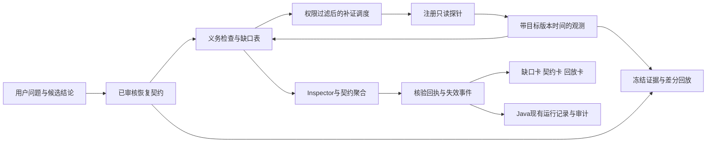

# 智维Agent 原创创新蓝图：证据驱动的恢复契约

日期：2026-11-05。阶段：设计完成后交接实现，当前没有新增业务实现或实测收益。配套：[AI实施任务包](原创创新AI任务包-20261105.md)。

## 1. 要做出自己的什么能力

建议把核心特色集中为：**AI 给出运维判断时，系统列出证明该判断还缺哪些证据，选择成本合适的补证动作，最后按事先约定的业务恢复判据给出可复核结论。**

产品名称建议“恢复证明工作台”。技术主线为“证据义务 → 补证调度 → 恢复契约 → 决策回放”。这里的“证明”指指定目标、版本、观测时间和测试范围内的可审计记录，不表示数学证明、持续健康保证或故障因果证明。

最小版本聚焦一个具体问题：**HTTP 返回200、进程启动成功或工具退出码为0，均可能与业务实际恢复不一致。系统怎样及时发现缺口，又避免无休止检查？**

这一主线延伸已有 Inspector、StateVerifier、审批、run_event 和知识库，形成项目自己的领域契约和决策策略。采用哪些模型、向量库和编排组件是实现选择，研究贡献要落实到可复核规则、数据结构和对照实验。

## 2. 已有基础与拟新增的实质

| 内容 | 当前已具备的基础 | 本次要新增 | 创新主张边界 |
|---|---|---|---|
| 判断与核验 | Inspector 多级检查；StateVerifier 校验给定 probes 与声明是否一致 | 由业务结论反向生成必需证据、时效/目标/版本要求及缺口清单 | 单纯“探针验证AI回答”已存在，不能再作为本轮新增 |
| 取证 | HTTP、端口、进程等探针 | 在允许的探针中选择下一项补证、解释选择原因、预算耗尽时暂缓 | 不是凭LLM自行决定访问任意目标，也不声称全局最优 |
| 恢复结论 | HTTP状态、显式健康字段、可选版本匹配 | 事前冻结的业务谓词、采样窗口、独立观测路径、结论有效期和失效条件 | 200或passed=true不等于业务恢复 |
| 复盘 | run_event、审计、DecisionLoop、经验记忆 | 同份证据与契约的确定性重放，逐条显示策略差异及新增规则的影响 | 重放不能预测实际修复效果；不称运维数字孪生 |
| 前端 | 引用、降级、失败、运行ID诊断 | 缺口卡、契约卡、反例回放卡；用户知道为什么暂缓及接下来查什么 | SSE阶段展示、运行ID展示本身属于既有工程能力 |

本轮源码核对点：

- [StateVerifier](../../agent/inspector/verifiers/state_verifier.py)：已有结论分类与探针汇总；HTTP分支通常以2xx/3xx判健康，可选版本检查由输入字段触发。新契约应独立定义业务谓词、时效和采样窗口。
- [EvidenceJudge](../../agent/inspector/judges/evidence_judge.py)：现有文本词元重叠、条数与版本检查，不等于结论所需的完整证据义务。
- [DecisionLoopService](../../backend/src/main/java/com/smartops/service/DecisionLoopService.java)：已有分析、记忆、决策、复盘和经验回写；本轮应补充观测绑定，复用该闭环。
- [前端聊天store](../../frontend/src/stores/aiChat.js)同时保留普通聊天调用与SSE调用路径。真实接入点要沿当前UI逐请求核对，不预设所有请求都经过Java或Python；旧架构建议里的“默认入口”不能代替新鲜调用证据。

这些是2026-11-05的源码审阅结论，后续AI接单须重核文件状态。安全/租户/持久Run建设沿用[既有优化任务清单](后续优化任务清单-多模型协同-20261105.md)，不把基础补齐重新包装为原创算法。

## 3. 创新机制一：结论生成证据义务，缺口驱动下一步

### 3.1 三类对象

**结论 Claim**：例如“服务A在版本r17下完成业务恢复”。它必须指定主体可见范围、目标、期望版本、判定问题和契约版本。自然语言只生成候选Claim，可信判定使用已审核的结构化模板。

**证据义务 Obligation**：为了支持该Claim必须满足的条件。例如：A的业务自检通过；下游B的独立只读业务探针通过；观测目标和版本匹配；三组样本满足预定时间窗；不存在更新的反例。

**观测 Observation**：记录受控采集器获得的事实与摘要。LLM文本、检索文档、操作者输入“已恢复”只能作为声明或背景，不能充当实时健康事实。

每条义务取三值 `TRUE/FALSE/UNKNOWN`，同时保存原因码：`MISSING/STALE/WRONG_TARGET/WRONG_REVISION/CONFLICT/TIMEOUT/MALFORMED` 等。无效或过期观测是 UNKNOWN，不能当成FALSE后随意抵消，也不能被更多无关证据补齐。有效业务观测明确失败才是FALSE。采集器连接超时默认UNKNOWN；只有契约明确“从该观测位置可达”是业务条件时，才能判该条件FALSE。

必须区分采集任务的`binding_revision`与响应的`observed_revision`：别轮/旧版本任务的健康记录不合格；本轮为r17采集却实际响应r16，是版本义务的有效反例，不能被过滤成“无关旧记录”。同理，来源或身份尚未确认的冲突只构成UNKNOWN；已确认同目标同轮次且明确违反业务谓词的观测才构成FALSE。`CONFLICT`原因码本身不决定三值。

### 3.2 规则

```text
可用证据 = 受信采集器 + 当前主体有权查看 + 目标匹配 + binding_revision匹配
          + 当前verification_round + hash/结构有效 + 时效满足 + 未被作废
当前待补集合 = 值为UNKNOWN的必需义务
已有反例 = 值为FALSE的必需义务
支持恢复 = 所有必需义务为TRUE，且不存在有效的冲突或更新反例
```

若存在必需义务FALSE，恢复声明为`CONTRADICTED`；没有FALSE但仍缺证据为`INSUFFICIENT`；全部TRUE且满足窗口才为`VERIFIED`。它们是核验结论，独立于工具是否执行成功、任务是否结束、审批是否批准和StateVerifier的passed。

V1的有效反例令本核验轮次终止。控制器确认环境阶段变化或操作者明确重新验证后，创建新的`verification_round`，复用冻结契约但不混用旧轮样本；历史反例保留。新轮次不重置run级调用预算与deadline，额度不足即停止。不能靠滑动窗口默默抹掉失败。

**具体新增贡献**：把“证据不足”从一个提示变成一组可计算、可补齐、可追责的义务；相同目标的重试仍须重新检查版本和时效。

## 4. 创新机制二：有预算的补证调度

V1使用可解释的加权覆盖策略，先解决“该查什么”，不引入不可校准的风险概率或因果推断模型。

1. 先按服务端身份、目标白名单、工具权限、只读限制、配额和deadline过滤探针。
2. 登记每个探针可覆盖的义务、确定的成本单位与观测来源组。登记本身不是观测结果。
3. 对剩余候选计算：

```text
score(p) = 本探针可检查的尚缺义务权重之和 / max(登记成本单位, 1)
```

4. 同分依次选择较低成本、固定probe_id；每次只发一个探针，收到结果后重新计算。时序义务拆成尚未满足的采样槽，仅对当前可执行槽计算覆盖，后续采样到时前输出`WAIT(next_eligible_at)`；等待不是无信息重试，也不扣探针调用次数。
5. 窗口内同一路径的后续采样也扣预算，重试不免费。每次调度重核剩余调用、未完成采样的最低等待、保留的超时开销与deadline；静态不相容契约在执行前拒绝，运行中不再可完成则`STOP`并给出缺口。等待也受总deadline约束。
6. 受限于总调用次数、单探针超时、deadline和单目标速率。探针无新增有效信息达到预定次数就停止，输出缺口或反例；不能因采样槽尚未到时就触发该规则。

成本单位在实验前冻结，V1统一调用成本也可成立；真实毫秒、token和网络开销分别报告。权重不代表故障概率、模型置信度或审批额度。探针标称覆盖不表示一定采集成功。

为反驳“只是多查几次”的质疑，对照必须包含**同预算固定顺序探针**和**当前完整Inspector+StateVerifier**，比较相同错误放行约束下的调用数量、有效结论覆盖和等待时间。该贪心策略不承诺最少探针；收益不达标时缩小主张为可解释调度。

存在有效业务反例时，V1保持本轮`CONTRADICTED`并保存冲突；只有来源/身份未决的矛盾则保持`INSUFFICIENT`。后续若设计消歧，必须指定取证资格和适用轮次规则；不能多数投票消除业务失败证据。

## 5. 创新机制三：恢复契约与可失效的核验回执

### 5.1 事先冻结的契约

在实验或处置前登记：业务谓词、目标与适用范围、版本标识、义务集合、采样次数/间隔、证据时效、探针预算、停止规则和回执有效期。LLM不得在检查失败后放宽这些条件。

最小实验参数建议：3组有效采样、首末相隔至少4秒、相邻不超过4秒、签发时证据年龄不超过15秒、单探针超时1秒、总调用不超过12次、总deadline30秒。每组必须同时含A/B两个路径的观测；组时间取两条有效观测采集时间的较晚值，组内最大偏差候选为1.25秒，重复ID不算新增采样。组间候选最早启动时间为前组完成后2秒，实际组间隔仍需检查，不以计划时间替代事实。N01须冻结计时原点、调度开销预留与边界规则；6次调用在正常低延迟下即可完成最小窗口，不保证网络接近超时上限时仍通过。参数没有生产SLO含义；若预算与采样要求不相容，应在执行前拒绝该契约。

单探针1秒包含连接、完整body读取与解析，采用单调绝对时限并按run剩余时间裁剪，不采用“每次读都可再等1秒”的语义。进程重启后不直接比较旧单调时钟；中断轮次记为INTERRUPTED/INSUFFICIENT，不自动续采，新轮继承持久预算。原deadline无法可信重建时终止该run；回执时间可信度不明确时不恢复ACTIVE，避免重启刷新额度或有效期。

每组采样包含两个观测路径：网关A的业务检查，以及直采下游B的注册探针。这里的独立指故障/采集路径分离，不声称统计独立；两个服务共享同一健康变量、缓存，或均经A转读B，也不算分离。`/health`与`/ready`若只是同一内部缓存的两个别名，应视为同一来源组。来源组由采集器登记与人工审阅确认，不用“URL不同”自动推断独立。应加入“A缓存显示绿、直采B业务失败”的负例。

### 5.2 回执语义

核验回执引用 `contract_digest`、`claim_digest`、`evidence_snapshot_digest`、策略版本、采集器版本、目标revision、run_id、逐义务结果、采样时间和有效期。hash只保证字节一致，不证明采集事实真实；真实性仍依赖采集器身份、权限和存储控制。

三类核验结论都保留结果记录，只有VERIFIED可以签发恢复回执。CONTRADICTED/INSUFFICIENT对应`NOT_ISSUED`，签发时间和有效期为空；当前状态ACTIVE的前提是已经VERIFIED且仍有效。回执状态词典为`NOT_ISSUED/ACTIVE/INVALIDATED/EXPIRED`，不能把“曾经运行过核验”当成有效回执。

回执记录“截至该采样窗口、这些业务条件已被支持”。`valid_until`不晚于`issued_at + receipt_ttl`与全部必需观测`observed_at + evidence_ttl`的最小值。已收到的新反例、已知目标revision改变、证据撤回或到期会令**当前有效视图**变为`INVALIDATED/EXPIRED`，历史回执保持不可改写，并追加失效事件。没有持续监测时不保证即时发现新故障，到期自动失效，不许继续显示“目前健康”。离散采样通过也不表示两次采样之间持续健康。

审批grant沿用平台现有来源；该回执没有执行授权能力，不会自动触发重启、变更或提权。

## 6. 配套创新：同证据的决策差分回放

把以下内容冻结为一次replay包：契约、结构化声明、原始观测摘要/受控原文、来源映射、策略版本、配置、显式判定时钟、探针预算和运行事件引用。

同一包分别运行旧/新策略，输出“哪条义务、哪份证据、哪个阈值导致结论不同”。重放时不得访问网络、重新调用LLM或使用当前墙钟覆盖录制时间。旧/新策略配置不同必须显式列入diff。

**能力边界**：现有证据已包含的判定可做确定性重放；新调度器若选择了未录制探针，则显示`REPLAY_INCOMPLETE`，不补造结果。调度收益必须由独立的真实隔离采集实验测量。策略回放不能证明“如果执行某条修复命令就会恢复”。V1不使用数字孪生或自动因果诊断名称。

完整性核验须对照外部受信expected digest，篡改原包直接拒绝；删证据/加反例等变形实验另建带新ID、digest、parent及diff的合法实验包，并标明不是原历史事实。两类测试分开，不能一边声称拒绝篡改，一边直接修改冻结历史继续求值。

失败经验先进入待审队列，保留适用版本、反例和失效条件；AI建议不能自动修改全局策略或进入人工Golden。

## 7. 接入现有项目



| 层 | 建议责任 | 约束 |
|---|---|---|
| Java | 主体/scope、契约版本登记、运行引用、审批和审计落库 | 复用既有运行域，避免新增第二审批源；实际迁移方案先盘点表和接口 |
| Python Inspector | 义务求值、允许的探针调度、契约核验、replay | 尽量提取确定性纯函数；当前StateVerifier适配输出，不把passed映射为recovered；保留独立的recovery_verdict、inspector_result和authorization_state |
| AI服务/模型 | 提议结论类型、解释缺口、给出排查建议 | 不签发契约、批准探针目标或决定最终恢复结果 |
| Knowledge | 提供有版本的义务模板/Runbook候选及来源引用 | 文档不是实时观测；候选需审核；禁止检索结果直接修改验收阈值 |
| 前端 | 三张卡展示缺口/预算/判据/反例/有效期和run_id | 只显示后端确认状态；样本、replay、真实平台标志分开 |

拟议对象：`RecoveryContract`、`Claim`、`EvidenceObservation`、`ObligationResult`、`ProbeDecision`、`VerificationReceipt`、`ReplayBundle`。任务包先定义schema和状态映射，再确定API和数据库迁移；本文件没有实施新接口。

现有StateVerifier可能把timeout判为不健康，新契约默认将采集超时判UNKNOWN；适配层须分别保存结果，不用“取最严重状态”伪造业务反证。Inspector发现安全问题可阻止对外放行，不会把未知业务状态改写成确定故障，也不会被契约VERIFIED覆盖。

## 8. 最小可演示版本

环境限定两个随机端口的`127.0.0.1`测试服务；固定GET白名单、禁止重定向和任意URL、无shell命令、无生产账号。故障状态由测试控制器预置；演示过程不由AI修复服务。

1. A的`/health`返回200，A的业务断言与B的交易自检失败。系统展示“进程有响应，业务条件失败”，本轮为CONTRADICTED，不输出VERIFIED。
2. 另一个缺证病例只提供过期或旧任务revision的健康记录，义务保持UNKNOWN，说明弃用原因；混合包若另有完整有效证据，则忽略无效记录后仍可通过。
3. 在同预算下比较固定顺序与缺口调度。记录每次选择及剩余预算，允许结果显示“未节省”。
4. 测试控制器令业务恢复并显式启动新核验轮次；前两组采样不足，暂缓签发，第三组满足契约后给出有限期回执。旧失败不删除，不混入新轮窗口，run总预算不重置。
5. revision变化或新反例到达，追加失效事件；历史回执仍可查看。
6. 对同一证据包重放当前/新策略，逐条解释差异；没有记录的探针明确INCOMPLETE。

三张卡：**缺口卡**列出已满足/缺失/冲突/下一探针/预算；**契约卡**列出恢复标准、观测窗口、有效期及结论；**回放卡**列出同证据下两策略不同的判定与原因。

## 9. 如何证明创新有用

强对照为当前完整Inspector+StateVerifier，而非只与裸LLM比较。先跑受控机制实验，后跑人工独立评审的运维样本；两类报告分开。

最小场景中两条路径×三组采样都必需，正确VERIFIED至少6次调用，专家固定SOP也可以6次。因此它只验证契约、窗口及提前反例停止，不承担调度成本优势的证明。若研究选择器增量，应另外预注册覆盖重叠、不同成本和不同初始缺口的合法候选探针场景，各组使用同一目录，固定SOP同样可及时停止，不人为塞无用检查削弱基线。

| 假设 | 对照与消融 | 主要指标 | 无效结果的处理 |
|---|---|---|---|
| 义务+时效/目标绑定减少误放行 | 当前完整基线；分别移除时效、目标、版本检查 | 真实未恢复或证明不足时的VERIFIED比例；正确恢复覆盖；UNKNOWN比例 | 全部暂缓不能算提高；证据不足与业务失败分开 |
| 缺口调度节省补证成本 | 同义务、同权限、同预算的固定顺序；移除调度 | 所有case的探针/重试/总耗时、完成覆盖、预算耗尽率，另列每次有效结论成本 | 安全指标相同且覆盖不劣时才讨论节省；不剔除失败/暂缓病例 |
| 采样窗口降低瞬时假恢复 | 移除窗口、仅单样本 | 抖动场景误放行、到真实恢复后的额外延迟 | 若延迟代价过高，缩小适用场景或不采用 |
| 回放提升可复核性 | 同包重复运行、版本单变量差分、遗漏观测用例 | 输出digest一致率、可定位差异比例、INCOMPLETE检出 | 不对未知探针预测结果；不称因果效果 |

测试设计以故障族/证据来源为分组单位，重复执行不算新增独立事故。ground truth分开记录`oracle_health`与`proof_sufficient`，来自独立控制器业务断言及看候选输出前冻结的人工参考规范；不复用被测契约解析/谓词代码，不由模型或StateVerifier.passed提供。oracle标签不进入探针注册表、覆盖权重或模型输入。误放行同时报告“所有不应放行case中错误VERIFIED占比”和“全部VERIFIED中不应放行占比”；零分母为null。每个指标保留原始计数、无效样本数、版本与不确定性。同证据判定对照与同预算采集对照分别回答不同问题，不混报。

PoC验收候选：仅有过期/错目标/错版本/重复来源/单样本而必需义务未齐的病例不签VERIFIED；有效业务失败病例不签VERIFIED；混合包忽略无效记录后若必需义务仍齐全可通过。同包确定性输出一致率100%；记录的权限测试不越权；至少存在可正确签发的真恢复样本。以上属于机制测试目标，尚无结果，0次观测违规也不代表生产风险为0。探针开销改善阈值交给评测任务在看结果前冻结。

## 10. 原创性与答辩表达

拟提出的项目贡献是：**面向中小企业运维，将结论依赖、补证预算、业务恢复条件、版本时效和反例回放统一为可计算契约，拟在现有运维Agent上验证它的收益和边界。**

证据图、主动诊断、时序验证、provenance、runtime verification和事件回放均有既有研究。本轮未完成外部论文/专利检索，因此不使用“全球首创”“首个算法”或专利可授权结论。给创新起名字不构成新颖性证据。专项任务N00须逐项寻找相近方法、引用和区别，允许结论为“工程组合贡献”，并据此调整答辩措辞。

建议答辩用一个反例讲清楚：**“页面200时，我们仍然看到业务失败；项目不只指出错误，还说明缺什么、下一步查什么、何时足以确认以及结论为何过期。”**

暂缓投入：自研基础模型、知识图数据库、完整数字孪生、未经校准的自动风险预算、在线策略自学习、多个Agent多数投票签发审批。它们不进入V1关键路径。

## 11. 调度与完成口径

已实际分派三个AI子任务：创新架构设计、产品流程设计、评测设计；它们属于方案工作。不同子代理承担不同角色，不代表已调用三个不同厂商或不同模型。

后续实现任务N00—N09见[AI任务包](原创创新AI任务包-20261105.md)。由其他AI接单实现，我负责契约协调、范围控制与验收审查。本轮只完成设计/交接；实现、PoC、真实E2E、效果分数、人工批准和训练均不在本文件中记为已完成。

专项原始意见：[架构](../../.runtime/innovation-architecture-advice.md)、[产品](../../.runtime/innovation-product-advice.md)、[评测](../../.runtime/innovation-evaluation-advice.md)。主蓝图优先于意见稿，冲突项以任务N01契约冻结结果为准。
